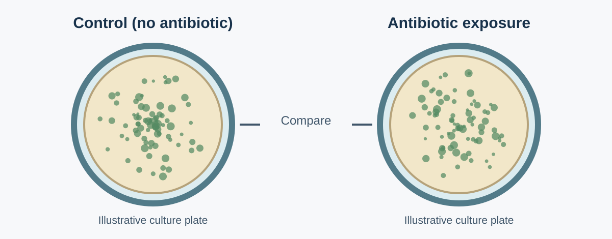
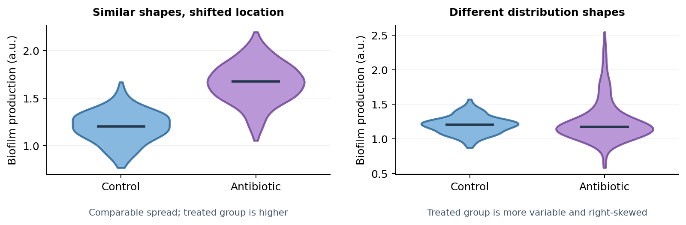
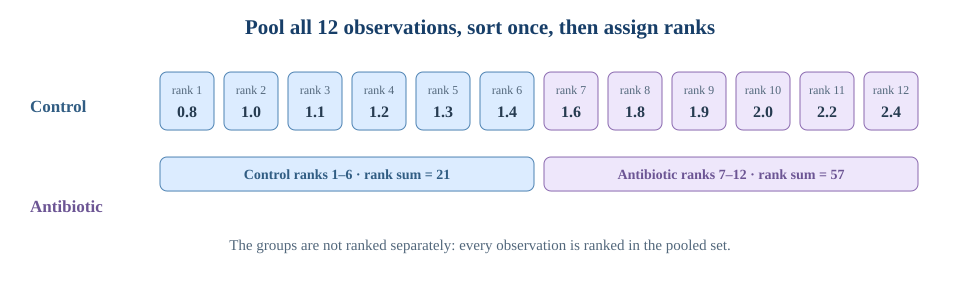
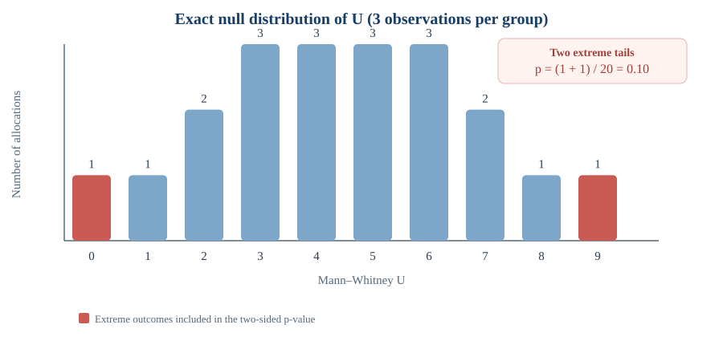
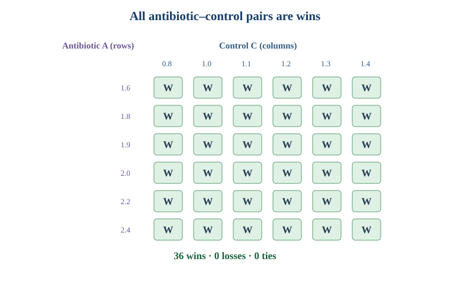
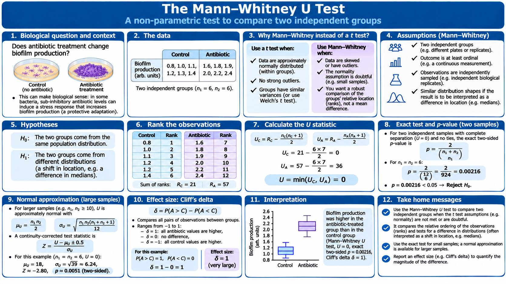

::: {.chapter-lead}
**Biostatistics · Molecular Biosciences**  
This chapter introduces a rank-based method for comparing two independent groups, using a bacterial biofilm experiment to connect experimental design, statistical reasoning, effect size and R.
:::

## Learning goals

By the end of this chapter, you should be able to:

- identify an independent-groups biological design;
- distinguish a comparison of distributions from a comparison of means;
- state the assumptions and hypotheses for the Mann–Whitney test;
- pool observations, assign ranks and calculate the two U statistics;
- explain exact and normal-approximation p-values, including small-sample limitations;
- interpret Cliff's delta and its confidence interval;
- run and interpret the analysis in R.

## Biological question: does antibiotic exposure change biofilm formation?

A researcher asks whether exposure to a **sub-inhibitory antibiotic concentration** is associated with a change in bacterial biofilm production. Compare independent biological cultures in a control group and an antibiotic-exposed group.

{fig-alt="Two Petri dishes labelled control without antibiotic and antibiotic exposure" width=90%}

The outcome might be biofilm biomass measured using a validated crystal-violet assay (optical density) or an image-based biomass measurement. The experimental unit is the independently grown culture or well, **not** repeated technical readings from the same culture. Technical replicates can improve measurement precision, but they do not create additional independent biological replicates.

::: {.callout-warning}
**Biological caution.** Sub-inhibitory antibiotics can sometimes stimulate biofilm formation, but this depends on the bacterial species, antibiotic and concentration. The research question is whether a change occurs; its direction should not be assumed in advance.
:::

## Choosing the method

A t-test addresses a difference in group means. **Welch's t-test** allows the two groups to have unequal variances. The Mann–Whitney test is appropriate when the outcome is ordinal or when a rank-based comparison is the scientific target. It compares the relative ordering of observations from two independent groups; skewness alone does not automatically make it the better choice.

### When is a median interpretation reasonable?

{fig-alt="Similar shapes with shifted location compared with different distribution shapes and spreads" width=100%}

- **Similar shapes and spreads, shifted location:** a location or median interpretation may be reasonable.
- **Different shapes or spreads:** describe a difference between distributions. Do not automatically reduce the result to a difference in medians.

The general Mann–Whitney null concerns equality of distributions. A simple location/median interpretation needs the additional similar-shape condition.

## Assumptions and hypotheses

- There are **two independent groups** (for example, different cultures or biological replicates).
- Observations are independent. Technical replicates are not substitutes for independent biological replicates.
- The outcome is at least ordinal, so observations can be ranked.
- Similar distribution shapes are **not** required for the general distributional comparison; they are needed for a simple location/median interpretation.

For the two-sided test:

$$
H_0: F_A(x)=F_C(x)\quad\text{for all }x
$$

$$
H_1: F_A(x)\ne F_C(x)\quad\text{for at least some }x
$$

### Example of a pre-specified one-sided hypothesis

Suppose independent prior evidence gives a clear biological reason to predict that a sub-inhibitory antibiotic **increases** biofilm biomass. The directional alternative is that antibiotic-treated cultures tend to have larger values than controls:

$$
H_0: F_A = F_C \quad\text{(no distributional difference)}
$$
$$
H_1: F_A \text{ is shifted toward larger values than } F_C
$$

In R, with the antibiotic group entered first, use `alternative = "greater"`:

```r
wilcox.test(antibiotic, control, alternative = "greater",
            exact = TRUE)
```

This direction must be specified before examining the data, not selected after seeing which group has larger observations.


Here, $F_A$ and $F_C$ are the population distributions for antibiotic and control groups.

A one-sided alternative is possible only when a genuinely directional biological question has been specified **before** examining the data. It should not be selected after seeing which group has larger values.

## Worked example: ranks and the U statistic

Consider the following biofilm measurements (arbitrary assay units):

- **Control:** 0.8, 1.0, 1.1, 1.2, 1.3, 1.4
- **Antibiotic:** 1.6, 1.8, 1.9, 2.0, 2.2, 2.4

Pool all 12 observations and rank them from smallest to largest.

{fig-alt="Pooled ranking of the six control and six antibiotic observations" width=100%}

The rank sums are $R_C=21$ and $R_A=57$. For a group with rank sum $R$ and sample size $n$:

$$
U=R-\frac{n(n+1)}{2}
$$

For the control group:

$$
U_C=R_C-\frac{n_C(n_C+1)}{2}=21-\frac{6(7)}{2}=0
$$

For the antibiotic group:

$$
U_A=R_A-\frac{n_A(n_A+1)}{2}=57-\frac{6(7)}{2}=36
$$

The two statistics satisfy:

$$
U_C+U_A=n_Cn_A=36,\qquad U_{\min}=0
$$

All 36 antibiotic–control pairs favour the antibiotic group in this deliberately clear-cut example. With ties, average ranks are assigned; tied pairs contribute zero to the numerator of Cliff's delta.

## Exact p-value and the null distribution

Under the null hypothesis, the group labels could have been assigned to the pooled observations in many different ways. Each possible allocation produces a U statistic. Together, these values form the **exact null distribution of U**.

The p-value is found by locating the observed U in this distribution and adding the probabilities of outcomes at least as extreme in the direction(s) specified by the alternative hypothesis. For a two-sided test, both tails are included. The p-value is not simply determined by the total number of possible allocations: it depends on the observed statistic and the probability in the relevant tails.

### Why three observations per group cannot give a two-sided exact p below 0.05

{fig-alt="Exact null distribution for U with three observations per group and both extreme tails highlighted" width=100%}

With **three observations per group**, there are $\binom{6}{3}=20$ possible allocations. Under complete separation, the observed U is at one extreme of the distribution. The two-sided exact p-value includes both extreme outcomes:

$$
p_{\min}=\frac{1+1}{20}=0.10
$$

A two-sided exact p-value below 0.05 is therefore impossible for this 3-versus-3 design, even with complete separation.

With **four observations per group**, a two-sided exact p-value below 0.05 becomes possible (the minimum is approximately 0.0286). These values illustrate the discreteness of the exact null distribution for balanced groups; they are not a general formula for every sample-size combination.

::: {.callout-important}
This is a limitation in **inferential resolution**, not evidence that there is no biological effect. The exact test remains useful with small samples because it does not rely on a normal approximation. A non-significant result does not establish that the populations are identical or that the biological effect is absent.
:::

## Normal approximation

For the worked example, $n_1=n_2=6$. Without ties:

$$
E(U)=\frac{n_1n_2}{2}=18
$$

$$
\operatorname{Var}(U)=\frac{n_1n_2(n_1+n_2+1)}{12}=39
$$

Using a continuity correction of 0.5:

$$
Z=\frac{U-E(U)+0.5}{\sqrt{\operatorname{Var}(U)}}
=\frac{0-18+0.5}{\sqrt{39}}\approx -2.80
$$

This Z statistic is compared with the **standard normal distribution**, not Student's $t$ distribution.

### Reproducing the normal approximation in R

Set `exact = FALSE` to ask `wilcox.test()` to use the asymptotic normal approximation. `correct = TRUE` applies the continuity correction. The test output reports the approximate p-value:

```r
wilcox.test(antibiotic, control,
            alternative = "two.sided",
            exact = FALSE,
            correct = TRUE)
```

For the separated 6-versus-6 example, this gives an approximate two-sided p-value near 0.0051. The exact test gives a different value because the exact distribution is discrete. The normal approximation is an approximation, not a replacement for the exact calculation when the exact method is appropriate.
 The exact two-sided p-value for the completely separated 6-versus-6 example is approximately 0.00216; the normal approximation is close but not identical (approximately 0.0051 with the continuity correction).

As a practical rule of thumb, it is generally reasonable to consider the normal approximation when **both groups have around 10 or more observations** ($n_1,n_2\gtrsim 10$). This is guidance, not a strict threshold. Accuracy also depends on tied ranks and how extreme the observed statistic is. When ties occur, the variance must be adjusted for ties; a continuity correction may also be applied. For small samples, prefer an exact method when its assumptions and implementation permit it. If ties prevent the standard exact calculation, a conditional or permutation-based method may be appropriate.

## Effect size: Cliff's delta

The p-value does not describe the magnitude of a biological difference. A useful non-parametric effect size is **Cliff's delta**:

$$
\delta=P(A>C)-P(A<C)
$$

Its sample estimate is:

$$
\widehat{\delta}=\frac{\text{wins}-\text{losses}}{n_A n_C}
$$

Every antibiotic observation $A$ is compared with every control observation $C$:

- **Win:** $A>C$, contributes +1.
- **Loss:** $A<C$, contributes −1.
- **Tie:** $A=C$, contributes 0 to the numerator but remains in the denominator.

{fig-alt="Six by six matrix showing 36 wins, no losses and no ties" width=90%}

In this worked example, every antibiotic value is greater than every control value. Therefore, all $36$ pairwise comparisons are wins, with no losses and no ties:

$$
\widehat{\delta}=\frac{36-0}{36}=+1
$$

Cliff's delta ranges from −1 to +1. A value of +1 means every antibiotic observation exceeds every control observation in this sample; it does **not** mean a 100% increase. A value of zero means wins and losses balance; it does not necessarily mean the distributions are identical. Magnitude labels used by software are conventions, not universal biological thresholds.

**Calculate and report effect size regardless of statistical significance.** A non-significant p-value is not a reason to omit the estimate. Report its confidence interval as well: with small samples, the interval may be wide and communicate substantial uncertainty. Interpret the estimate and its confidence interval alongside the p-value, not as a replacement for it.

## R practical: run the analysis in your browser

The following editor runs R in the browser using WebR. No additional R package is required. A ready-to-use helper calculates Cliff's delta and a bootstrap 95% confidence interval, so the exercise can focus on interpreting the effect size rather than programming it. The normal approximation is demonstrated explicitly using `exact = FALSE` and a continuity correction.

::: {.webR-runner}
<div class="runner-heading">
  <div><strong>Editable R code</strong><p>Change the data or code, then select Run R.</p></div>
  <span id="rstatus" class="status" aria-live="polite">WebR has not loaded yet.</span>
</div>
<textarea id="rcode" spellcheck="false" aria-label="Editable R code">control <- c(0.8, 1.0, 1.1, 1.2, 1.3, 1.4)
antibiotic <- c(1.6, 1.8, 1.9, 2.0, 2.2, 2.4)

## Exact two-sided Wilcoxon rank-sum test
print(wilcox.test(antibiotic, control,
                  alternative = "two.sided", exact = TRUE))

## Normal approximation (asymptotic test), with continuity correction
print(wilcox.test(antibiotic, control,
                  alternative = "two.sided", exact = FALSE,
                  correct = TRUE))

## Cliff's delta and its 95% confidence interval
print(cliffs_delta(antibiotic, control))

## One-sided example: direction specified in advance
print(wilcox.test(antibiotic, control,
                  alternative = "greater", exact = TRUE))</textarea>
<div class="runner-actions">
  <button id="runR" type="button">▶ Run R</button>
  <button id="resetR" class="secondary" type="button">Reset code</button>
  <button id="loadOverlap" class="secondary" type="button">Load overlapping-groups exercise</button>
</div>
<pre id="rout" class="r-output" aria-live="polite">R output will appear here.</pre>
:::

### R interpretation exercise: overlapping groups

Run the following dataset in the editor above (replace the worked-example data), or copy it into desktop R. The groups overlap, unlike the completely separated worked example.

```r
control <- c(0.8, 1.0, 1.2, 1.4, 1.6, 1.8)
antibiotic <- c(1.1, 1.3, 1.5, 1.7, 1.9, 2.1)

wilcox.test(antibiotic, control, alternative = "two.sided", exact = TRUE)
median(control)
median(antibiotic)
```

R reports a rank-sum statistic $W=47$ and a two-sided p-value of approximately 0.2403. In this two-sample call, $W$ is the rank sum for the first sample (`antibiotic`), not the smaller U statistic. The antibiotic rank sum is 47, so $W=47-6(7)/2=26$; the other group's U is 10.

## Practice questions

Answer the questions online and check the feedback. These questions are formative: use the explanations to review the relevant sections.

::: {.practice-question data-correct="B" data-explanation="Mann–Whitney is for two independent groups. For paired measurements, a paired method is needed."}
**1. Which design calls for Mann–Whitney U?**

- A. The same six samples measured before and after treatment.
- B. Two independent groups of biological cultures.
- C. Three repeated measurements from the same plants.
:::

::: {.practice-question data-correct="C" data-explanation="U_C = R_C − n_C(n_C + 1)/2 = 21 − 6×7/2 = 0."}
**2. In the worked example, the control rank sum is $R_C=21$ and $n_C=6$. What is $U_C$?**

- A. 21
- B. 36
- C. 0
:::

::: {.practice-question data-correct="A" data-explanation="The general null concerns the population distributions. A median interpretation requires similar distribution shapes."}
**3. What does a significant Mann–Whitney result establish in general?**

- A. Evidence that the population distributions differ.
- B. Proof that the population means differ.
- C. Proof that the medians differ, regardless of distribution shape.
:::

::: {.practice-question data-correct="B" data-explanation="Cliff's delta = +1 means every antibiotic observation exceeds every control observation in this sample; it is not a percentage increase."}
**4. What does Cliff's delta = +1 mean in the completely separated example?**

- A. The antibiotic group mean is exactly one unit higher.
- B. Every antibiotic observation exceeds every control observation.
- C. The p-value equals 1.
:::

## Practice questions: calculations and p-values

::: {.practice-question data-correct="9" data-explanation="U_1 = R_1 − n_1(n_1 + 1)/2 = 24 − 5×6/2 = 9."}
**5. Short calculation.** Suppose $n_1=5$, $n_2=7$, and the rank sum for group 1 is $R_1=24$. Calculate $U_1$.

<input class="short-answer" id="shortAnswer" type="number" step="any" aria-label="Enter U one" placeholder="Enter U₁" />
:::

::: {.practice-question data-correct="B" data-explanation="A p-value is calculated under H₀. It is not the probability that H₀ is true and is not an effect-size measure."}
**6. A two-sided test reports $p=0.0022$. Which interpretation is best?**

- A. There is a 0.22% probability that the null hypothesis is true.
- B. Under H₀, the probability of a result at least this extreme is 0.22%.
- C. The antibiotic group mean is 0.0022 units higher.
:::

## Practice questions: small samples and R interpretation

::: {.practice-question data-correct="C" data-explanation="For 3 vs 3, the minimum two-sided exact p-value is 0.10. This is a limitation in inferential resolution, not evidence of no biological effect."}
**7. With three independent observations per group, can a two-sided exact p-value be below 0.05, even with complete separation?**

- A. Yes, because complete separation always gives p = 0.
- B. Yes, if the measurements are normally distributed.
- C. No. The smallest attainable p-value is 0.10 for 3 vs 3.
:::

::: {.practice-question data-correct="B" data-explanation="The p-value is greater than 0.05, so we do not reject equal distributions. This is not proof that the distributions are identical."}
**8. The overlapping-groups R exercise reports $p=0.2403$. Which conclusion is most appropriate at $\alpha=0.05$?**

- A. The two population distributions are proven to be identical.
- B. The result is not statistically significant; these data do not provide sufficient evidence to reject equal distributions.
- C. There is a 24.03% probability that the null hypothesis is true.
:::

::: {.practice-question data-correct="A" data-explanation="R reports W as the rank sum for the first sample. Here the antibiotic rank sum is 47, so its U is 47 − 21 = 26. The other group's U is 10."}
**9. What does the reported $W=47$ represent in the R call `wilcox.test(antibiotic, control)`?**

- A. The rank sum for the first sample (antibiotic), before converting it to $U=26$.
- B. The smaller of the two U statistics (10).
- C. The difference between the two sample medians.
:::

::: {.callout-note}
**Interpretation reminder.** A non-significant result does not prove that the population distributions are identical. Calculate and report an effect size, with its confidence interval, regardless of statistical significance.
:::

## Student notes

Use this space to record your interpretation, questions or reminders. Notes are saved locally in the current browser and device; they are not synchronised between devices.

::: {.student-notes}
<textarea id="studentNotes" aria-label="Student notes" placeholder="My notes for Chapter 1…"></textarea>
<p id="notesStatus" class="notes-status" aria-live="polite">Notes are stored locally in this browser.</p>
<button type="button" onclick="window.print()">Print / Save as PDF</button>
<button type="button" id="clearNotes" class="secondary">Clear notes</button>
:::

## Chapter recap: the complete infographic

The original Chapter 1 infographic is retained unchanged. Use it to review the biological question, test choice, assumptions, hypotheses, ranks, U, p-value, normal approximation, effect size and interpretation.

{fig-alt="Complete original Mann–Whitney U chapter infographic recap" width=100%}

---

**End of Chapter 1 · Biostatistics for Molecular Biosciences**

```{=html}
<script>
(() => {
  const initialCode = document.getElementById('rcode').value;
  let webR = null;
  let initPromise = null;
  async function getWebR() {
    if (webR) return webR;
    if (!initPromise) {
      initPromise = (async () => {
        const module = await import('https://webr.r-wasm.org/latest/webr.mjs');
        const runtime = new module.WebR();
        await runtime.init();
        await runtime.evalRVoid(`
          cliffs_delta <- function(x, y, conf.level = 0.95, B = 2000) {
            stopifnot(is.numeric(x), is.numeric(y), length(x) > 0, length(y) > 0)
            pair_differences <- outer(x, y, "-")
            estimate <- (sum(pair_differences > 0) - sum(pair_differences < 0)) /
                        (length(x) * length(y))
            set.seed(2026)
            boot <- replicate(B, {
              xb <- sample(x, length(x), replace = TRUE)
              yb <- sample(y, length(y), replace = TRUE)
              d <- outer(xb, yb, "-")
              (sum(d > 0) - sum(d < 0)) / (length(xb) * length(yb))
            })
            alpha <- 1 - conf.level
            ci <- unname(quantile(boot, c(alpha / 2, 1 - alpha / 2), na.rm = TRUE))
            data.frame(Cliffs_delta = estimate,
                       CI_95_lower = ci[1],
                       CI_95_upper = ci[2])
          }
        `);
        webR = runtime;
        return runtime;
      })();
    }
    try { return await initPromise; }
    catch (error) { initPromise = null; throw error; }
  }
  document.getElementById('runR').addEventListener('click', async () => {
    const button = document.getElementById('runR');
    const status = document.getElementById('rstatus');
    const output = document.getElementById('rout');
    button.disabled = true;
    status.textContent = 'Loading WebR…';
    output.textContent = 'Starting R…';
    try {
      const runtime = await getWebR();
      status.textContent = 'Running R code…';
      const code = document.getElementById('rcode').value;
      const result = await runtime.evalRString(`paste(capture.output({\n${code}\n}), collapse = '\\n')`);
      output.textContent = String(result).trim() || 'R finished, but produced no visible output. Try print(object).';
      status.textContent = 'R finished. Output is shown below.';
    } catch (error) {
      status.textContent = 'R could not run. Check your internet connection and try again.';
      output.textContent = error?.message || String(error);
    } finally { button.disabled = false; }
  });
  document.getElementById('loadOverlap').addEventListener('click', () => {
    document.getElementById('rcode').value = `control <- c(0.8, 1.0, 1.2, 1.4, 1.6, 1.8)
antibiotic <- c(1.1, 1.3, 1.5, 1.7, 1.9, 2.1)

print(wilcox.test(antibiotic, control, alternative = "two.sided", exact = TRUE))

print(cliffs_delta(antibiotic, control))`;
    document.getElementById('rout').textContent = 'Overlapping-groups code loaded. Select Run R.';
    document.getElementById('rstatus').textContent = 'Ready to run the overlapping-groups exercise.';
  });
  document.getElementById('resetR').addEventListener('click', () => {
    document.getElementById('rcode').value = initialCode;
    document.getElementById('rout').textContent = 'R output will appear here.';
    document.getElementById('rstatus').textContent = 'Code reset. WebR has not run yet.';
  });
  document.querySelectorAll('.practice-question').forEach((box, index) => {
    const labels = Array.from(box.querySelectorAll('li'));
    if (labels.length) {
      const group = `q${index + 1}`;
      labels.forEach((li, i) => {
        const input = document.createElement('input');
        input.type = 'radio'; input.name = group; input.value = ['A','B','C'][i];
        input.setAttribute('aria-label', li.textContent.trim());
        li.prepend(input, document.createTextNode(' '));
      });
    }
    const feedback = document.createElement('p');
    feedback.className = 'feedback'; feedback.setAttribute('aria-live','polite');
    const check = document.createElement('button'); check.type = 'button'; check.textContent = 'Check answer';
    check.addEventListener('click', () => {
      const selected = box.querySelector('input[type="radio"]:checked');
      const short = box.querySelector('.short-answer');
      const value = selected ? selected.value : (short ? short.value.trim() : '');
      if (!value) { feedback.textContent = 'Choose or enter an answer first.'; feedback.className = 'feedback incorrect'; return; }
      const ok = value.toUpperCase() === box.dataset.correct.toUpperCase();
      feedback.textContent = (ok ? 'Correct. ' : 'Not quite. ') + box.dataset.explanation;
      feedback.className = 'feedback ' + (ok ? 'correct' : 'incorrect');
    });
    box.append(check, feedback);
  });
  const notes = document.getElementById('studentNotes');
  const key = `biostatistics-course-${location.pathname}-chapter-1-notes`;
  const status = document.getElementById('notesStatus');
  try {
    notes.value = localStorage.getItem(key) || '';
    notes.addEventListener('input', () => {
      try { localStorage.setItem(key, notes.value); status.textContent = 'Saved in this browser.'; }
      catch (e) { status.textContent = 'Autosave is unavailable; print or copy your notes before leaving.'; }
    });
  } catch (e) { status.textContent = 'Browser storage is unavailable; print or copy your notes before leaving.'; }
  document.getElementById('clearNotes').addEventListener('click', () => {
    notes.value = '';
    try { localStorage.removeItem(key); status.textContent = 'Notes cleared in this browser.'; }
    catch (e) { status.textContent = 'Notes cleared from the text area.'; }
  });
})();
</script>
```