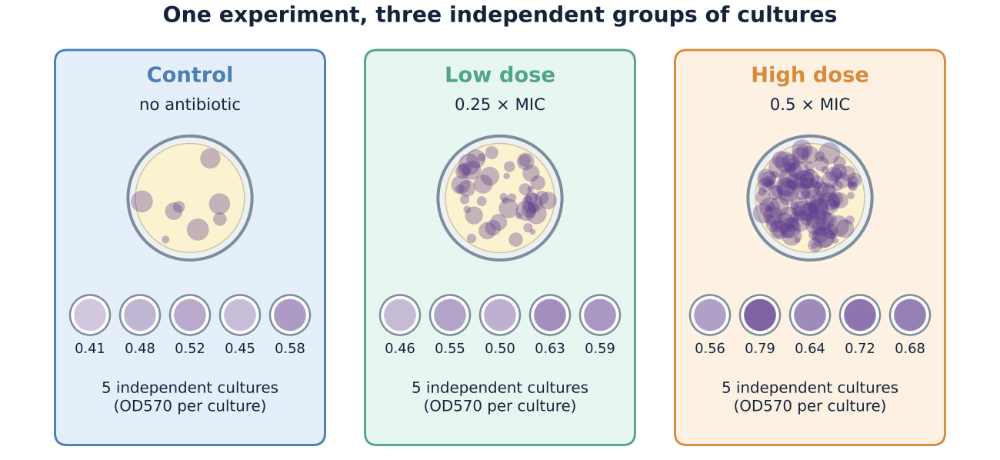
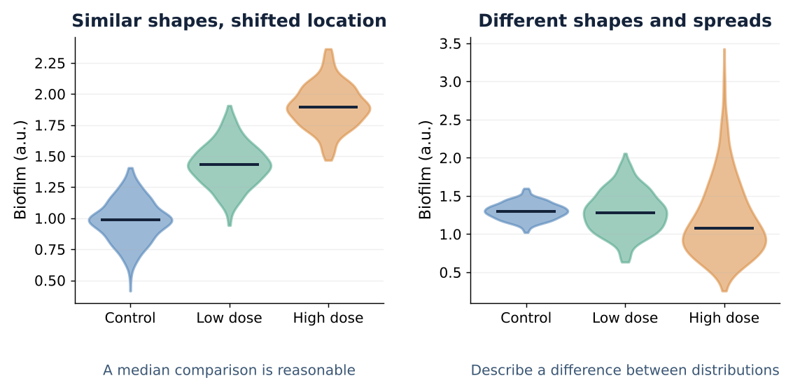
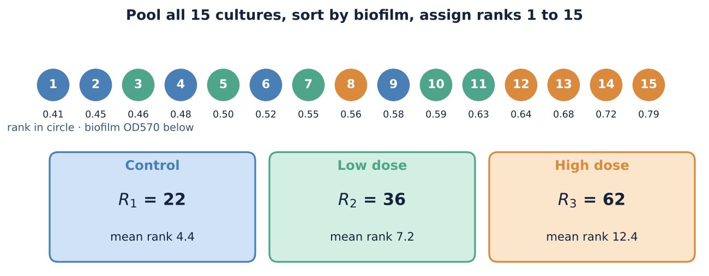
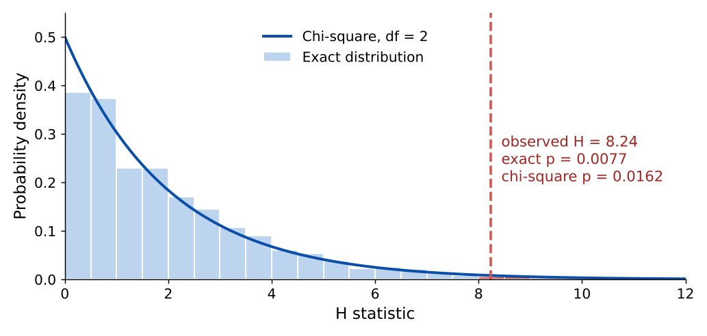
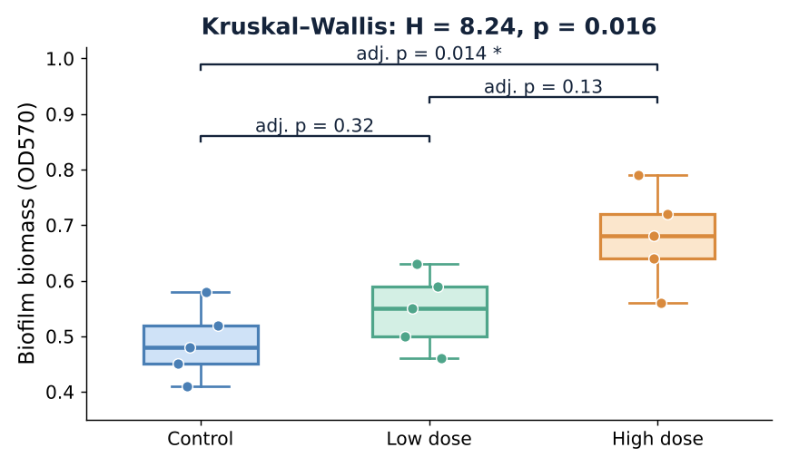
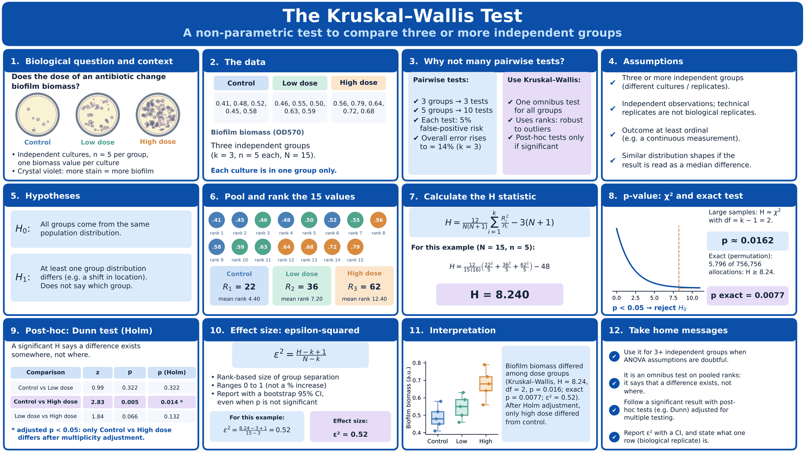

::: {.chapter-lead}
**Biostatistics · Molecular Biosciences**  
This chapter introduces a rank-based method for comparing three or more independent groups. One experiment is followed from start to finish: how biofilm formation changes with antibiotic dose.
:::

## Learning goals

By the end of this chapter, you should be able to:

- recognise an independent-groups design with three or more groups;
- state the assumptions and hypotheses for the Kruskal–Wallis test;
- pool observations, assign ranks and calculate the $H$ statistic;
- explain the exact p-value and the chi-square approximation;
- follow a significant result with adjusted post-hoc comparisons;
- interpret epsilon-squared and its confidence interval;
- run and interpret the analysis in R.

## Biological question: does antibiotic dose change biofilm formation?

A researcher asks whether a **sub-inhibitory antibiotic concentration** changes how much biofilm a bacterial strain forms. Fifteen independent cultures are grown in a 96-well plate: five with no antibiotic (control), five with a low dose and five with a high dose. After incubation, biofilm is stained with crystal violet and measured as optical density (OD570). **This one experiment is used throughout the chapter.**

{.nostretch fig-alt="Three groups of five cultures: control, low dose and high dose, with increasing crystal violet staining" width=100%}

The experimental unit is the independently grown culture (well), **not** repeated readings of the same well. Technical replicates improve precision but do not create extra independent cultures.

::: {.callout-warning}
**What to tell the analyst when you submit data.** State what one row is (culture, well, reading), which values are biological and which are technical replicates, whether groups were grown independently, and any plates, batches or days. Observations that are not independent need a different method.
:::

## Choosing the method

The Mann–Whitney test compares **two** independent groups. The Kruskal–Wallis test extends the same rank-based idea to **three or more** independent groups. Running many pairwise tests instead would inflate the overall false-positive rate; Kruskal–Wallis is a single omnibus test. A one-way ANOVA compares group means; Kruskal–Wallis is appropriate when the outcome is ordinal or when a rank-based comparison is the scientific target.

### When is a median interpretation reasonable?

{.nostretch fig-alt="Three similar violins shifted upwards compared with three violins of different shapes and spreads" width=100%}

- **Similar shapes and spreads, shifted location:** a location or median interpretation may be reasonable.
- **Different shapes or spreads:** describe a difference between distributions. Do not automatically reduce the result to a difference in medians.

The general Kruskal–Wallis null concerns equality of distributions. A simple median interpretation needs the additional similar-shape condition.

## Assumptions and hypotheses

- There are **three or more independent groups** (here: different cultures in each dose group).
- Observations are independent. Technical replicates are not substitutes for independent cultures.
- The outcome is at least ordinal, so observations can be ranked.
- Similar distribution shapes are **not** required for the general distributional comparison; they are needed for a simple median interpretation.

For $k$ groups:

$$
H_0: F_1(x)=F_2(x)=\cdots=F_k(x)\quad\text{for all }x
$$

$$
H_1: F_i(x)\ne F_j(x)\quad\text{for at least one pair }(i,j)\text{ and some }x
$$

### The test is omnibus and non-directional

Here, $F_1,\ldots,F_k$ are the population distributions of the groups. The alternative does not say which group differs or in which direction, so there is no one-sided Kruskal–Wallis test. In R, give the response and the grouping factor:

```r
kruskal.test(biomass ~ group)
```

## Worked example: ranks and the H statistic

The biofilm measurements (OD570) from our experiment are:

- **Control:** 0.41, 0.48, 0.52, 0.45, 0.58
- **Low dose:** 0.46, 0.55, 0.5, 0.63, 0.59
- **High dose:** 0.56, 0.79, 0.64, 0.72, 0.68

Pool all 15 observations and rank them from smallest to largest.

{.nostretch fig-alt="Pooled ranks of fifteen cultures with rank sums 22, 36 and 62" width=100%}

The rank sums are $R_1=22$, $R_2=36$ and $R_3=62$. For $k$ groups with sample sizes $n_i$ and $N=\sum n_i$:

$$
H=\frac{12}{N(N+1)}\sum_{i=1}^{k}\frac{R_i^2}{n_i}-3(N+1)
$$

For this example, $k=3$, $n_i=5$ and $N=15$:

$$
H=\frac{12}{15(16)}\left(\frac{22^2}{5}+\frac{36^2}{5}+\frac{62^2}{5}\right)-3(16)=8.24
$$

If the groups were alike, each group's mean rank would be close to $(N+1)/2=8$. Here the mean ranks are $4.4$, $7.2$ and $12.4$. With ties, average ranks are assigned and $H$ is divided by a tie correction factor.

## Exact p-value and the null distribution

Under the null hypothesis, the group labels could have been assigned to the pooled observations in many different ways. Each possible allocation produces an $H$ statistic. Together, these values form the **exact null distribution of H**.

{.nostretch fig-alt="Histogram of the exact null distribution of H with the chi-square curve and the observed H at 8.24" width=100%}

For this example there are $\dfrac{15!}{5!\,5!\,5!}=756,756$ possible allocations of the 15 ranks to three labelled groups of five, and 5,796 of them give $H\ge 8.24$. The exact p-value is the proportion in the tail:

$$
p_{\text{exact}}=\frac{5,796}{756,756}=0.0077
$$

### Why two observations per group cannot give an exact p below 0.05

With **two observations per group** there are $\dfrac{6!}{2!\,2!\,2!}=90$ allocations. Under complete separation, the six allocations that give the three pairs of ranks to the three groups in any order all produce the maximum $H$:

$$
p_{\min}=\frac{6}{90}=0.067
$$

With **three observations per group**, the minimum becomes $6/1680\approx 0.0036$. These values show the discreteness of the exact distribution; they are not a general formula for every design.

::: {.callout-important}
This is a limitation in **inferential resolution**, not evidence that there is no biological effect. A non-significant result does not establish that the populations are identical.
:::

## Chi-square approximation

For larger samples, $H$ is compared with a **chi-square** distribution with $k-1$ degrees of freedom, not with a normal or Student's $t$ distribution:

$$
H\approx\chi^2_{k-1},\qquad E(H)=k-1,\qquad \operatorname{Var}(H)=2(k-1)
$$

The p-value is the upper-tail probability:

$$
p=P\left(\chi^2_{k-1}\ge H_{\text{observed}}\right)
$$

For our experiment, $df=2$ and $p=0.0162$. When ties occur, $H$ is corrected:

$$
H_c=\frac{H}{1-\dfrac{\sum_j\left(t_j^3-t_j\right)}{N^3-N}}
$$

where $t_j$ is the size of each group of tied values.

### Reproducing the chi-square approximation in R

`kruskal.test()` reports the chi-square approximation and applies the tie correction automatically:

```r
kruskal.test(biomass ~ group)
```

R reports $H=8.24$, $df=2$ and $p=0.0162$. The exact p-value (0.0077) is smaller because the exact distribution is discrete and the approximation is least accurate in the tail with small groups. As a rule of thumb, the approximation is generally reasonable when every group has about five or more observations; for very small groups prefer an exact or permutation method.

## Post-hoc comparisons: which groups differ?

A significant omnibus result does not say which groups differ. Use **Dunn's test** on the mean ranks $\bar R_i$, adjusting the p-values for the three comparisons (Holm):

$$
z_{ij}=\frac{\bar R_i-\bar R_j}{\sqrt{\dfrac{N(N+1)}{12}\left(\dfrac{1}{n_i}+\dfrac{1}{n_j}\right)}}
$$

For this example the standard error is $\sqrt{20\times0.4}=2.83$:

- **Control vs Low dose:** $z=0.99$, $p=0.322$, adjusted $p=0.322$
- **Control vs High dose:** $z=2.83$, $p=0.0047$, adjusted $p=0.014$
- **Low dose vs High dose:** $z=1.84$, $p=0.066$, adjusted $p=0.132$

{.nostretch fig-alt="Box plots of the three dose groups with adjusted p-values" width=100%}

Only control versus high dose remains significant. Report which comparisons were planned and which adjustment was used.

## Effect size: epsilon-squared

The p-value does not describe the magnitude of a biological difference. A useful rank-based effect size is **epsilon-squared**:

$$
\varepsilon^2=\frac{H-k+1}{N-k}
$$

For our experiment:

$$
\varepsilon^2=\frac{8.24-3+1}{15-3}=0.52
$$

It ranges from 0 to 1 and describes how strongly the groups are separated on the rank scale. A value of 0.52 does **not** mean a 52% increase in biomass. Magnitude labels used by software are conventions, not universal biological thresholds.

**Calculate and report effect size regardless of statistical significance.** Report its confidence interval as well: for our data, the bootstrap 95% interval is about 0.17 to 0.85, which shows how uncertain the estimate is with only five cultures per group. The practical below uses a bootstrap that resamples cultures within each group.

## R practical: run the analysis in your browser

The following editor runs R in the browser using WebR. No additional R package is required. Ready-to-use helpers calculate epsilon-squared with a bootstrap 95% confidence interval and Dunn's test with Holm adjustment, so the exercise can focus on interpreting the results rather than programming them.

```{=html}
<div class="webR-runner">
<div class="runner-heading">
  <div><strong>Editable R code</strong><p>Change the data or code, then select Run R.</p></div>
  <span id="rstatus" class="status" aria-live="polite">WebR has not loaded yet.</span>
</div>
<textarea id="rcode" spellcheck="false" aria-label="Editable R code">control &lt;- c(0.41, 0.48, 0.52, 0.45, 0.58)
low_dose &lt;- c(0.46, 0.55, 0.5, 0.63, 0.59)
high_dose &lt;- c(0.56, 0.79, 0.64, 0.72, 0.68)
biomass &lt;- c(control, low_dose, high_dose)
group &lt;- factor(rep(c("Control", "Low dose", "High dose"), each = 5),
                levels = c("Control", "Low dose", "High dose"))

## Kruskal-Wallis omnibus test (chi-square approximation)
print(kruskal.test(biomass ~ group))

## Epsilon-squared and its bootstrap 95% confidence interval
print(kw_epsilon_ci(biomass, group, conf.level = 0.95, B = 2000))

## Post-hoc: Dunn's test with Holm adjustment
print(dunn_holm(biomass, group), digits = 4)</textarea>
<div class="runner-actions">
  <button id="runR" type="button">▶ Run R</button>
  <button id="resetR" class="secondary" type="button">Reset code</button>
  <button id="loadOverlap" class="secondary" type="button">Load overlapping-groups exercise</button>
</div>
<pre id="rout" class="r-output" aria-live="polite">R output will appear here.</pre>
</div>
```


### R interpretation exercise: a second plate with overlapping groups

Select **Load overlapping-groups exercise** above, or copy the data into desktop R. In this second plate the antibiotic had little effect, so the groups overlap.

```r
control  <- c(0.45, 0.52, 0.48, 0.6, 0.55)
low_dose <- c(0.5, 0.58, 0.47, 0.62, 0.53)
high_dose <- c(0.56, 0.63, 0.52, 0.68, 0.59)
```

R reports $H=3.37$, $df=2$ and $p=0.185$. The estimated $\varepsilon^2=(3.37-3+1)/12\approx0.11$. The result is not statistically significant at $\alpha=0.05$: these data do not give sufficient evidence to reject equal distributions. That is not proof that the antibiotic has no effect.


## Practice questions

Answer the questions online and check the feedback. These questions are formative: use the explanations to review the relevant sections.

::: {.practice-question data-correct="B" data-explanation="Kruskal–Wallis compares three or more independent groups. Repeated measurements require a blocked/repeated-measures method such as Friedman."}
**1. Which experimental design calls for the Kruskal–Wallis test?**

- A. The same samples measured before and after treatment
- B. Three or more independent groups
- C. Three repeated conditions measured in each subject
- D. Two paired measurements
:::

::: {.practice-question data-correct="A" data-explanation="All observations are pooled and ranked together; each observation retains its group label."}
**2. What is ranked in the Kruskal–Wallis procedure?**

- A. Observations pooled across all independent groups
- B. Differences within each subject
- C. Group means
- D. Only the largest observation in each group
:::

::: {.practice-question data-correct="C" data-explanation="The general null concerns the population distributions. A location/median interpretation is reasonable when group distribution shapes are similar."}
**3. What is the general null hypothesis?**

- A. All group means are equal
- B. All group medians must be equal regardless of shape
- C. The population distributions are the same across groups
- D. Every observation is identical
:::

## Practice questions: calculations and p-values

::: {.practice-question data-correct="B" data-explanation="Low dose has ranks 3, 5, 7, 10 and 11, which sum to 36."}
**4. For the worked example, what is the rank sum for the low-dose group?**

- A. 22
- B. 36
- C. 62
- D. 120
:::

::: {.practice-question data-correct="B" data-explanation="The omnibus test indicates evidence of a difference somewhere; post-hoc pairwise comparisons are needed to locate it."}
**5. What does a significant Kruskal–Wallis result tell you?**

- A. Every group differs from every other group
- B. At least one group distribution differs
- C. The group with the largest rank sum is significantly different from all others
- D. The treatment caused the difference
:::

::: {.practice-question data-correct="C" data-explanation="For k independent groups, the asymptotic reference distribution has k − 1 degrees of freedom."}
**6. What degrees of freedom are used for the chi-square approximation?**

- A. N − 1
- B. N − k
- C. k − 1
- D. k + 1
:::

## Practice questions: small samples and R interpretation

::: {.practice-question data-correct="B" data-explanation="Epsilon-squared is a rank-based effect-size estimate for the Kruskal–Wallis comparison."}
**7. What is a suitable effect size to accompany H?**

- A. Kendall's W only
- B. Epsilon-squared
- C. Cliff's delta for one group alone
- D. The p-value
:::

::: {.practice-question data-correct="B" data-explanation="An omnibus result does not identify which pairs differ. Use planned or adjusted post-hoc comparisons."}
**8. If the overall test is significant, what is the next step?**

- A. Conclude all groups differ
- B. Run suitable post-hoc pairwise comparisons with multiplicity adjustment
- C. Repeat the same omnibus test
- D. Choose the group with the largest mean
:::

::: {.practice-question data-correct="D" data-explanation="In base R, kruskal.test(response ~ group) performs the independent-groups Kruskal–Wallis test."}
**9. Which R function performs the Kruskal–Wallis test?**

- A. t.test()
- B. friedman.test()
- C. wilcox.test()
- D. kruskal.test()
:::

::: {.callout-note}
**Interpretation reminder.** A non-significant result does not prove that the groups or conditions are the same. Calculate and report an effect size, with its confidence interval, regardless of statistical significance.
:::

## Student notes

Use this space to record your interpretation, questions or reminders. Notes are saved locally in the current browser and device; they are not synchronised between devices.

::: {.student-notes}
<textarea id="studentNotes" aria-label="Student notes" placeholder="My notes for Chapter 3…"></textarea>
<p id="notesStatus" class="notes-status" aria-live="polite">Notes are stored locally in this browser.</p>
<button type="button" onclick="window.print()">Print / Save as PDF</button>
<button type="button" id="clearNotes" class="secondary">Clear notes</button>
:::

## Chapter recap: the complete infographic

The infographic below summarises the whole chapter. Use it to review the biological question, test choice, assumptions, hypotheses, ranks, $H$, p-values, post-hoc comparisons, effect size and interpretation.

{.nostretch fig-alt="Kruskal–Wallis chapter infographic recap with twelve panels" width=100%}

---

**End of Chapter 3 · Biostatistics for Molecular Biosciences**

```{=html}
<script>
(() => {
  const initialCode = document.getElementById('rcode').value;
  let webR = null;
  let initPromise = null;
  async function getWebR() {
    if (webR) return webR;
    if (!initPromise) {
      initPromise = (async () => {
        const module = await import('https://webr.r-wasm.org/latest/webr.mjs');
        const runtime = new module.WebR();
        await runtime.init();
        await runtime.evalRVoid(`
kw_epsilon_ci <- function(x, group, conf.level = 0.95, B = 2000) {
  stopifnot(is.numeric(x), length(x) == length(group), B >= 100)
  group <- droplevels(as.factor(group))
  if (nlevels(group) < 2) stop("At least two groups are required.")
  stat <- function(xx, gg) {
    kk <- nlevels(droplevels(as.factor(gg))); NN <- length(xx)
    HH <- as.numeric(kruskal.test(xx, gg)$statistic)
    max(0, min(1, (HH - kk + 1) / (NN - kk)))
  }
  estimate <- stat(x, group)
  set.seed(2026)
  lev <- levels(group)
  boot <- replicate(B, {
    idx <- unlist(lapply(lev, function(g) {
      ii <- which(group == g); sample(ii, length(ii), replace = TRUE)
    }))
    stat(x[idx], droplevels(group[idx]))
  })
  alpha <- 1 - conf.level
  ci <- unname(quantile(boot, c(alpha/2, 1-alpha/2), na.rm=TRUE))
  data.frame(epsilon_squared=estimate, CI=conf.level, CI_low=ci[1], CI_high=ci[2])
}

dunn_holm <- function(x, g) {
  g <- factor(g); N <- length(x); r <- rank(x)
  mr <- as.numeric(tapply(r, g, mean)); n <- as.numeric(tapply(r, g, length))
  tc <- sum(table(x)^3 - table(x))
  v <- N * (N + 1) / 12 - tc / (12 * (N - 1))
  lv <- levels(g); out <- NULL
  for (i in 1:(length(lv) - 1)) for (j in (i + 1):length(lv)) {
    z <- (mr[j] - mr[i]) / sqrt(v * (1 / n[i] + 1 / n[j]))
    out <- rbind(out, data.frame(comparison = paste(lv[i], "vs", lv[j]),
                                 z = z, p = 2 * pnorm(-abs(z))))
  }
  out$p_Holm <- p.adjust(out$p, method = "holm")
  out
}
        `);
        webR = runtime;
        return runtime;
      })();
    }
    try { return await initPromise; }
    catch (error) { initPromise = null; throw error; }
  }
  document.getElementById('runR').addEventListener('click', async () => {
    const button = document.getElementById('runR');
    const status = document.getElementById('rstatus');
    const output = document.getElementById('rout');
    button.disabled = true;
    status.textContent = 'Loading WebR…';
    output.textContent = 'Starting R…';
    try {
      const runtime = await getWebR();
      status.textContent = 'Running R code…';
      const code = document.getElementById('rcode').value;
      const result = await runtime.evalRString(`paste(capture.output({\n${code}\n}), collapse = '\\n')`);
      output.textContent = String(result).trim() || 'R finished, but produced no visible output. Try print(object).';
      status.textContent = 'R finished. Output is shown below.';
    } catch (error) {
      status.textContent = 'R could not run. Check your internet connection and try again.';
      output.textContent = error?.message || String(error);
    } finally { button.disabled = false; }
  });
  document.getElementById('loadOverlap').addEventListener('click', () => {
    document.getElementById('rcode').value = `control <- c(0.45, 0.52, 0.48, 0.6, 0.55)
low_dose <- c(0.5, 0.58, 0.47, 0.62, 0.53)
high_dose <- c(0.56, 0.63, 0.52, 0.68, 0.59)
biomass <- c(control, low_dose, high_dose)
group <- factor(rep(c("Control", "Low dose", "High dose"), each = 5),
                levels = c("Control", "Low dose", "High dose"))

print(kruskal.test(biomass ~ group))

print(kw_epsilon_ci(biomass, group, conf.level = 0.95, B = 2000))`;
    document.getElementById('rout').textContent = 'Overlapping-groups code loaded. Select Run R.';
    document.getElementById('rstatus').textContent = 'Ready to run the overlapping-groups exercise.';
  });
  document.getElementById('resetR').addEventListener('click', () => {
    document.getElementById('rcode').value = initialCode;
    document.getElementById('rout').textContent = 'R output will appear here.';
    document.getElementById('rstatus').textContent = 'Code reset. WebR has not run yet.';
  });
  document.querySelectorAll('.practice-question').forEach((box, index) => {
    const labels = Array.from(box.querySelectorAll('li'));
    if (labels.length) {
      const group = `q${index + 1}`;
      labels.forEach((li, i) => {
        const input = document.createElement('input');
        input.type = 'radio'; input.name = group; input.value = ['A','B','C','D'][i];
        input.setAttribute('aria-label', li.textContent.trim());
        li.prepend(input, document.createTextNode(' '));
      });
    }
    const feedback = document.createElement('p');
    feedback.className = 'feedback'; feedback.setAttribute('aria-live','polite');
    const check = document.createElement('button'); check.type = 'button'; check.textContent = 'Check answer';
    check.addEventListener('click', () => {
      const selected = box.querySelector('input[type="radio"]:checked');
      const short = box.querySelector('.short-answer');
      const value = selected ? selected.value : (short ? short.value.trim() : '');
      if (!value) { feedback.textContent = 'Choose or enter an answer first.'; feedback.className = 'feedback incorrect'; return; }
      const ok = value.toUpperCase() === box.dataset.correct.toUpperCase();
      feedback.textContent = (ok ? 'Correct. ' : 'Not quite. ') + box.dataset.explanation;
      feedback.className = 'feedback ' + (ok ? 'correct' : 'incorrect');
    });
    box.append(check, feedback);
  });
  const notes = document.getElementById('studentNotes');
  const key = `biostatistics-course-${location.pathname}-chapter-3-notes`;
  const status = document.getElementById('notesStatus');
  try {
    notes.value = localStorage.getItem(key) || '';
    notes.addEventListener('input', () => {
      try { localStorage.setItem(key, notes.value); status.textContent = 'Saved in this browser.'; }
      catch (e) { status.textContent = 'Autosave is unavailable; print or copy your notes before leaving.'; }
    });
  } catch (e) { status.textContent = 'Browser storage is unavailable; print or copy your notes before leaving.'; }
  document.getElementById('clearNotes').addEventListener('click', () => {
    notes.value = '';
    try { localStorage.removeItem(key); status.textContent = 'Notes cleared in this browser.'; }
    catch (e) { status.textContent = 'Notes cleared from the text area.'; }
  });
})();
</script>
```
