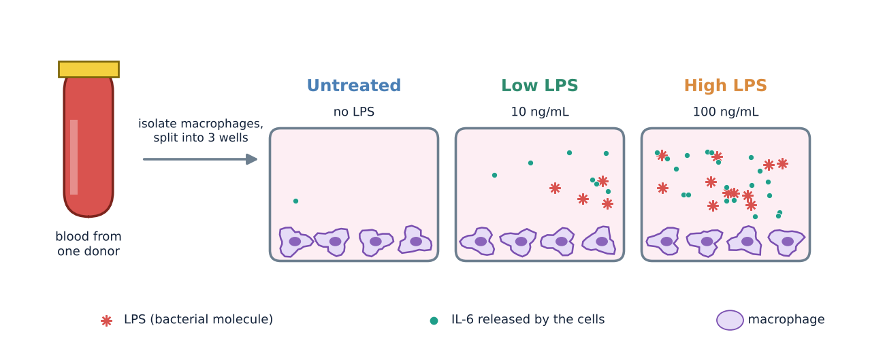
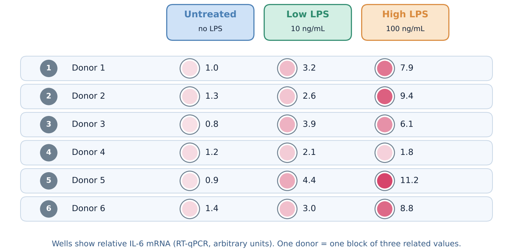
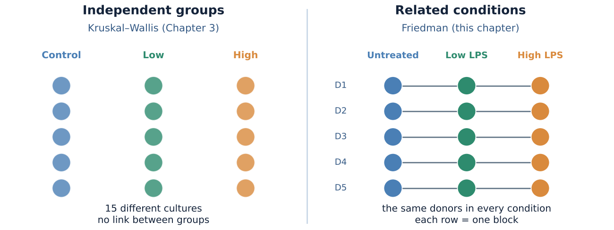
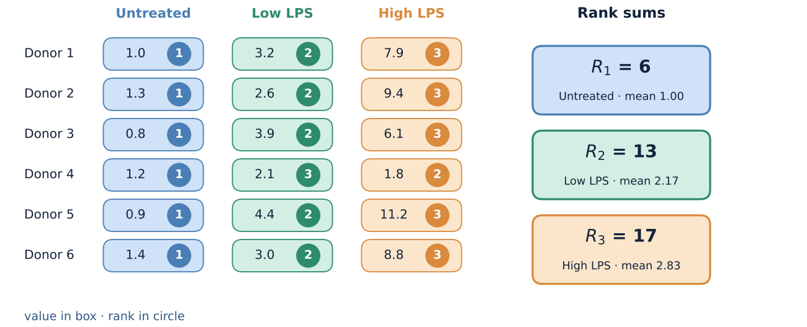
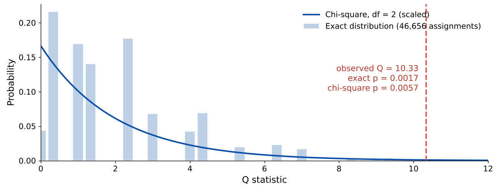
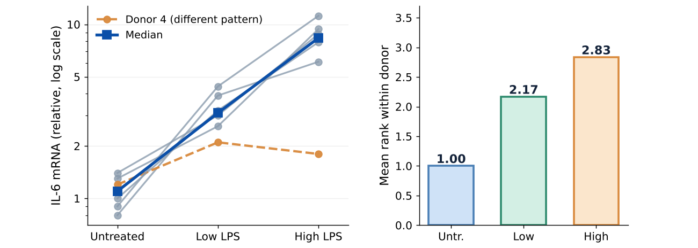
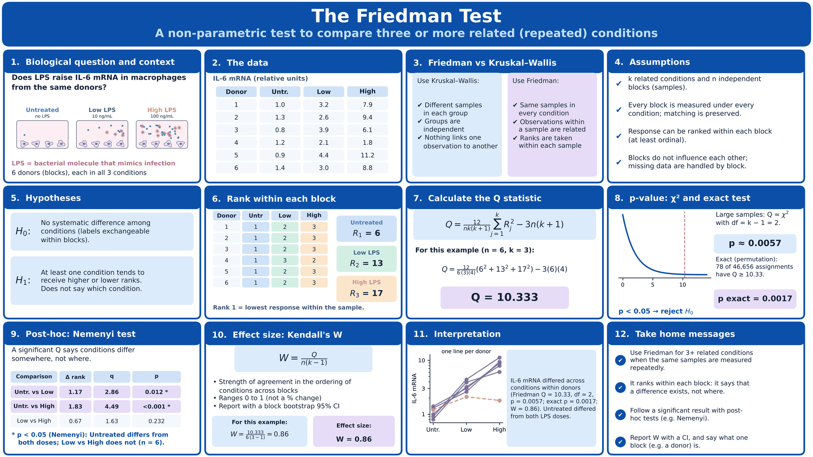

::: {.chapter-lead}
**Biostatistics · Molecular Biosciences**  
This chapter introduces a rank-based method for comparing three or more conditions measured in the same biological samples. One experiment is followed from start to finish: how a bacterial stimulus changes inflammatory gene expression in cells from the same donors.
:::

## Learning goals

By the end of this chapter, you should be able to:

- recognise when conditions are related because the same donors (blocks) are measured repeatedly;
- explain what a block is and why ranks are taken within each block;
- state the hypotheses for the Friedman test;
- calculate the $Q$ statistic from within-block ranks;
- explain the exact p-value and the chi-square approximation;
- follow a significant result with post-hoc comparisons;
- interpret Kendall's $W$ and run the analysis in R.

## Biological question: does LPS change IL-6 gene expression?

A researcher asks whether **LPS** raises the expression of the inflammatory gene *IL6*, and whether the dose matters. LPS (lipopolysaccharide) is a molecule from the outer membrane of Gram-negative bacteria. Macrophages recognise it through the receptor TLR4 and respond by switching on inflammatory genes, so adding LPS to cells in a dish is a standard way to mimic a bacterial infection. **IL-6** is one of the signalling proteins (cytokines) that these cells produce.

Macrophages are isolated from **six donors**. The cells of each donor are split into three wells: untreated, low LPS (10 ng/mL) and high LPS (100 ng/mL). After a few hours, IL-6 mRNA is measured by RT-qPCR. **This one experiment is used throughout the chapter.**

{.nostretch fig-alt="Blood tube, three culture wells with macrophages, LPS particles and IL-6 dots" width=100%}

The same procedure is repeated for six donors. Each row below is one donor:

{.nostretch fig-alt="Table of IL-6 values for six donors in three conditions" width=100%}

::: {.callout-note}
**What is a block?** A block is one biological unit, here **one donor**, that is measured under **every** condition. The three values from one donor belong together. Different donors are different blocks and are independent of each other. The same idea applies to one mouse, one patient or one culture flask measured several times.
:::

::: {.callout-warning}
**What to tell the analyst when you submit data.** Say which column identifies the donor (the block), which values are biological and which are technical replicates (average technical replicates within each donor and condition), whether every donor was measured under every condition, and any batches or plates.
:::

## Choosing the method

The Wilcoxon signed-rank test compares **two** related conditions. The Friedman test extends the same idea to **three or more** related conditions. The key question is not how many conditions there are, but whether the observations are independent or linked through the same donor.

### Independent groups or related conditions?

{.nostretch fig-alt="Independent groups with different cultures compared with related conditions with the same donors in every condition" width=100%}

- **Independent groups (Kruskal–Wallis):** every observation comes from a different culture.
- **Related conditions (Friedman):** each donor appears in every condition, so values from the same donor are linked.

A repeated-measures ANOVA compares condition means; Friedman is appropriate when the outcome is ordinal or when a rank-based comparison within donors is the scientific target.

## Assumptions and hypotheses

- Every donor (block) is measured under every condition.
- Different donors are independent of each other.
- The response can be ranked within each donor (at least ordinal).
- A donor with a missing condition cannot be ranked in the standard test, so missing values must be reported.

The hypotheses in words and symbols:

$$
H_0:\ \text{within each donor, the }k\text{ conditions have the same distribution}
$$

$$
H_1:\ \text{at least one condition tends to give higher or lower values}
$$

### The test is omnibus and non-directional

Under $H_0$, the condition labels are exchangeable within each donor. The alternative does not say which condition differs, so there is no one-sided Friedman test. In R, the donor is given after the vertical bar:

```r
friedman.test(response ~ condition | block, data = dat)
```

## Worked example: ranks within each donor

Rank the three conditions **inside each donor**: rank 1 is the lowest IL-6 value of that donor and rank 3 the highest. Think of ranking three songs separately for each listener: only the order inside one donor matters, so differences between donors (some donors respond strongly, others weakly) do not affect the test.

{.nostretch fig-alt="Within-donor ranks with rank sums 6, 13 and 17" width=100%}

The rank sums are $R_1=6$ (untreated), $R_2=13$ (low LPS) and $R_3=17$ (high LPS). For $n$ blocks and $k$ conditions:

$$
Q=\frac{12}{nk(k+1)}\sum_{j=1}^{k}R_j^2-3n(k+1)
$$

For this example, $n=6$ donors and $k=3$ conditions:

$$
Q=\frac{12}{6(3)(4)}\left(6^2+13^2+17^2\right)-3(6)(4)=10.33
$$

If the conditions were alike, each rank sum would be close to $n(k+1)/2=12$. Donor 4 behaves differently (its high-LPS value is lower than its low-LPS value), but the other five donors agree. With ties inside a donor, average ranks are assigned and $Q$ is divided by a tie correction factor.

## Exact p-value and the null distribution

Under the null hypothesis, the three conditions can be put in any of $3!=6$ orders inside each donor. For six donors there are $6^6=46,656$ equally likely sets of within-donor ranks. Each gives a $Q$ statistic; together they form the **exact null distribution of Q**.

{.nostretch fig-alt="Distribution of Q with the chi-square curve and the observed Q at 10.33" width=100%}

Of these, 78 give $Q\ge 10.33$, so the exact p-value is:

$$
p_{\text{exact}}=\frac{78}{46,656}=0.0017
$$

### Why two donors cannot give an exact p below 0.05

With **two donors** there are $6^2=36$ equally likely assignments. Even if both donors order the conditions identically, 6 of the 36 assignments reach that maximum $Q$:

$$
p_{\min}=\frac{6}{36}=0.167
$$

With **three donors**, the minimum becomes $6/216\approx0.028$. These values show the discreteness of the exact distribution.

::: {.callout-important}
This is a limitation in **inferential resolution**, not evidence of no effect. Base R's `friedman.test()` reports the chi-square approximation, not the exact value. A non-significant result does not show that the conditions are equivalent.
:::

## Chi-square approximation

For larger numbers of donors, $Q$ is compared with a **chi-square** distribution with $k-1$ degrees of freedom, not with a normal or Student's $t$ distribution:

$$
Q\approx\chi^2_{k-1},\qquad E(Q)=k-1,\qquad \operatorname{Var}(Q)=2(k-1)
$$

The p-value is the upper-tail probability:

$$
p=P\left(\chi^2_{k-1}\ge Q_{\text{observed}}\right)
$$

For our experiment, $df=2$ and $p=0.0057$. When ties occur within donors, $Q$ is corrected:

$$
Q_c=\frac{Q}{1-\dfrac{\sum\left(t^3-t\right)}{nk\left(k^2-1\right)}}
$$

where $t$ is the size of each group of tied values within a donor.

### Reproducing the chi-square approximation in R

`friedman.test()` reports the chi-square approximation and applies the tie correction automatically:

```r
friedman.test(response ~ condition | block, data = dat)
```

R reports $Q=10.33$, $df=2$ and $p=0.0057$. The exact p-value (0.0017) is smaller because the exact distribution is discrete. As a rough guide, the approximation is more reliable with about ten or more donors; with few donors prefer an exact or permutation method.

## Post-hoc comparisons: which conditions differ?

A significant omnibus result does not say which conditions differ. A common rank-based follow-up is the **Nemenyi** test on the mean ranks $\bar R_j=R_j/n$:

$$
q_{ij}=\frac{\left|\bar R_i-\bar R_j\right|}{\sqrt{\dfrac{k(k+1)}{12\,n}}}
$$

The p-value comes from the studentised range distribution, which already controls the family-wise error rate. For this example the standard error is $\sqrt{12/72}=0.41$:

- **Untreated vs Low LPS:** mean-rank difference $1.17$, $q=2.86$, $p=0.012$
- **Untreated vs High LPS:** mean-rank difference $1.83$, $q=4.49$, $p$ below 0.001
- **Low LPS vs High LPS:** mean-rank difference $0.67$, $q=1.63$, $p=0.23$

{.nostretch fig-alt="Line plot of six donors across three conditions and a bar chart of mean ranks" width=100%}

Both LPS doses differ from untreated cells, but low and high LPS cannot be separated with six donors. Report which comparisons were planned and which method was used.

## Effect size: Kendall's W

The p-value does not describe the magnitude of a biological effect. A useful rank-based effect size is **Kendall's coefficient of concordance**, $W$:

$$
W=\frac{Q}{n(k-1)}
$$

For our experiment:

$$
W=\frac{10.33}{6(3-1)}=0.86
$$

It ranges from 0 (no agreement between donors in how they order the conditions) to 1 (every donor orders the conditions identically). A value of 0.86 does **not** mean an 86% change in IL-6. Magnitude labels used by software are conventions, not universal biological thresholds.

**Calculate and report effect size regardless of statistical significance.** Report its confidence interval as well: for our data, the bootstrap 95% interval is about 0.75 to 1.00. The practical below uses a bootstrap that resamples whole donors, keeping each donor's three values together.

## R practical: run the analysis in your browser

The following editor runs R in the browser using WebR. No additional R package is required. Ready-to-use helpers calculate Kendall's W with a bootstrap 95% confidence interval and the Nemenyi post-hoc test, so the exercise can focus on interpreting the results rather than programming them.

```{=html}
<div class="webR-runner">
<div class="runner-heading">
  <div><strong>Editable R code</strong><p>Change the data or code, then select Run R.</p></div>
  <span id="rstatus" class="status" aria-live="polite">WebR has not loaded yet.</span>
</div>
<textarea id="rcode" spellcheck="false" aria-label="Editable R code">## IL-6 mRNA (relative units): each donor (block) is measured in all three conditions
dat &lt;- data.frame(
  block = factor(rep(1:6, each = 3)),
  condition = factor(rep(c("Untreated", "Low LPS", "High LPS"), times = 6),
                     levels = c("Untreated", "Low LPS", "High LPS")),
  response = c(1.0, 3.2, 7.9,
               1.3, 2.6, 9.4,
               0.8, 3.9, 6.1,
               1.2, 2.1, 1.8,
               0.9, 4.4, 11.2,
               1.4, 3.0, 8.8))

## Friedman test: the donor is the block (chi-square approximation)
print(friedman.test(response ~ condition | block, data = dat))

## Kendall's W and its donor-level bootstrap 95% confidence interval
print(friedman_kendall_ci(dat, conf.level = 0.95, B = 2000))

## Post-hoc: Nemenyi test
print(nemenyi_friedman(dat), digits = 4)</textarea>
<div class="runner-actions">
  <button id="runR" type="button">▶ Run R</button>
  <button id="resetR" class="secondary" type="button">Reset code</button>
  <button id="loadOverlap" class="secondary" type="button">Load overlapping-groups exercise</button>
</div>
<pre id="rout" class="r-output" aria-live="polite">R output will appear here.</pre>
</div>
```


### R interpretation exercise: a second experiment with inconsistent donors

Select **Load overlapping-groups exercise** above, or copy the data into desktop R. In this second experiment the donors did not agree on how the conditions rank.

```r
response <- c(1.0, 1.2, 1.4, 1.3, 1.1, 1.6, 0.9, 1.3, 1.2, 1.1, 1.5, 1.3, 1.4, 1.2, 1.8, 1.2, 1.6, 1.5)   # donor 1, donor 2, ... (untreated, low, high)
```

R reports $Q=4.33$, $df=2$ and $p=0.115$. Kendall's $W=4.33/(6\times2)\approx0.36$. The result is not statistically significant at $\alpha=0.05$: with six donors, these data do not give sufficient evidence of a difference between conditions. That is not proof that LPS has no effect.


## Practice questions

Answer the questions online and check the feedback. These questions are formative: use the explanations to review the relevant sections.

::: {.practice-question data-correct="B" data-explanation="Friedman is for related or repeated conditions, with each block/subject measured under every condition." data-wrong="A=Three independent treatment groups call for Kruskal–Wallis.||C=Two independent groups call for the Mann–Whitney test.||D=A single group measured once has no conditions to compare."}
**1. Which design calls for the Friedman test?**

- A. Three independent treatment groups
- B. The same subjects measured under three or more conditions
- C. Two independent groups
- D. A single group measured once
:::

::: {.practice-question data-correct="C" data-explanation="A block is one donor (or other experimental unit) measured under all conditions, so its values form a matched set." data-wrong="A=Unrelated subjects are independent. A block links the values of one subject.||B=Technical replicates are repeated readings of the same sample. They are averaged, not used as blocks.||D=A treatment level is a condition (for example low LPS), not a block."}
**2. What is a block in a Friedman design?**

- A. A group of unrelated subjects
- B. A set of technical replicates
- C. A donor or experimental unit measured under all conditions
- D. A treatment level
:::

::: {.practice-question data-correct="B" data-explanation="Rank the treatment measurements within each block, separately for each subject or matched unit." data-wrong="A=Pooling all donors would ignore the matching. That is how Kruskal–Wallis ranks.||C=Ranks are taken within each donor, not within each treatment across donors.||D=All the values in a block are ranked, not only the largest."}
**3. How are observations ranked in the Friedman test?**

- A. Across all subjects and conditions together
- B. Within each block, across the conditions
- C. Within each treatment across all subjects
- D. Only the largest value is ranked
:::

## Practice questions: calculations and p-values

::: {.practice-question data-correct="C" data-explanation="The Friedman null states there is no systematic difference among the related conditions." data-wrong="A=Means belong to ANOVA. Friedman is rank-based.||B=This is the wording for independent groups. The Friedman null concerns the related conditions within blocks.||D=Blocks can have very different raw values. Only the order inside each block matters."}
**4. What is the null hypothesis of the Friedman test?**

- A. All treatment means are equal
- B. The treatment distributions are identical in every population context
- C. The treatment conditions have the same rank distribution / no systematic treatment effect
- D. Every block has the same raw measurements
:::

::: {.practice-question data-correct="A" data-explanation="Summing the within-donor ranks gives 6 (untreated), 13 (low LPS) and 17 (high LPS)." data-wrong="B=These do not match the within-donor ranks in the table. Add the ranks of each condition across the six donors.||C=12, 12, 12 is what you would expect if the conditions were alike. Here they clearly differ.||D=1, 2, 3 are possible ranks for one donor, not rank sums over six donors."}
**5. In the worked example, what are the rank sums for untreated, low LPS and high LPS?**

- A. 6, 13, 17
- B. 7, 11, 18
- C. 12, 12, 12
- D. 1, 2, 3
:::

::: {.practice-question data-correct="B" data-explanation="The asymptotic Friedman reference distribution has k−1 degrees of freedom." data-wrong="A=n − 1 depends on the number of donors. The df depends on the number of conditions.||C=n(k − 1) would grow with the number of donors. The df depends only on k.||D=k + 1 adds one degree of freedom. The correct value is k − 1."}
**6. For three conditions, what are the chi-square approximation degrees of freedom?**

- A. n − 1
- B. k − 1 = 2
- C. n(k − 1)
- D. k + 1 = 4
:::

## Practice questions: small samples and R interpretation

::: {.practice-question data-correct="C" data-explanation="Kendall's W = Q/[n(k−1)] = 10.333/[6×2] ≈ 0.861." data-wrong="A=W = 0.05 would mean almost no agreement among donors. Calculate Q / [n(k − 1)] = 10.333 / 12.||B=W = 0.50 would be moderate agreement. 10.333 / 12 is larger.||D=W cannot exceed 1."}
**7. What is Kendall's W in the worked example?**

- A. 0.05
- B. 0.50
- C. Approximately 0.86
- D. 1.50
:::

::: {.practice-question data-correct="B" data-explanation="The omnibus result does not locate the differences; follow up with paired comparisons and adjust for multiplicity." data-wrong="A=The omnibus result does not show that every pair differs.||C=Switching to an independent-groups test would ignore that the same donors were measured.||D=Ignoring the blocks throws away the matching and changes the test."}
**8. What should follow a significant Friedman test?**

- A. Conclude every pair differs
- B. Use appropriate paired post-hoc comparisons with multiplicity adjustment
- C. Switch to an independent-groups test
- D. Ignore the block structure
:::

::: {.practice-question data-correct="C" data-explanation="In base R, friedman.test(response ~ condition | block, data = ...) performs the test." data-wrong="A=kruskal.test() is for independent groups.||B=wilcox.test() handles two groups, not three or more.||D=t.test() compares means."}
**9. Which R function performs the Friedman test?**

- A. kruskal.test()
- B. wilcox.test()
- C. friedman.test()
- D. t.test()
:::

::: {.callout-note}
**Interpretation reminder.** A non-significant result does not prove that the groups or conditions are the same. Calculate and report an effect size, with its confidence interval, regardless of statistical significance.
:::

## Student notes

Use this space to record your interpretation, questions or reminders. Notes are saved locally in the current browser and device; they are not synchronised between devices.

::: {.student-notes}
<textarea id="studentNotes" aria-label="Student notes" placeholder="My notes for Chapter 4…"></textarea>
<p id="notesStatus" class="notes-status" aria-live="polite">Notes are stored locally in this browser.</p>
<button type="button" onclick="window.print()">Print / Save as PDF</button>
<button type="button" id="clearNotes" class="secondary">Clear notes</button>
:::

## Chapter recap: the complete infographic

The infographic below summarises the whole chapter. Use it to review the biological question, test choice, assumptions, hypotheses, within-donor ranks, $Q$, p-values, post-hoc comparisons, effect size and interpretation.

{.nostretch fig-alt="Friedman chapter infographic recap with twelve panels" width=100%}

---

**End of Chapter 4 · Biostatistics for Molecular Biosciences**

```{=html}
<script>
(() => {
  const initialCode = document.getElementById('rcode').value;
  let webR = null;
  let initPromise = null;
  async function getWebR() {
    if (webR) return webR;
    if (!initPromise) {
      initPromise = (async () => {
        const module = await import('https://webr.r-wasm.org/latest/webr.mjs');
        const runtime = new module.WebR();
        await runtime.init();
        await runtime.evalRVoid(`
friedman_kendall_ci <- function(dat, conf.level = 0.95, B = 2000) {
  stopifnot(all(c("block","condition","response") %in% names(dat)), B >= 100)
  wide <- xtabs(response ~ block + condition, data = dat)
  if (any(is.na(wide))) stop("Every block must have a measurement in every condition.")
  if (ncol(wide) < 2) stop("At least two conditions are required.")
  calc <- function(w) {
    n <- nrow(w); k <- ncol(w)
    ranks <- t(apply(w, 1, rank, ties.method = "average"))
    sums <- colSums(ranks)
    Q <- 12/(n*k*(k+1))*sum(sums^2)-3*n*(k+1)
    Q/(n*(k-1))
  }
  estimate <- calc(wide)
  set.seed(2026)
  boot <- replicate(B, {
    ii <- sample(seq_len(nrow(wide)), nrow(wide), replace=TRUE)
    calc(wide[ii,,drop=FALSE])
  })
  alpha <- 1-conf.level
  ci <- unname(quantile(boot, c(alpha/2,1-alpha/2), na.rm=TRUE))
  data.frame(Kendalls_W=estimate, CI=conf.level, CI_low=ci[1], CI_high=ci[2])
}

nemenyi_friedman <- function(dat) {
  stopifnot(all(c("block", "condition", "response") %in% names(dat)))
  wide <- xtabs(response ~ block + condition, data = dat)
  n <- nrow(wide); k <- ncol(wide)
  rk <- t(apply(wide, 1, rank)); mr <- colMeans(rk)
  se <- sqrt(k * (k + 1) / (12 * n)); lv <- colnames(wide); out <- NULL
  for (i in 1:(k - 1)) for (j in (i + 1):k) {
    d <- abs(mr[i] - mr[j]); q <- d / se
    out <- rbind(out, data.frame(comparison = paste(lv[i], "vs", lv[j]),
                                 mean_rank_diff = as.numeric(d), statistic = as.numeric(q),
                                 p = ptukey(sqrt(2) * q, k, Inf, lower.tail = FALSE)))
  }
  rownames(out) <- NULL
  out
}
        `);
        webR = runtime;
        return runtime;
      })();
    }
    try { return await initPromise; }
    catch (error) { initPromise = null; throw error; }
  }
  document.getElementById('runR').addEventListener('click', async () => {
    const button = document.getElementById('runR');
    const status = document.getElementById('rstatus');
    const output = document.getElementById('rout');
    button.disabled = true;
    status.textContent = 'Loading WebR…';
    output.textContent = 'Starting R…';
    try {
      const runtime = await getWebR();
      status.textContent = 'Running R code…';
      const code = document.getElementById('rcode').value;
      const result = await runtime.evalRString(`paste(capture.output({\n${code}\n}), collapse = '\\n')`);
      output.textContent = String(result).trim() || 'R finished, but produced no visible output. Try print(object).';
      status.textContent = 'R finished. Output is shown below.';
    } catch (error) {
      status.textContent = 'R could not run. Check your internet connection and try again.';
      output.textContent = error?.message || String(error);
    } finally { button.disabled = false; }
  });
  document.getElementById('loadOverlap').addEventListener('click', () => {
    document.getElementById('rcode').value = `dat <- data.frame(
  block = factor(rep(1:6, each = 3)),
  condition = factor(rep(c("Untreated", "Low LPS", "High LPS"), times = 6),
                     levels = c("Untreated", "Low LPS", "High LPS")),
  response = c(1.0, 1.2, 1.4,
               1.3, 1.1, 1.6,
               0.9, 1.3, 1.2,
               1.1, 1.5, 1.3,
               1.4, 1.2, 1.8,
               1.2, 1.6, 1.5))

print(friedman.test(response ~ condition | block, data = dat))

print(friedman_kendall_ci(dat, conf.level = 0.95, B = 2000))`;
    document.getElementById('rout').textContent = 'Overlapping-groups code loaded. Select Run R.';
    document.getElementById('rstatus').textContent = 'Ready to run the overlapping-groups exercise.';
  });
  document.getElementById('resetR').addEventListener('click', () => {
    document.getElementById('rcode').value = initialCode;
    document.getElementById('rout').textContent = 'R output will appear here.';
    document.getElementById('rstatus').textContent = 'Code reset. WebR has not run yet.';
  });
  document.querySelectorAll('.practice-question').forEach((box, index) => {
    const labels = Array.from(box.querySelectorAll('li'));
    if (labels.length) {
      const group = `q${index + 1}`;
      labels.forEach((li, i) => {
        const input = document.createElement('input');
        input.type = 'radio'; input.name = group; input.value = ['A','B','C','D'][i];
        input.setAttribute('aria-label', li.textContent.trim());
        li.prepend(input, document.createTextNode(' '));
      });
    }
    const feedback = document.createElement('p');
    feedback.className = 'feedback'; feedback.setAttribute('aria-live','polite');
    const check = document.createElement('button'); check.type = 'button'; check.textContent = 'Check answer';
    check.addEventListener('click', () => {
      const selected = box.querySelector('input[type="radio"]:checked');
      const short = box.querySelector('.short-answer');
      const value = selected ? selected.value : (short ? short.value.trim() : '');
      if (!value) { feedback.textContent = 'Choose or enter an answer first.'; feedback.className = 'feedback incorrect'; return; }
      const ok = value.toUpperCase() === box.dataset.correct.toUpperCase();
      let msg = ok ? 'Correct. ' + box.dataset.explanation : 'Not quite. ';
      if (!ok) {
        const wrong = {};
        (box.dataset.wrong || '').split('||').forEach(p => { const i = p.indexOf('='); if (i > 0) wrong[p.slice(0, i).trim()] = p.slice(i + 1).trim(); });
        if (wrong[value.toUpperCase()]) msg += 'Why ' + value.toUpperCase() + ' is wrong: ' + wrong[value.toUpperCase()] + ' ';
        msg += 'The correct answer is ' + box.dataset.correct.toUpperCase() + ': ' + box.dataset.explanation;
      }
      feedback.textContent = msg;
      feedback.className = 'feedback ' + (ok ? 'correct' : 'incorrect');
    });
    box.append(check, feedback);
  });
  const notes = document.getElementById('studentNotes');
  const key = `biostatistics-course-${location.pathname}-chapter-4-notes`;
  const status = document.getElementById('notesStatus');
  try {
    notes.value = localStorage.getItem(key) || '';
    notes.addEventListener('input', () => {
      try { localStorage.setItem(key, notes.value); status.textContent = 'Saved in this browser.'; }
      catch (e) { status.textContent = 'Autosave is unavailable; print or copy your notes before leaving.'; }
    });
  } catch (e) { status.textContent = 'Browser storage is unavailable; print or copy your notes before leaving.'; }
  document.getElementById('clearNotes').addEventListener('click', () => {
    notes.value = '';
    try { localStorage.removeItem(key); status.textContent = 'Notes cleared in this browser.'; }
    catch (e) { status.textContent = 'Notes cleared from the text area.'; }
  });
})();
</script>
```
