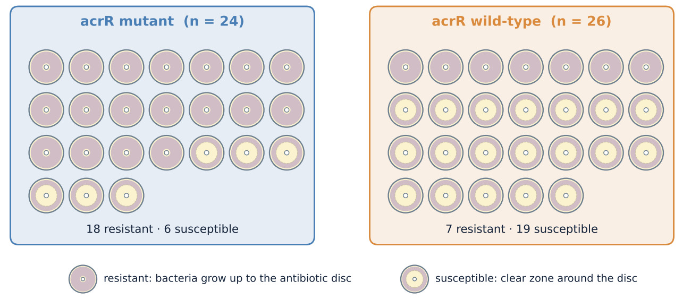
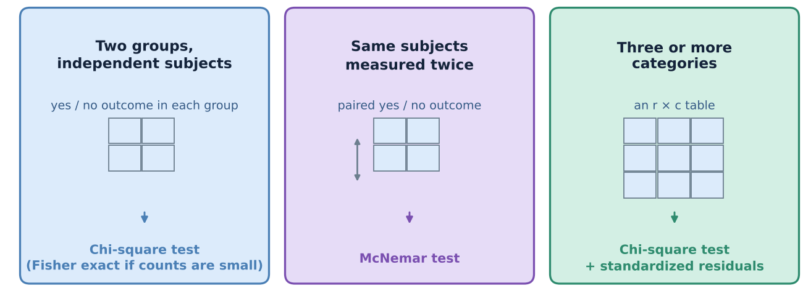
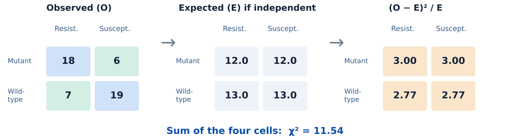
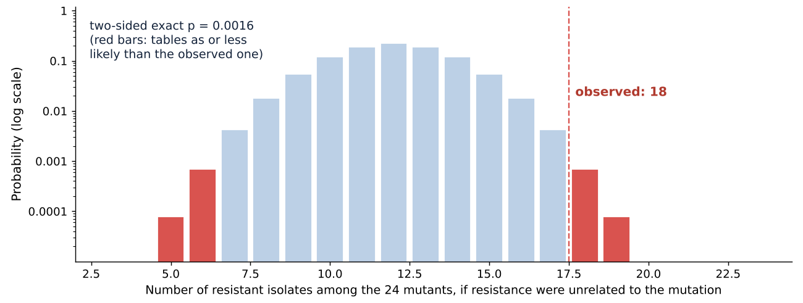
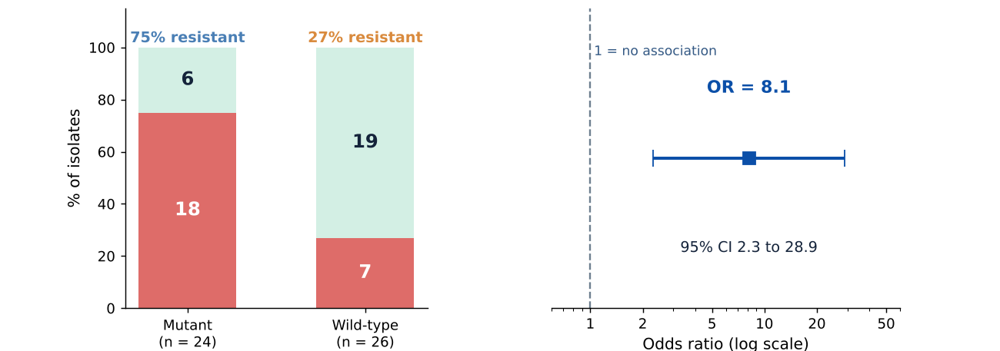
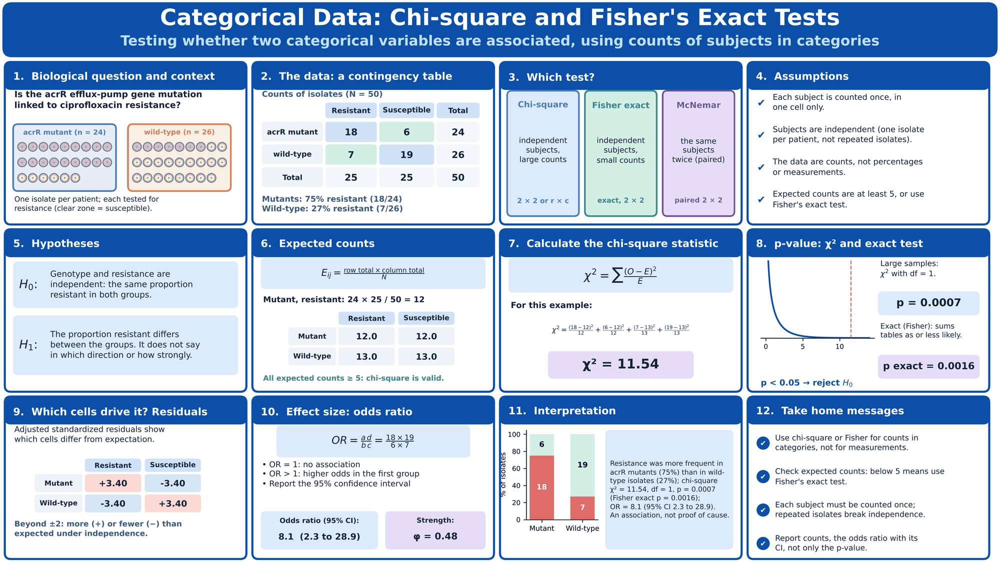

::: {.chapter-lead}
**Biostatistics · Molecular Biosciences**  
This chapter introduces tests for **categorical data**: outcomes that are counts of categories (resistant or susceptible) rather than measurements. One experiment is followed from start to finish: whether a mutation in a bacterial gene is associated with antibiotic resistance.
:::

## Learning goals

By the end of this chapter, you should be able to:

- recognise when the data are counts in categories and arrange them in a contingency table;
- choose between the chi-square test, Fisher's exact test and McNemar's test;
- state the hypotheses and assumptions of the test of independence;
- calculate expected counts and the $\chi^2$ statistic;
- explain the exact p-value and when the chi-square approximation is unreliable;
- use standardized residuals, the odds ratio and its confidence interval;
- run the analysis in R and report the result.

## Biological question: is an efflux-pump mutation linked to resistance?

Ciprofloxacin is an antibiotic that bacteria can resist by pumping it out of the cell. The *acrR* gene encodes a repressor of the AcrAB-TolC efflux pump: when *acrR* is mutated, the pump is produced in excess and more drug is expelled. A laboratory collected **50 clinical isolates of *E. coli*, one per patient**, sequenced *acrR* and tested each isolate for ciprofloxacin resistance (disc diffusion: a clear zone around the antibiotic disc means susceptible). **This one experiment is used throughout the chapter.**

{.nostretch fig-alt="Fifty agar plates grouped by acrR mutant or wild-type, coloured by resistance" width=100%}

Each isolate is classified twice: *acrR* **mutant or wild-type**, and ciprofloxacin **resistant or susceptible**. Counting isolates in each combination gives a 2 × 2 **contingency table**:

| | Resistant | Susceptible | Total |
|---|:-:|:-:|:-:|
| ***acrR* mutant** | 18 | 6 | 24 |
| ***acrR* wild-type** | 7 | 19 | 26 |
| **Total** | 25 | 25 | 50 |

::: {.callout-warning}
**What to tell the analyst when you submit data.** Give the **counts**, not only percentages. Say what one row of your data is (here, one isolate from one patient), which variable is the group and which is the outcome, and how the outcome was defined (for example the breakpoint used for resistance). State whether several isolates came from the same patient or the same outbreak: they are **not independent**. If the same subjects were measured twice, say so, because that is a paired design.
:::

## Choosing the method

The tests in the previous chapters rank **measurements**. Here the data are **counts of subjects in categories**, so ranks are not used. The right test depends on how the subjects are linked.

{.nostretch fig-alt="Three cards: independent groups, paired data, and larger tables with the matching tests" width=100%}

- **Chi-square test of independence:** each subject is counted once, in one row and one column.
- **Fisher's exact test:** the same question as the chi-square test, but an exact calculation, used when counts are small.
- **McNemar's test:** the same subjects are classified twice (for example before and after treatment), so the two classifications are linked.

## Assumptions and hypotheses

- Each subject is counted **once**, in exactly one cell, and subjects are independent of each other.
- The data are **counts** (not percentages or means).
- For the chi-square approximation, **expected** counts should be large enough: a common rule is at least 5 in every cell. Otherwise use Fisher's exact test.

The hypotheses in words and symbols:

$$
H_0:\ \text{resistance is independent of }acrR\text{ status (same proportion resistant in both groups)}
$$

$$
H_1:\ \text{the proportion resistant differs between mutant and wild-type isolates}
$$

### The test is omnibus and non-directional

Rejecting $H_0$ shows that the two variables are associated, not **in which direction** or how strongly: that comes from the proportions, the odds ratio and its confidence interval. In R:

```r
chisq.test(tab, correct = FALSE)
```

## Worked example: expected counts and the chi-square statistic

If resistance were unrelated to the mutation, the proportion resistant would be the same in both groups: $25/50=50\%$. The expected count in each cell follows from the totals:

$$
E_{ij}=\frac{(\text{row total}_i)\times(\text{column total}_j)}{N}
$$

For the mutant isolates that are resistant, $E_{11}=24\times25/50=12$. Each cell then contributes $(O-E)^2/E$:

{.nostretch fig-alt="Observed, expected and contribution tables with chi-square equal to 11.54" width=100%}

$$
\chi^2=\sum_{i,j}\frac{\left(O_{ij}-E_{ij}\right)^2}{E_{ij}}=\frac{(18-12)^2}{12}+\frac{(6-12)^2}{12}+\frac{(7-13)^2}{13}+\frac{(19-13)^2}{13}=11.54
$$

If the variables were independent, observed and expected counts would be close and $\chi^2$ would be small. Here every cell is 6 isolates away from its expected count.

## Exact p-value: Fisher's exact test

With the row and column totals fixed (24 mutants, 26 wild-type, 25 resistant, 25 susceptible), the number of resistant isolates among the 24 mutants can only take certain values. If resistance were unrelated to the mutation, its probability follows the **hypergeometric distribution**: it is like drawing 24 isolates at random from the 50 and counting how many are resistant.

{.nostretch fig-alt="Hypergeometric distribution with tails coloured red beyond the observed value of 18" width=100%}

The probability of exactly 18 is $0.0007$. The **two-sided exact p-value** adds the probabilities of all tables that are as likely or less likely than the observed one (the red bars, in both tails):

$$
p_{\text{exact}}=0.0016
$$

### What changes when the counts are small

Take a smaller study of 11 isolates: 4 of 5 mutants and 1 of 6 wild-type isolates are resistant. The expected counts are 2.27, 2.73, 2.73 and 3.27, so **two are below 5**. The chi-square test gives $p=0.036$, but Fisher's exact test gives $p=0.080$: the two tests lead to different conclusions. With small counts the exact test is the reliable one.

::: {.callout-important}
The chi-square p-value is an **approximation** that is accurate when expected counts are large. Check the expected counts first (`test$expected` in R). If any is below 5 in a 2 × 2 table, report Fisher's exact test.
:::

## Chi-square approximation

For larger samples, $\chi^2$ is compared with a **chi-square distribution** with degrees of freedom equal to the number of independent cells:

$$
df=(r-1)(c-1)=(2-1)(2-1)=1
$$

The p-value is the upper-tail probability:

$$
p=P\left(\chi^2_{1}\ge 11.54\right)=0.0007
$$

The chi-square distribution has mean $df$ and variance $2\,df$. Some programs apply **Yates' continuity correction** to 2 × 2 tables, subtracting 0.5 from each $|O-E|$: this gives $\chi^2=9.70$ and $p=0.0018$. The correction is conservative; in R it is the default, which is why the examples here set `correct = FALSE`. Say which version you report.

### Reproducing the chi-square test in R

```r
chisq.test(tab, correct = FALSE)
```

R reports $\chi^2=11.54$, $df=1$ and $p=0.0007$. The exact p-value (0.0016) is slightly larger because the exact distribution is discrete.

## Which cells drive the association? Standardized residuals

A significant result says the variables are associated, not which cells are responsible. In larger tables, look at the **adjusted standardized residual** of each cell:

$$
z_{ij}=\frac{O_{ij}-E_{ij}}{\sqrt{E_{ij}\left(1-\dfrac{r_i}{N}\right)\left(1-\dfrac{c_j}{N}\right)}}
$$

Values beyond about $\pm2$ mark cells with clearly more (positive) or fewer (negative) observations than expected under independence. For our table:

- **Mutant, resistant:** $z=+3.40$ (more resistant mutants than expected)
- **Mutant, susceptible:** $z=-3.40$
- **Wild-type, resistant:** $z=-3.40$ (fewer resistant wild-type isolates than expected)
- **Wild-type, susceptible:** $z=+3.40$

In a 2 × 2 table all four residuals have the same size, so they only restate the single comparison. They become informative in tables with three or more categories, where the same test is applied to the full $r\times c$ table.

## Effect size: odds ratio and risk difference

The p-value says whether an association exists; the **effect size** says how strong it is. In the mutant group $75\%$ of isolates are resistant, against $27\%$ in wild-type: a difference of $48$ percentage points. The **odds ratio** compares the odds of resistance in the two groups:

$$
\text{OR}=\frac{18/6}{7/19}=\frac{18\times19}{6\times7}=8.1
$$

An odds ratio of 1 means no association. The confidence interval is computed on the log scale:

$$
\text{95\% CI}=\exp\!\left(\ln\text{OR}\pm1.96\sqrt{\tfrac1{18}+\tfrac1{6}+\tfrac1{7}+\tfrac1{19}}\right)=2.3\text{ to }28.9
$$

{.nostretch fig-alt="Stacked bars of resistant and susceptible counts and an odds ratio with confidence interval" width=100%}

For a 2 × 2 table the strength of the association is also summarised by $\phi=\sqrt{\chi^2/N}=0.48$ (Cramér's $V$ for larger tables), which ranges from 0 to 1. The interval for the odds ratio is wide, because there are only 50 isolates: report it, not just the p-value.
## R practical: run the analysis in your browser

The following editor runs R in the browser using WebR. No additional R package is required. A ready-to-use helper calculates the odds ratio with its 95% confidence interval. The code builds the table, runs the chi-square and Fisher tests, and shows expected counts and residuals.

```{=html}
<div class="webR-runner">
<div class="runner-heading">
  <div><strong>Editable R code</strong><p>Change the data or code, then select Run R.</p></div>
  <span id="rstatus" class="status" aria-live="polite">WebR has not loaded yet.</span>
</div>
<textarea id="rcode" spellcheck="false" aria-label="Editable R code">tab &lt;- matrix(c(18, 7, 6, 19), nrow = 2,
              dimnames = list(acrR = c("mutant", "wild-type"),
                              ciprofloxacin = c("resistant", "susceptible")))
print(tab)

test &lt;- chisq.test(tab, correct = FALSE)
print(test)
print(test$expected)                 # all expected counts should be at least 5
print(round(test$stdres, 2))         # adjusted standardized residuals

print(fisher.test(tab))              # exact p-value
print(odds_ratio_ci(tab))            # odds ratio with 95% CI</textarea>
<div class="runner-actions">
  <button id="runR" type="button">▶ Run R</button>
  <button id="resetR" class="secondary" type="button">Reset code</button>
  <button id="loadOverlap" class="secondary" type="button">Load small-sample exercise</button>
</div>
<pre id="rout" class="r-output" aria-live="polite">R output will appear here.</pre>
</div>
```


### R interpretation exercise: a small study with low expected counts

Select **Load small-sample exercise** above, or copy the code into desktop R. In this smaller study 4 of 5 mutants and 1 of 6 wild-type isolates are resistant.

R shows expected counts of 2.27, 2.73, 2.73 and 3.27, two of them below 5. The chi-square test gives $p=0.036$ but Fisher's exact test gives $p=0.080$, which is not significant at $\alpha=0.05$. The exact test is the one to report, and the odds ratio interval is very wide (0.6 to more than 1000): with 11 isolates the data are compatible with almost any association. That is not evidence that the mutation has no effect.

## Practice questions

Answer the questions online and check the feedback. These questions are formative: use the explanations to review the relevant sections.

::: {.practice-question data-correct="B" data-explanation="The same variable (genotype) classifies independent isolates into two groups, and each isolate is also classified as resistant or susceptible: a 2 × 2 table of independent subjects." data-wrong="A=The same patients before and after treatment is a paired design: use McNemar's test.||C=MIC values are measurements. Compare them with a rank test such as Mann–Whitney.||D=The same donors under three conditions is a Friedman design."}
**1. Which design calls for a chi-square test of independence?**

- A. The same patients' isolates classified resistant or susceptible before and after treatment
- B. Isolates from 50 different patients classified by genotype and by resistance
- C. MIC values compared between two groups of isolates
- D. Gene expression in the same donors under three conditions
:::

::: {.practice-question data-correct="C" data-explanation="E = row total × column total / N = 24 × 25 / 50 = 12." data-wrong="A=18 is the observed count, not the expected count.||B=9 does not follow from the totals. E = row total × column total / N = 24 × 25 / 50.||D=6 is the observed number of susceptible mutants."}
**2. In the worked example, what is the expected count for resistant mutant isolates?**

- A. 18
- B. 9
- C. 12
- D. 6
:::

::: {.practice-question data-correct="A" data-explanation="H0 says the proportion of resistant isolates is the same in both genotypes, i.e. the variables are independent." data-wrong="B=The test cannot show causation. The null hypothesis is about independence.||C=The cells do not need to be equal. Expected counts depend on the row and column totals.||D=An odds ratio of 1 is the null. An odds ratio above 1 would be an alternative."}
**3. What does the null hypothesis of the chi-square test of independence state?**

- A. Resistance and genotype are independent
- B. The mutation causes resistance
- C. All four cell counts are equal
- D. The odds ratio is greater than 1
:::

## Practice questions: calculations and p-values

::: {.practice-question data-correct="D" data-explanation="df = (r − 1)(c − 1) = (2 − 1)(2 − 1) = 1." data-wrong="A=4 is the number of cells, not the degrees of freedom.||B=3 is not (r − 1)(c − 1) for a 2 × 2 table.||C=2 does not match (2 − 1)(2 − 1)."}
**4. How many degrees of freedom does the chi-square test have for a 2 × 2 table?**

- A. 4
- B. 3
- C. 2
- D. 1
:::

::: {.practice-question data-correct="B" data-explanation="Fisher's test sums the probabilities of all tables, with the same totals, that are as likely or less likely than the observed table." data-wrong="A=That is the probability of one table. The p-value adds all tables that are as likely or less likely.||C=Squared differences between observed and expected counts make up the chi-square statistic, not the Fisher p-value.||D=The p-value is not the probability that the odds ratio equals 1."}
**5. What does the exact (Fisher) p-value add up?**

- A. The probability of exactly the observed table
- B. The probabilities of tables with the same totals that are as or less likely than the observed one
- C. The squared differences between observed and expected counts
- D. The probability that the odds ratio equals 1
:::

::: {.practice-question data-correct="A" data-explanation="χ² = 11.54 with df = 1 gives p = 0.0007, strong evidence that resistance and genotype are associated; it does not show causation." data-wrong="B=The test shows an association, not that the mutation causes resistance in every isolate.||C=p = 0.0007 rejects independence.||D=p = 0.0007 is below 0.05, so the result is significant."}
**6. The test gives χ² = 11.54, df = 1, p = 0.0007. What is a correct conclusion?**

- A. The data give strong evidence of an association between genotype and resistance
- B. The mutation causes resistance in every isolate
- C. The two variables are independent
- D. The result is not significant at 5%
:::

## Practice questions: small samples and interpretation

::: {.practice-question data-correct="C" data-explanation="Two expected counts (2.27 and 2.73) are below 5, so the chi-square approximation is unreliable; Fisher's exact test is used." data-wrong="A=Changing the degrees of freedom does not fix an unreliable approximation.||B=McNemar's test is for paired observations, not independent isolates.||D=Kruskal–Wallis is for measurements, not counts in categories."}
**7. A small study has expected counts of 2.27, 2.73, 2.73 and 3.27. Which test should you report?**

- A. Chi-square with a larger df
- B. McNemar test
- C. Fisher's exact test
- D. Kruskal–Wallis test
:::

::: {.practice-question data-correct="B" data-explanation="The odds of resistance are about 8 times higher in mutants, and because the 95% CI (2.3 to 28.9) excludes 1 the association is statistically supported; the wide CI shows the estimate is imprecise." data-wrong="A=8.1 is an odds ratio, not a percentage of resistant mutants.||C=The odds ratio compares the odds of resistance, not how common the mutation is.||D=The interval excludes 1, so the association is statistically supported. A wide interval means the estimate is imprecise."}
**8. The odds ratio is 8.1 with a 95% CI of 2.3 to 28.9. What does this mean?**

- A. 8.1% of mutants are resistant
- B. The odds of resistance are about 8 times higher in mutants, with a wide, imprecise interval
- C. The mutation is 8 times more common than the wild type
- D. The result is not significant because the interval is wide
:::

::: {.practice-question data-correct="A" data-explanation="Both the chi-square and the Fisher test assume that every subject is counted once and that subjects are independent. Several isolates from one patient are not independent; use one isolate per patient or a method that accounts for clustering." data-wrong="B=Related isolates do not make expected counts larger. They make the observations dependent.||C=The odds ratio can still be calculated, but its interval and p-value would be misleading.||D=More isolates from the same patients do not add independent information."}
**9. Several isolates were taken from each patient. Which assumption of the chi-square and Fisher tests is broken?**

- A. Independence: isolates from the same patient are not independent observations
- B. The expected counts will be too large
- C. The odds ratio cannot be calculated
- D. Nothing: more isolates always improve the test
:::

::: {.callout-note}
**Interpretation reminder.** A significant association is not proof of causation: resistance and the mutation can both be linked to bacterial lineage. Report counts, the effect size and its confidence interval, and say whether isolates were independent.
:::

## Student notes

Use this space to record your interpretation, questions or reminders. Notes are saved locally in the current browser and device; they are not synchronised between devices.

::: {.student-notes}
<textarea id="studentNotes" aria-label="Student notes" placeholder="My notes for Chapter 5…"></textarea>
<p id="notesStatus" class="notes-status" aria-live="polite">Notes are stored locally in this browser.</p>
<button type="button" onclick="window.print()">Print / Save as PDF</button>
<button type="button" id="clearNotes" class="secondary">Clear notes</button>
:::

## Chapter recap: the complete infographic

The infographic below summarises the whole chapter. Use it to review the biological question, test choice, assumptions, hypotheses, expected counts, $\chi^2$, p-values, residuals, effect size and interpretation.

{.nostretch fig-alt="Categorical data chapter infographic recap with twelve panels" width=100%}

---

**End of Chapter 5 · Biostatistics for Molecular Biosciences**

```{=html}
<script>
(() => {
  const initialCode = document.getElementById('rcode').value;
  let webR = null;
  let initPromise = null;
  async function getWebR() {
    if (webR) return webR;
    if (!initPromise) {
      initPromise = (async () => {
        const module = await import('https://webr.r-wasm.org/latest/webr.mjs');
        const runtime = new module.WebR();
        await runtime.init();
        await runtime.evalRVoid(`
odds_ratio_ci <- function(tab, conf.level = 0.95) {
  stopifnot(is.matrix(tab) || is.table(tab), all(dim(tab) == c(2, 2)), all(tab > 0))
  tab <- as.matrix(tab)
  or <- (tab[1, 1] * tab[2, 2]) / (tab[1, 2] * tab[2, 1])
  se <- sqrt(sum(1 / tab))
  z <- qnorm(1 - (1 - conf.level) / 2)
  out <- c(odds_ratio = or, lower = exp(log(or) - z * se), upper = exp(log(or) + z * se))
  round(out, 3)
}
        `);
        webR = runtime;
        return runtime;
      })();
    }
    try { return await initPromise; }
    catch (error) { initPromise = null; throw error; }
  }
  document.getElementById('runR').addEventListener('click', async () => {
    const button = document.getElementById('runR');
    const status = document.getElementById('rstatus');
    const output = document.getElementById('rout');
    button.disabled = true;
    status.textContent = 'Loading WebR…';
    output.textContent = 'Starting R…';
    try {
      const runtime = await getWebR();
      status.textContent = 'Running R code…';
      const code = document.getElementById('rcode').value;
      const result = await runtime.evalRString(`paste(capture.output({\n${code}\n}), collapse = '\\n')`);
      output.textContent = String(result).trim() || 'R finished, but produced no visible output. Try print(object).';
      status.textContent = 'R finished. Output is shown below.';
    } catch (error) {
      status.textContent = 'R could not run. Check your internet connection and try again.';
      output.textContent = error?.message || String(error);
    } finally { button.disabled = false; }
  });
  document.getElementById('loadOverlap').addEventListener('click', () => {
    document.getElementById('rcode').value = `tab <- matrix(c(4, 1, 1, 5), nrow = 2,
              dimnames = list(acrR = c("mutant", "wild-type"),
                              ciprofloxacin = c("resistant", "susceptible")))
print(tab)

test <- suppressWarnings(chisq.test(tab, correct = FALSE))
print(round(test$expected, 2))       # two expected counts are below 5
print(round(test$p.value, 4))        # chi-square p-value: not reliable here
print(fisher.test(tab))              # exact p-value: use this one`;
    document.getElementById('rout').textContent = 'Small-sample code loaded. Select Run R.';
    document.getElementById('rstatus').textContent = 'Ready to run the small-sample exercise.';
  });
  document.getElementById('resetR').addEventListener('click', () => {
    document.getElementById('rcode').value = initialCode;
    document.getElementById('rout').textContent = 'R output will appear here.';
    document.getElementById('rstatus').textContent = 'Code reset. WebR has not run yet.';
  });
  document.querySelectorAll('.practice-question').forEach((box, index) => {
    const labels = Array.from(box.querySelectorAll('li'));
    if (labels.length) {
      const group = `q${index + 1}`;
      labels.forEach((li, i) => {
        const input = document.createElement('input');
        input.type = 'radio'; input.name = group; input.value = ['A','B','C','D'][i];
        input.setAttribute('aria-label', li.textContent.trim());
        li.prepend(input, document.createTextNode(' '));
      });
    }
    const feedback = document.createElement('p');
    feedback.className = 'feedback'; feedback.setAttribute('aria-live','polite');
    const check = document.createElement('button'); check.type = 'button'; check.textContent = 'Check answer';
    check.addEventListener('click', () => {
      const selected = box.querySelector('input[type="radio"]:checked');
      const short = box.querySelector('.short-answer');
      const value = selected ? selected.value : (short ? short.value.trim() : '');
      if (!value) { feedback.textContent = 'Choose or enter an answer first.'; feedback.className = 'feedback incorrect'; return; }
      const ok = value.toUpperCase() === box.dataset.correct.toUpperCase();
      let msg = ok ? 'Correct. ' + box.dataset.explanation : 'Not quite. ';
      if (!ok) {
        const wrong = {};
        (box.dataset.wrong || '').split('||').forEach(p => { const i = p.indexOf('='); if (i > 0) wrong[p.slice(0, i).trim()] = p.slice(i + 1).trim(); });
        if (wrong[value.toUpperCase()]) msg += 'Why ' + value.toUpperCase() + ' is wrong: ' + wrong[value.toUpperCase()] + ' ';
        msg += 'The correct answer is ' + box.dataset.correct.toUpperCase() + ': ' + box.dataset.explanation;
      }
      feedback.textContent = msg;
      feedback.className = 'feedback ' + (ok ? 'correct' : 'incorrect');
    });
    box.append(check, feedback);
  });
  const notes = document.getElementById('studentNotes');
  const key = `biostatistics-course-${location.pathname}-chapter-5-notes`;
  const status = document.getElementById('notesStatus');
  try {
    notes.value = localStorage.getItem(key) || '';
    notes.addEventListener('input', () => {
      try { localStorage.setItem(key, notes.value); status.textContent = 'Saved in this browser.'; }
      catch (e) { status.textContent = 'Autosave is unavailable; print or copy your notes before leaving.'; }
    });
  } catch (e) { status.textContent = 'Browser storage is unavailable; print or copy your notes before leaving.'; }
  document.getElementById('clearNotes').addEventListener('click', () => {
    notes.value = '';
    try { localStorage.removeItem(key); status.textContent = 'Notes cleared in this browser.'; }
    catch (e) { status.textContent = 'Notes cleared from the text area.'; }
  });
})();
</script>
```
