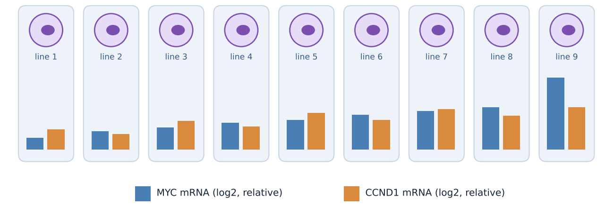
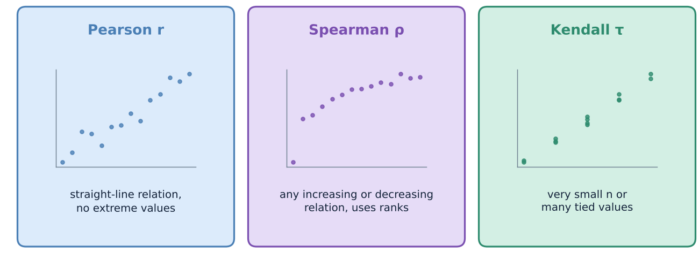
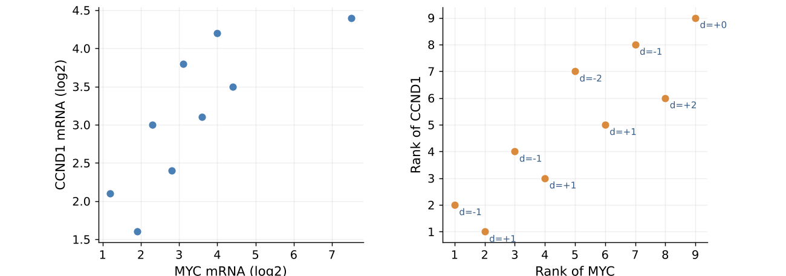
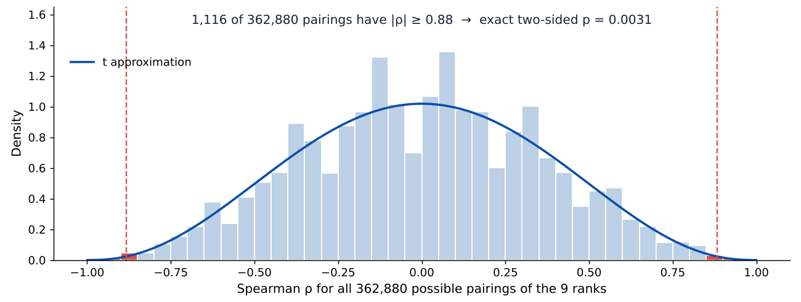
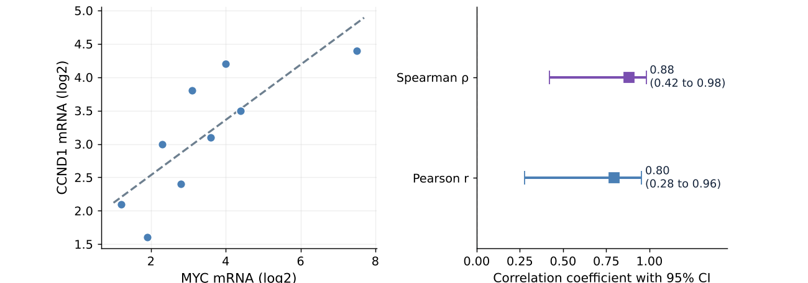
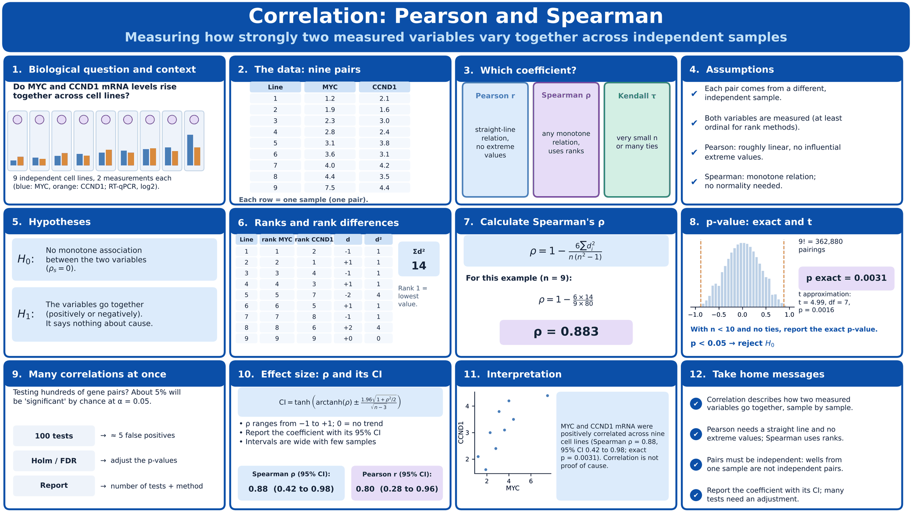

::: {.chapter-lead}
**Biostatistics · Molecular Biosciences**  
This chapter introduces **correlation**: how strongly two measurements made on the same samples vary together. One experiment is followed from start to finish: whether the expression of two genes rises and falls together across cell lines.
:::

## Learning goals

By the end of this chapter, you should be able to:

- recognise when a correlation is the right question (two measurements on each independent sample);
- choose between Pearson's $r$, Spearman's $\rho$ and Kendall's $\tau$;
- state the hypotheses and assumptions of the correlation tests;
- calculate Spearman's $\rho$ from ranks and its exact p-value;
- explain the t approximation and why extreme values affect Pearson's $r$ more;
- report a coefficient with its confidence interval, and avoid reading correlation as causation;
- run the analysis in R.

## Biological question: do MYC and CCND1 expression rise together?

The transcription factor MYC promotes cell proliferation and can switch on the gene *CCND1*, which encodes cyclin D1. A researcher measured the mRNA level of both genes by RT-qPCR in **nine independent cell lines** and asks whether lines with more MYC also have more CCND1. **This one experiment is used throughout the chapter.**

{.nostretch fig-alt="Nine cell lines with two bars each for MYC and CCND1 expression" width=100%}

Each cell line contributes **one pair of values**, so there are nine pairs. A correlation asks whether pairs with a high first value tend to have a high second value (positive correlation), a low second value (negative correlation) or no pattern.

::: {.callout-warning}
**What to tell the analyst when you submit data.** Say what one row is (here, one cell line) and that both measurements come from the same sample. State which values are **biological replicates** (different cell lines, patients or animals) and which are technical replicates (average those within each sample first). Several wells or isolates from the same sample are **not** independent pairs. Say whether any extreme value could be a typing or measurement error.
:::

## Choosing the method

A correlation does not compare groups. It describes how two **measured** variables go together, so both must be measured on every sample. The choice of coefficient depends on the shape of the relation and on the data.

{.nostretch fig-alt="Three cards: Pearson, Spearman and Kendall with example scatter plots" width=100%}

- **Pearson's $r$:** measures a **straight-line** relation. It uses the raw values, so extreme values influence it strongly.
- **Spearman's $\rho$:** measures a **monotone** relation (always increasing or always decreasing, not necessarily straight). It is Pearson's $r$ calculated on the **ranks**.
- **Kendall's $\tau$:** also rank-based; preferred with very small samples or many tied values.

## Assumptions and hypotheses

- Each pair comes from a **different, independent** sample.
- Both variables are measured (at least ordinal for the rank methods).
- **Pearson's test:** the relation is roughly linear, there are no influential extreme values and, for the t test and interval, the pairs come from a roughly bivariate normal distribution.
- **Spearman's test:** the relation is monotone. No normality is required.

The hypotheses of the Spearman test in words and symbols:

$$
H_0:\ \rho_s=0\quad\text{(no monotone association between MYC and CCND1)}
$$

$$
H_1:\ \rho_s\neq0\quad\text{(the two tend to increase together, or one tends to decrease as the other increases)}
$$

### The test is two-sided and says nothing about cause

A significant correlation shows that the variables go together, not that one **causes** the other: both may respond to a third factor (for example the proliferation rate of the line). In R:

```r
cor.test(myc, ccnd1, method = "spearman")
```

## Worked example: ranks and Spearman's rho

Rank each variable separately from 1 (lowest) to 9 (highest), then compare the two ranks of each cell line. If MYC and CCND1 go together, the ranks will be similar and the differences $d$ small.

{.nostretch fig-alt="Scatter plot of raw values and scatter plot of ranks with rank differences" width=100%}

Without ties, Spearman's coefficient is:

$$
\rho=1-\frac{6\sum d_i^2}{n\left(n^2-1\right)}
$$

For this example the squared differences add up to $\sum d^2=1+1+1+1+4+1+1+4+0=14$:

$$
\rho=1-\frac{6\times14}{9\times80}=0.88
$$

$\rho$ ranges from $-1$ (perfectly opposite order) to $+1$ (identical order). With ties, average ranks are assigned and $\rho$ is the Pearson correlation of the ranks.

## Exact p-value and the null distribution

Under $H_0$ the ranks of CCND1 could be matched to the ranks of MYC in any order. For nine cell lines there are $9!=362,880$ equally likely pairings. Each gives a $\rho$; together they form the **exact null distribution of $\rho$**.

{.nostretch fig-alt="Histogram of rho under the null with the t approximation and the observed rho marked" width=100%}

Of these, 1,116 give $|\rho|\ge0.88$, so the two-sided exact p-value is:

$$
p_{\text{exact}}=\frac{1,116}{362,880}=0.0031
$$

### Why very small samples cannot give a small p-value

With **four** pairs there are only $4!=24$ pairings. Even a perfect rank agreement ($\rho=1$) occurs in 2 of the 24 pairings (counting both directions), so $p_{\min}=2/24=0.083$. With five pairs the minimum is $2/120=0.017$.

::: {.callout-important}
This is a limit of **resolution**, not evidence of no relation. With fewer than about six pairs, a rank correlation cannot reach $p<0.05$. Report the coefficient and its interval, not only whether $p$ is below 0.05.
:::

## The t approximation

For larger samples, $r$ or $\rho$ is converted into a **t statistic** with $n-2$ degrees of freedom:

$$
t=\frac{\rho\sqrt{n-2}}{\sqrt{1-\rho^2}},\qquad df=n-2
$$

For Pearson's $r=0.80$ in our data, $t=3.47$, $df=7$ and $p=0.0104$. Applying the same formula to Spearman's $\rho$ gives $p=0.0016$, smaller than the exact value (0.0031): with only nine pairs the approximation is too optimistic. R uses the exact test for Spearman when $n<10$ and there are no ties.

### Reproducing the tests in R

```r
cor.test(myc, ccnd1, method = "spearman")
cor.test(myc, ccnd1, method = "pearson")
```

R reports Spearman's $\rho=0.88$ with exact $p=0.0031$, and Pearson's $r=0.80$ with $t=3.47$, $df=7$, $p=0.0104$.

## Many correlations at once

In omics studies a researcher often calculates **hundreds** of correlations (every gene against every other). With 100 tests at $\alpha=0.05$, about five will be "significant" by chance alone. Adjust the p-values for the number of tests, for example with **Holm's method** or the false discovery rate:

```r
p.adjust(p_values, method = "holm")
```

Report the number of correlations tested and the adjustment method. The same reasoning as for post-hoc tests in the previous chapters applies.

## Effect size: the coefficient and its interval

The coefficient is itself the effect size. Report it with a **confidence interval**, calculated on the Fisher $z$ scale:

$$
z=\operatorname{arctanh}(\rho),\qquad \text{95\% CI}=\tanh\!\left(z\pm\frac{1.96\sqrt{1+\rho^2/2}}{\sqrt{n-3}}\right)
$$

For our data, Spearman's $\rho=0.88$ (95% CI 0.42 to 0.98) and Pearson's $r=0.80$ (95% CI 0.28 to 0.96).

{.nostretch fig-alt="Scatter plot and confidence intervals of Spearman and Pearson coefficients" width=100%}

The intervals are wide because there are only nine cell lines. The square of Pearson's coefficient, $r^2=0.63$, is the share of the variance of one variable that a straight line on the other explains. Kendall's $\tau$ for these data is 0.72.
## R practical: run the analysis in your browser

The following editor runs R in the browser using WebR. No additional R package is required. A ready-to-use helper calculates Spearman's rho with a 95% confidence interval. The code runs both correlation tests.

```{=html}
<div class="webR-runner">
<div class="runner-heading">
  <div><strong>Editable R code</strong><p>Change the data or code, then select Run R.</p></div>
  <span id="rstatus" class="status" aria-live="polite">WebR has not loaded yet.</span>
</div>
<textarea id="rcode" spellcheck="false" aria-label="Editable R code">myc    &lt;- c(1.2, 1.9, 2.3, 2.8, 3.1, 3.6, 4.0, 4.4, 7.5)
ccnd1  &lt;- c(2.1, 1.6, 3.0, 2.4, 3.8, 3.1, 4.2, 3.5, 4.4)

print(cor.test(myc, ccnd1, method = "spearman"))   # exact p-value (no ties, n &lt; 10)
print(cor.test(myc, ccnd1, method = "pearson"))    # t test and Fisher z interval
print(spearman_ci(myc, ccnd1))                     # Spearman rho with 95% CI</textarea>
<div class="runner-actions">
  <button id="runR" type="button">▶ Run R</button>
  <button id="resetR" class="secondary" type="button">Reset code</button>
  <button id="loadOverlap" class="secondary" type="button">Load second-example exercise</button>
</div>
<pre id="rout" class="r-output" aria-live="polite">R output will appear here.</pre>
</div>
```


### R interpretation exercise: one mistyped value

Select **Load second-example exercise** above, or copy the code into desktop R. Here the last CCND1 value, 4.4, was typed as 44.0 by mistake.

Pearson's $r$ changes from 0.80 to 0.86 because the extreme value pulls the line, while Spearman's $\rho$ stays at 0.88: only the **order** of the values matters, and 44.0 is still the largest. Always plot the data, and check extreme values against the lab notebook before choosing or interpreting a coefficient.

## Practice questions

Answer the questions online and check the feedback. These questions are formative: use the explanations to review the relevant sections.

::: {.practice-question data-correct="B" data-explanation="A correlation needs two measurements on every sample, asking whether they vary together." data-wrong="A=Comparing one variable between two groups calls for Mann–Whitney or a t test, not a correlation.||C=Counts of categories in two groups call for a chi-square or Fisher test.||D=The same donors under three conditions is a Friedman design."}
**1. Which design calls for a correlation?**

- A. Comparing the mean of one gene between two groups of cell lines
- B. Measuring two genes in each of several independent cell lines
- C. Counting resistant and susceptible isolates in two groups
- D. Measuring the same donors under three conditions
:::

::: {.practice-question data-correct="C" data-explanation="Spearman's rho is Pearson's r on the ranks, so it detects any monotone relation, straight or curved." data-wrong="A=Straight-line relations are what Pearson's r measures. Spearman's ρ also detects curved monotone relations.||B=Spearman's test is rank-based and does not require normality.||D=ρ = 0 only means there is no monotone trend. A U-shaped relation can have ρ close to 0."}
**2. Which statement about Spearman's ρ is correct?**

- A. It measures only straight-line relations
- B. It requires both variables to be normally distributed
- C. It is Pearson's r calculated on the ranks and detects any monotone relation
- D. ρ = 0 proves that the variables are independent
:::

::: {.practice-question data-correct="A" data-explanation="The null hypothesis of the Spearman test is that there is no monotone association: ρ = 0." data-wrong="B=ρ = 1 would be perfect agreement, not the null hypothesis.||C=Equal means is a hypothesis for comparing groups, not for a correlation.||D=Normality is not part of the Spearman null hypothesis."}
**3. What is the null hypothesis of the Spearman correlation test?**

- A. There is no monotone association between the variables (ρ = 0)
- B. The two variables are perfectly correlated (ρ = 1)
- C. The two variables have the same mean
- D. Both variables are normally distributed
:::

## Practice questions: calculations and p-values

::: {.practice-question data-correct="D" data-explanation="Add the squared rank differences: 1 + 1 + 1 + 1 + 4 + 1 + 1 + 4 + 0 = 14." data-wrong="A=9 is the number of cell lines, not Σd².||B=45 is the sum of the ranks 1 to 9, not of the squared differences.||C=36 is not the sum of the squared differences. Square each d and add them."}
**4. In the worked example, what is Σd² (the sum of squared rank differences)?**

- A. 9
- B. 45
- C. 36
- D. 14
:::

::: {.practice-question data-correct="B" data-explanation="ρ = 1 − 6 × 14 / (9 × 80) = 0.883." data-wrong="A=0.14 is not 1 − 6Σd²/[n(n² − 1)]. Do not forget to subtract from 1.||C=0.80 is Pearson's r, calculated on the raw values, not Spearman's ρ.||D=ρ = 1.00 would require Σd² = 0, identical rankings."}
**5. What is Spearman's ρ in the worked example?**

- A. 0.14
- B. 0.88
- C. 0.80
- D. 1.00
:::

::: {.practice-question data-correct="C" data-explanation="The t approximation for a correlation has n − 2 degrees of freedom: 9 − 2 = 7." data-wrong="A=n − 1 = 8 is the df of a one-sample test, not of a correlation (two estimated quantities).||B=9 is the number of pairs, not the degrees of freedom.||D=n − 3 appears in the Fisher z standard error, not in the df of the t test."}
**6. How many degrees of freedom does the t approximation of the correlation test have for n = 9 pairs?**

- A. 8
- B. 9
- C. 7
- D. 6
:::

## Practice questions: extreme values and independence

::: {.practice-question data-correct="B" data-explanation="With only nine pairs the exact distribution is discrete and the t approximation is not accurate, so the exact p-value (0.0031) is preferred." data-wrong="A=A smaller p-value is not better. Choose the method that is valid for the sample size.||C=There are no ties in these data. Ties would change the method but not remove the exact test altogether.||D=The Spearman test does not need normality."}
**7. The exact p-value is 0.0031 and the t approximation gives 0.0016. Which should be reported, and why?**

- A. The approximation, because it is smaller
- B. The exact p-value, because with nine pairs the approximation is not accurate
- C. Neither, because there are ties
- D. Both are wrong because the test needs normality
:::

::: {.practice-question data-correct="A" data-explanation="Only the order of the values matters for Spearman's ρ, and 44.0 is still the largest value, so ρ is unchanged." data-wrong="B=Pearson's r uses the raw values, so an extreme value changes it (here from 0.80 to 0.86).||C=Only Spearman's ρ stays the same: Pearson's r changes.||D=Spearman's ρ is unchanged because the ranks are the same."}
**8. One CCND1 value of 4.4 was mistyped as 44.0. Which coefficient does the error not change?**

- A. Spearman's ρ
- B. Pearson's r
- C. Both coefficients
- D. Neither coefficient
:::

::: {.practice-question data-correct="C" data-explanation="Both Pearson's and Spearman's tests assume independent pairs. Wells from the same cell line are not independent pairs." data-wrong="A=Normality is not the issue here, and the Spearman test does not require it.||B=A monotone relation is a property of the data, not of the sampling design.||D=Equal variances are an assumption of group comparisons, not of correlation."}
**9. Three wells were measured from each of three cell lines and treated as nine pairs. Which assumption of the Pearson and Spearman tests is broken?**

- A. Normality of the residuals
- B. A monotone relation
- C. Independence: wells from the same cell line are not independent pairs
- D. Equal variances in the two groups
:::

::: {.callout-note}
**Interpretation reminder.** A significant correlation is not proof of causation, and a non-significant one does not prove there is no relation. Plot the data, report the coefficient with its confidence interval, and say which method and which adjustment (if any) were used.
:::

## Student notes

Use this space to record your interpretation, questions or reminders. Notes are saved locally in the current browser and device; they are not synchronised between devices.

::: {.student-notes}
<textarea id="studentNotes" aria-label="Student notes" placeholder="My notes for Chapter 6…"></textarea>
<p id="notesStatus" class="notes-status" aria-live="polite">Notes are stored locally in this browser.</p>
<button type="button" onclick="window.print()">Print / Save as PDF</button>
<button type="button" id="clearNotes" class="secondary">Clear notes</button>
:::

## Chapter recap: the complete infographic

The infographic below summarises the whole chapter. Use it to review the biological question, choice of coefficient, assumptions, hypotheses, ranks, $\rho$, p-values, multiple testing, effect size and interpretation.

{.nostretch fig-alt="Correlation chapter infographic recap with twelve panels" width=100%}

---

**End of Chapter 6 · Biostatistics for Molecular Biosciences**

```{=html}
<script>
(() => {
  const initialCode = document.getElementById('rcode').value;
  let webR = null;
  let initPromise = null;
  async function getWebR() {
    if (webR) return webR;
    if (!initPromise) {
      initPromise = (async () => {
        const module = await import('https://webr.r-wasm.org/latest/webr.mjs');
        const runtime = new module.WebR();
        await runtime.init();
        await runtime.evalRVoid(`
spearman_ci <- function(x, y, conf.level = 0.95) {
  stopifnot(length(x) == length(y), length(x) > 3)
  ok <- complete.cases(x, y); x <- x[ok]; y <- y[ok]; n <- length(x)
  rho <- cor(x, y, method = "spearman")
  se <- sqrt((1 + rho^2 / 2) / (n - 3))           # Bonett-Wright standard error
  z <- atanh(rho) + c(-1, 1) * qnorm(1 - (1 - conf.level) / 2) * se
  round(c(rho = rho, lower = tanh(z[1]), upper = tanh(z[2])), 3)
}
        `);
        webR = runtime;
        return runtime;
      })();
    }
    try { return await initPromise; }
    catch (error) { initPromise = null; throw error; }
  }
  document.getElementById('runR').addEventListener('click', async () => {
    const button = document.getElementById('runR');
    const status = document.getElementById('rstatus');
    const output = document.getElementById('rout');
    button.disabled = true;
    status.textContent = 'Loading WebR…';
    output.textContent = 'Starting R…';
    try {
      const runtime = await getWebR();
      status.textContent = 'Running R code…';
      const code = document.getElementById('rcode').value;
      const result = await runtime.evalRString(`paste(capture.output({\n${code}\n}), collapse = '\\n')`);
      output.textContent = String(result).trim() || 'R finished, but produced no visible output. Try print(object).';
      status.textContent = 'R finished. Output is shown below.';
    } catch (error) {
      status.textContent = 'R could not run. Check your internet connection and try again.';
      output.textContent = error?.message || String(error);
    } finally { button.disabled = false; }
  });
  document.getElementById('loadOverlap').addEventListener('click', () => {
    document.getElementById('rcode').value = `myc    <- c(1.2, 1.9, 2.3, 2.8, 3.1, 3.6, 4.0, 4.4, 7.5)
ccnd1  <- c(2.1, 1.6, 3.0, 2.4, 3.8, 3.1, 4.2, 3.5, 44.0)   # 4.4 typed as 44.0 by mistake

print(round(cor(myc, ccnd1, method = "pearson"), 3))    # changes with the typing error
print(round(cor(myc, ccnd1, method = "spearman"), 3))   # unchanged: only the order matters`;
    document.getElementById('rout').textContent = 'Second-example code loaded. Select Run R.';
    document.getElementById('rstatus').textContent = 'Ready to run the second-example exercise.';
  });
  document.getElementById('resetR').addEventListener('click', () => {
    document.getElementById('rcode').value = initialCode;
    document.getElementById('rout').textContent = 'R output will appear here.';
    document.getElementById('rstatus').textContent = 'Code reset. WebR has not run yet.';
  });
  document.querySelectorAll('.practice-question').forEach((box, index) => {
    const labels = Array.from(box.querySelectorAll('li'));
    if (labels.length) {
      const group = `q${index + 1}`;
      labels.forEach((li, i) => {
        const input = document.createElement('input');
        input.type = 'radio'; input.name = group; input.value = ['A','B','C','D'][i];
        input.setAttribute('aria-label', li.textContent.trim());
        li.prepend(input, document.createTextNode(' '));
      });
    }
    const feedback = document.createElement('p');
    feedback.className = 'feedback'; feedback.setAttribute('aria-live','polite');
    const check = document.createElement('button'); check.type = 'button'; check.textContent = 'Check answer';
    check.addEventListener('click', () => {
      const selected = box.querySelector('input[type="radio"]:checked');
      const short = box.querySelector('.short-answer');
      const value = selected ? selected.value : (short ? short.value.trim() : '');
      if (!value) { feedback.textContent = 'Choose or enter an answer first.'; feedback.className = 'feedback incorrect'; return; }
      const ok = value.toUpperCase() === box.dataset.correct.toUpperCase();
      let msg = ok ? 'Correct. ' + box.dataset.explanation : 'Not quite. ';
      if (!ok) {
        const wrong = {};
        (box.dataset.wrong || '').split('||').forEach(p => { const i = p.indexOf('='); if (i > 0) wrong[p.slice(0, i).trim()] = p.slice(i + 1).trim(); });
        if (wrong[value.toUpperCase()]) msg += 'Why ' + value.toUpperCase() + ' is wrong: ' + wrong[value.toUpperCase()] + ' ';
        msg += 'The correct answer is ' + box.dataset.correct.toUpperCase() + ': ' + box.dataset.explanation;
      }
      feedback.textContent = msg;
      feedback.className = 'feedback ' + (ok ? 'correct' : 'incorrect');
    });
    box.append(check, feedback);
  });
  const notes = document.getElementById('studentNotes');
  const key = `biostatistics-course-${location.pathname}-chapter-6-notes`;
  const status = document.getElementById('notesStatus');
  try {
    notes.value = localStorage.getItem(key) || '';
    notes.addEventListener('input', () => {
      try { localStorage.setItem(key, notes.value); status.textContent = 'Saved in this browser.'; }
      catch (e) { status.textContent = 'Autosave is unavailable; print or copy your notes before leaving.'; }
    });
  } catch (e) { status.textContent = 'Browser storage is unavailable; print or copy your notes before leaving.'; }
  document.getElementById('clearNotes').addEventListener('click', () => {
    notes.value = '';
    try { localStorage.removeItem(key); status.textContent = 'Notes cleared in this browser.'; }
    catch (e) { status.textContent = 'Notes cleared from the text area.'; }
  });
})();
</script>
```
