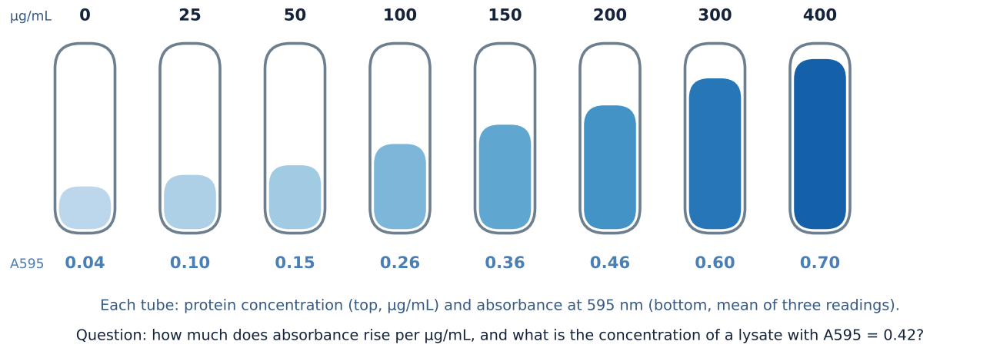
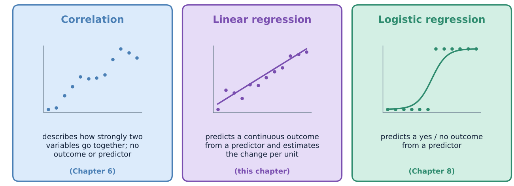
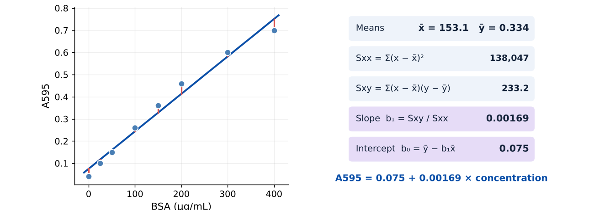
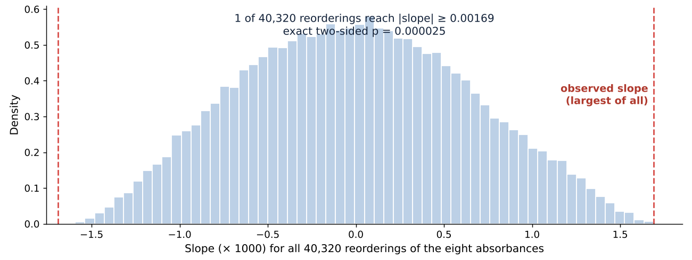
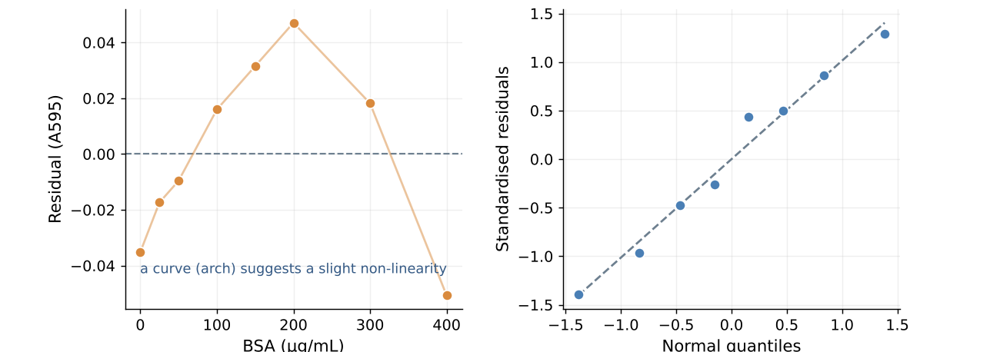
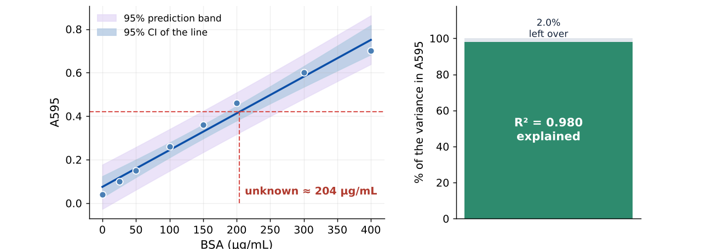
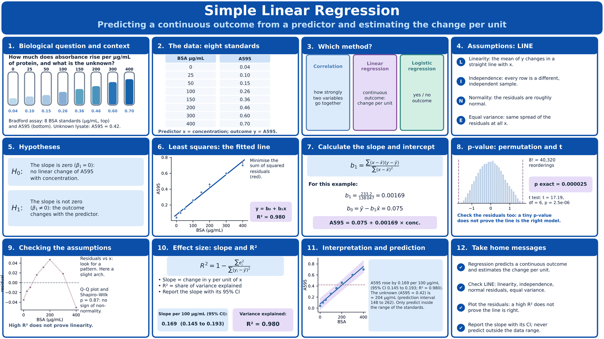

::: {.chapter-lead}
**Biostatistics · Molecular Biosciences**  
This chapter introduces **simple linear regression**: fitting a straight line to predict a continuous outcome from a predictor. One experiment is followed from start to finish: a protein standard curve used to measure the concentration of an unknown sample.
:::

## Learning goals

By the end of this chapter, you should be able to:

- recognise when a regression (rather than a correlation) is the right question;
- fit a least-squares line and interpret the slope, intercept and $R^2$;
- state the hypotheses and the four assumptions of linear regression;
- explain the exact permutation p-value and the t test for the slope;
- check the assumptions with residual plots;
- give a confidence interval for the slope and a prediction interval for a new sample;
- run the analysis in R.

## Biological question: how much protein is in the lysate?

The Bradford assay turns protein concentration into a blue colour: the more protein, the more light is absorbed at 595 nm (A595). To measure an unknown lysate, a researcher first measures **eight standards** of bovine serum albumin (BSA) of known concentration, and asks how much the absorbance rises for each extra µg/mL. The unknown lysate then gave A595 = 0.42. **This one experiment is used throughout the chapter.**

{.nostretch fig-alt="Eight tubes with increasing blue colour and their absorbance values" width=100%}

The concentration is the **predictor** (the variable we choose, $x$) and the absorbance is the **outcome** (the variable we measure, $y$). Unlike a correlation, a regression gives a **prediction rule**: for any concentration it tells us the expected absorbance.

::: {.callout-warning}
**What to tell the analyst when you submit data.** Say which variable is the predictor and which is the outcome. Say what one row is, and whether the values are means of technical replicates (here, each absorbance is the mean of three readings of one tube). Report the range of the standards: predictions are only valid **inside** that range. If the same sample appears in several rows, or rows are measured in several batches, tell the analyst, because the rows are then not independent.
:::

## Choosing the method

Regression answers a different question from the tests in the previous chapters: not "do groups differ?" but "how does the outcome change with a measured predictor?".

{.nostretch fig-alt="Three cards comparing correlation, linear regression and logistic regression" width=100%}

- **Correlation (Chapter 6):** how strongly two variables go together; the two are treated symmetrically.
- **Linear regression:** a continuous outcome is explained by a predictor; it estimates the **change in $y$ per unit of $x$**.
- **Logistic regression (Chapter 8):** the outcome is yes or no.

## Assumptions and hypotheses

The assumptions of the linear regression t test are easy to remember as **LINE**:

- **L**inearity: the mean of $y$ changes in a straight line with $x$.
- **I**ndependence: every observation comes from a different, independent sample.
- **N**ormality: the **residuals** (the distances from the line) are roughly normal.
- **E**qual variance: the residuals have the same spread at all values of $x$.

The hypotheses of the test of the slope in words and symbols:

$$
H_0:\ \beta_1=0\quad\text{(absorbance does not change with concentration)}
$$

$$
H_1:\ \beta_1\neq0\quad\text{(absorbance changes with concentration)}
$$

### Model and R code

The model is $y_i=\beta_0+\beta_1x_i+\varepsilon_i$, where $\varepsilon_i$ is the random error. In R:

```r
fit <- lm(a595 ~ bsa)
summary(fit)
```

## Worked example: fitting the line by least squares

The **least-squares line** is the line that makes the sum of the squared vertical distances (the residuals, in red) as small as possible. It has a closed form:

{.nostretch fig-alt="Scatter plot with fitted line and residuals, and a table of the calculation steps" width=100%}

$$
b_1=\frac{\sum(x_i-\bar x)(y_i-\bar y)}{\sum(x_i-\bar x)^2}=\frac{233.2}{138,047}=0.00169,\qquad b_0=\bar y-b_1\bar x=0.334-0.00169\times153.1=0.075
$$

The fitted line is $\widehat{\text{A595}}=0.075+0.00169\times\text{concentration}$. Each extra 100 µg/mL of BSA raises the absorbance by about 0.169.

## Exact p-value: a permutation test of the slope

If absorbance and concentration were unrelated, the eight absorbances could have been matched to the eight concentrations in any order. There are $8!=40,320$ equally likely reorderings. Each gives a slope; together they form the **exact null distribution of the slope**.

{.nostretch fig-alt="Histogram of permuted slopes with the observed slope at the far right edge" width=100%}

Only 1 of the 40,320 reorderings gives a slope as extreme as the observed one (the original order, in which absorbance increases with every step), so:

$$
p_{\text{exact}}=\frac{1}{40,320}=0.000025
$$

::: {.callout-important}
An exact permutation p-value can never be smaller than $1/n!$ (here $0.000025$). A tiny p-value of this kind says the relation is very unlikely to be chance, not that the line is a good model: check the residuals as well.
:::

## The t test for the slope

The usual p-value uses the **t distribution** with $n-2$ degrees of freedom, because two parameters ($b_0$ and $b_1$) were estimated:

$$
t=\frac{b_1}{SE(b_1)},\qquad SE(b_1)=\frac{s}{\sqrt{\sum(x_i-\bar x)^2}},\qquad s=\sqrt{\frac{\sum e_i^2}{n-2}}
$$

For our data $s=0.0365$, $SE(b_1)=0.00010$, $t=17.19$ with $df=6$ and $p=2.5e-06$. The overall F test of the model gives the same result, $F=t^2=295.5$. This p-value is smaller than the exact one because it relies on the normal-residual assumption rather than on the reordering argument.

### Reproducing the test in R

`summary(fit)` reports the estimate, standard error, t value and p-value of each coefficient, the residual standard error and $R^2$:

```r
summary(fit)
confint(fit)
```

## Checking the assumptions: residual plots

A small p-value does not show that the line is a good model. Look at the **residuals** $e_i=y_i-\hat y_i$:

{.nostretch fig-alt="Residual plot showing an arch and a normal Q-Q plot" width=100%}

- **Residuals against $x$:** points should scatter randomly around zero. Here they form a slight **arch** (negative at both ends, positive in the middle): the calibration curve flattens a little at high concentration, so the straight line is only an approximation.
- **Normal Q-Q plot:** points should follow the dashed line. They do (Shapiro–Wilk $p=0.87$), but with eight points this test has little power.
- **Spread:** the vertical spread should look similar at all $x$. With eight points it is hard to judge: do not rely on a test alone.

A high $R^2$ does not prove linearity: the arch shows that the line is least accurate at the ends. A residual pattern calls for a better model (for example a curve or a transformation), not for a smaller p-value.

## Effect size and prediction

The **slope** is the effect size: the change in $y$ per unit of $x$, reported with its confidence interval. $R^2$ is the share of the variance of $y$ explained by the line.

For our data the slope is 0.169 absorbance units per 100 µg/mL (95% CI 0.145 to 0.193), the intercept is 0.075 (95% CI 0.027 to 0.124) and $R^2=0.980$.

{.nostretch fig-alt="Regression line with confidence and prediction bands and R squared bar" width=100%}

There are two different intervals for a new sample:

- the **confidence interval** describes where the **mean** absorbance at a given concentration lies;
- the **prediction interval** is wider and describes where a **single new measurement** will fall. At 250 µg/mL the predicted absorbance is 0.50 (95% prediction interval 0.40 to 0.59).

To measure the unknown lysate, invert the line: $x_0=(0.42-0.075)/0.00169\approx204$ µg/mL. Allowing for the uncertainty of a single new measurement, it lies between about 148 and 262 µg/mL.

::: {.callout-note}
Never predict **outside** the range of the standards (0 to 400 µg/mL here): the relation may curve, and the assumptions have not been checked there.
:::
## R practical: run the analysis in your browser

The following editor runs R in the browser using WebR. No additional R package is required. A ready-to-use helper inverts the calibration line to estimate the concentration of an unknown sample, with an interval. The code fits the model, checks the residuals and makes predictions.

```{=html}
<div class="webR-runner">
<div class="runner-heading">
  <div><strong>Editable R code</strong><p>Change the data or code, then select Run R.</p></div>
  <span id="rstatus" class="status" aria-live="polite">WebR has not loaded yet.</span>
</div>
<textarea id="rcode" spellcheck="false" aria-label="Editable R code">bsa  &lt;- c(0, 25, 50, 100, 150, 200, 300, 400)             # ug/mL
a595 &lt;- c(0.04, 0.10, 0.15, 0.26, 0.36, 0.46, 0.60, 0.70)

fit &lt;- lm(a595 ~ bsa)
print(summary(fit))                   # slope, t test, R-squared
print(confint(fit))                   # 95% confidence intervals

print(shapiro.test(residuals(fit)))   # normality of the residuals
print(round(residuals(fit), 3))       # look for a pattern: plot(fit, which = 1)

print(predict(fit, data.frame(bsa = 250), interval = "prediction"))
print(inverse_predict(fit, y0 = 0.42))  # concentration of the unknown sample</textarea>
<div class="runner-actions">
  <button id="runR" type="button">▶ Run R</button>
  <button id="resetR" class="secondary" type="button">Reset code</button>
  <button id="loadOverlap" class="secondary" type="button">Load second-example exercise</button>
</div>
<pre id="rout" class="r-output" aria-live="polite">R output will appear here.</pre>
</div>
```


### R interpretation exercise: standards that curve

Select **Load second-example exercise** above, or copy the code into desktop R. Here the standards extend to 800 µg/mL and the absorbance flattens at high concentration.

A straight line still has $R^2=0.925$, but the residuals form a clear arch (−0.09, −0.06, −0.04, then +0.11, +0.13, +0.04 and −0.12). Adding a squared term gives $R^2=0.998$ and removes the pattern. High $R^2$ and a tiny p-value do not make a line the right model: always look at the residuals.

## Practice questions

Answer the questions online and check the feedback. These questions are formative: use the explanations to review the relevant sections.

::: {.practice-question data-correct="B" data-explanation="A regression predicts a continuous outcome from a predictor and gives the change per unit." data-wrong="A=Comparing two groups calls for Mann–Whitney or a t test.||C=Counts of resistant and susceptible isolates call for a chi-square or Fisher test.||D=Three related conditions call for a Friedman test."}
**1. Which question calls for a simple linear regression?**

- A. Do two groups of cell lines differ in median expression?
- B. How much does absorbance increase for each extra µg/mL of protein?
- C. Is resistance more frequent in mutant than in wild-type isolates?
- D. Do three conditions differ within the same donors?
:::

::: {.practice-question data-correct="C" data-explanation="The slope is the change in y per one-unit increase in x." data-wrong="A=The strength of an association is measured by a correlation coefficient. The slope is in the units of y per x.||B=That is the intercept b₀.||D=That is R²."}
**2. What does the slope b₁ measure?**

- A. The strength of the correlation
- B. The value of y when x = 0
- C. The change in the outcome for one unit increase in the predictor
- D. The share of variance explained
:::

::: {.practice-question data-correct="A" data-explanation="The null hypothesis of the test of the slope is β₁ = 0: no linear change of y with x." data-wrong="B=R² = 1 would mean a perfect fit and is not a null hypothesis.||C=Normality of residuals is an assumption of the test, not its null hypothesis.||D=The intercept has its own test. The null hypothesis of the slope test concerns β₁."}
**3. What is the null hypothesis of the t test for the slope in linear regression?**

- A. β₁ = 0: the outcome does not change linearly with the predictor
- B. R² = 1
- C. The residuals are normal
- D. The intercept equals zero
:::

## Practice questions: fitting and testing

::: {.practice-question data-correct="D" data-explanation="Add the squared vertical distances: least squares minimises Σe², not the sum of the signed distances." data-wrong="A=The signed residuals always sum to zero for the least-squares line, so that cannot be what is minimised.||B=That would be a different method (minimax). Least squares uses all the points.||C=That is a different method (least absolute deviations)."}
**4. What does the least-squares line minimise?**

- A. The sum of the residuals
- B. The largest residual
- C. The sum of the absolute values of the residuals
- D. The sum of the squared residuals
:::

::: {.practice-question data-correct="B" data-explanation="With n = 8 and two estimated parameters (b₀ and b₁), the residual degrees of freedom are 8 − 2 = 6." data-wrong="A=8 is the number of standards, not the degrees of freedom.||C=n − 1 = 7 would apply if only one parameter was estimated. Regression estimates two.||D=2 is the number of estimated parameters, not the residual degrees of freedom."}
**5. How many degrees of freedom does the t test of the slope have with n = 8 standards?**

- A. 8
- B. 6
- C. 7
- D. 2
:::

::: {.practice-question data-correct="A" data-explanation="Residuals should scatter randomly around zero; an arch means the relation is not exactly linear." data-wrong="B=An arch in the residuals says nothing about the slope being zero. It signals a poor model.||C=Perfect data would give residuals scattered randomly around zero.||D=A pattern in the residuals is not caused by a large sample."}
**6. The residuals plotted against x form a clear arch. What does this indicate?**

- A. The relation is not linear, so the straight-line model is inadequate
- B. The slope is zero
- C. The data are perfect
- D. The sample size is too large
:::

## Practice questions: checking assumptions and prediction

::: {.practice-question data-correct="C" data-explanation="The prediction interval for one new measurement is wider than the confidence interval for the mean, because it includes the random error of a single observation." data-wrong="A=Both are 95% intervals. The difference is what they describe.||B=It includes the uncertainty of the line plus the random error of a single new observation.||D=Both intervals assume normal residuals."}
**7. Why is the 95% prediction interval wider than the 95% confidence interval of the line?**

- A. It uses a different confidence level
- B. It ignores the uncertainty of the slope
- C. It describes a single new observation, which also has random error
- D. It assumes the residuals are not normal
:::

::: {.practice-question data-correct="D" data-explanation="Predictions are only reliable inside the range of the standards (0 to 400 µg/mL). The relation may curve outside it." data-wrong="A=The line was only checked inside the range of the standards. Beyond 400 µg/mL the relation may curve.||B=A p-value for the slope does not make extrapolation valid.||C=Extrapolation makes the uncertainty larger, not smaller."}
**8. An unknown sample has an absorbance that corresponds to 600 µg/mL on the line, beyond the highest standard (400). What should you do?**

- A. Report 600 µg/mL because the line is straight
- B. Use the exact permutation p-value
- C. Report it with a smaller interval
- D. Dilute the sample so it falls within the range of the standards and measure again
:::

::: {.practice-question data-correct="C" data-explanation="The rows from the same tube are not independent, which breaks the independence assumption (the I in LINE) of the t test for the slope." data-wrong="A=Linearity concerns the shape of the relation, not how the rows were obtained.||B=Equal variance is about the spread of the residuals, not how rows were entered.||D=Regression does not require x to be normal. The assumption concerns the residuals."}
**9. Three readings from one tube were entered as three separate rows. Which assumption of the regression t test is broken?**

- A. Linearity
- B. Equal variance
- C. Independence: readings from the same tube are not independent observations
- D. Normality of x
:::

::: {.callout-note}
**Interpretation reminder.** A significant slope and a high R² do not prove that the line is the right model or that x causes y. Look at the residuals, report the slope with its confidence interval, and do not predict outside the range of the data.
:::

## Student notes

Use this space to record your interpretation, questions or reminders. Notes are saved locally in the current browser and device; they are not synchronised between devices.

::: {.student-notes}
<textarea id="studentNotes" aria-label="Student notes" placeholder="My notes for Chapter 7…"></textarea>
<p id="notesStatus" class="notes-status" aria-live="polite">Notes are stored locally in this browser.</p>
<button type="button" onclick="window.print()">Print / Save as PDF</button>
<button type="button" id="clearNotes" class="secondary">Clear notes</button>
:::

## Chapter recap: the complete infographic

The infographic below summarises the whole chapter. Use it to review the biological question, method choice, assumptions, hypotheses, least squares, p-values, residual checks, effect size and prediction.

{.nostretch fig-alt="Linear regression chapter infographic recap with twelve panels" width=100%}

---

**End of Chapter 7 · Biostatistics for Molecular Biosciences**

```{=html}
<script>
(() => {
  const initialCode = document.getElementById('rcode').value;
  let webR = null;
  let initPromise = null;
  async function getWebR() {
    if (webR) return webR;
    if (!initPromise) {
      initPromise = (async () => {
        const module = await import('https://webr.r-wasm.org/latest/webr.mjs');
        const runtime = new module.WebR();
        await runtime.init();
        await runtime.evalRVoid(`
inverse_predict <- function(fit, y0, level = 0.95) {
  # Concentration x0 whose predicted response is y0, with the x-range where the
  # prediction interval of the line contains y0 (valid inside the range of the standards).
  mf <- model.frame(fit); xn <- names(mf)[2]; x <- mf[[2]]
  edge <- function(v, col) {
    nd <- setNames(data.frame(v), xn)
    predict(fit, nd, interval = "prediction", level = level)[, col] - y0
  }
  x0 <- (y0 - coef(fit)[1]) / coef(fit)[2]
  lo <- uniroot(edge, range(x), col = "upr")$root
  hi <- uniroot(edge, range(x), col = "lwr")$root
  round(c(estimate = unname(x0), lower = lo, upper = hi), 1)
}
        `);
        webR = runtime;
        return runtime;
      })();
    }
    try { return await initPromise; }
    catch (error) { initPromise = null; throw error; }
  }
  document.getElementById('runR').addEventListener('click', async () => {
    const button = document.getElementById('runR');
    const status = document.getElementById('rstatus');
    const output = document.getElementById('rout');
    button.disabled = true;
    status.textContent = 'Loading WebR…';
    output.textContent = 'Starting R…';
    try {
      const runtime = await getWebR();
      status.textContent = 'Running R code…';
      const code = document.getElementById('rcode').value;
      const result = await runtime.evalRString(`paste(capture.output({\n${code}\n}), collapse = '\\n')`);
      output.textContent = String(result).trim() || 'R finished, but produced no visible output. Try print(object).';
      status.textContent = 'R finished. Output is shown below.';
    } catch (error) {
      status.textContent = 'R could not run. Check your internet connection and try again.';
      output.textContent = error?.message || String(error);
    } finally { button.disabled = false; }
  });
  document.getElementById('loadOverlap').addEventListener('click', () => {
    document.getElementById('rcode').value = `bsa  <- c(0, 25, 50, 100, 200, 400, 600, 800)             # standards up to 800 ug/mL
a595 <- c(0.04, 0.10, 0.15, 0.26, 0.46, 0.70, 0.82, 0.88)

fit <- lm(a595 ~ bsa)
print(round(summary(fit)$r.squared, 3))   # R-squared is still high
print(round(residuals(fit), 3))           # but the residuals form an arch: the line is wrong

fit2 <- lm(a595 ~ bsa + I(bsa^2))         # a curved calibration fits better
print(round(summary(fit2)$r.squared, 3))
print(round(residuals(fit2), 3))`;
    document.getElementById('rout').textContent = 'Second-example code loaded. Select Run R.';
    document.getElementById('rstatus').textContent = 'Ready to run the second-example exercise.';
  });
  document.getElementById('resetR').addEventListener('click', () => {
    document.getElementById('rcode').value = initialCode;
    document.getElementById('rout').textContent = 'R output will appear here.';
    document.getElementById('rstatus').textContent = 'Code reset. WebR has not run yet.';
  });
  document.querySelectorAll('.practice-question').forEach((box, index) => {
    const labels = Array.from(box.querySelectorAll('li'));
    if (labels.length) {
      const group = `q${index + 1}`;
      labels.forEach((li, i) => {
        const input = document.createElement('input');
        input.type = 'radio'; input.name = group; input.value = ['A','B','C','D'][i];
        input.setAttribute('aria-label', li.textContent.trim());
        li.prepend(input, document.createTextNode(' '));
      });
    }
    const feedback = document.createElement('p');
    feedback.className = 'feedback'; feedback.setAttribute('aria-live','polite');
    const check = document.createElement('button'); check.type = 'button'; check.textContent = 'Check answer';
    check.addEventListener('click', () => {
      const selected = box.querySelector('input[type="radio"]:checked');
      const short = box.querySelector('.short-answer');
      const value = selected ? selected.value : (short ? short.value.trim() : '');
      if (!value) { feedback.textContent = 'Choose or enter an answer first.'; feedback.className = 'feedback incorrect'; return; }
      const ok = value.toUpperCase() === box.dataset.correct.toUpperCase();
      let msg = ok ? 'Correct. ' + box.dataset.explanation : 'Not quite. ';
      if (!ok) {
        const wrong = {};
        (box.dataset.wrong || '').split('||').forEach(p => { const i = p.indexOf('='); if (i > 0) wrong[p.slice(0, i).trim()] = p.slice(i + 1).trim(); });
        if (wrong[value.toUpperCase()]) msg += 'Why ' + value.toUpperCase() + ' is wrong: ' + wrong[value.toUpperCase()] + ' ';
        msg += 'The correct answer is ' + box.dataset.correct.toUpperCase() + ': ' + box.dataset.explanation;
      }
      feedback.textContent = msg;
      feedback.className = 'feedback ' + (ok ? 'correct' : 'incorrect');
    });
    box.append(check, feedback);
  });
  const notes = document.getElementById('studentNotes');
  const key = `biostatistics-course-${location.pathname}-chapter-7-notes`;
  const status = document.getElementById('notesStatus');
  try {
    notes.value = localStorage.getItem(key) || '';
    notes.addEventListener('input', () => {
      try { localStorage.setItem(key, notes.value); status.textContent = 'Saved in this browser.'; }
      catch (e) { status.textContent = 'Autosave is unavailable; print or copy your notes before leaving.'; }
    });
  } catch (e) { status.textContent = 'Browser storage is unavailable; print or copy your notes before leaving.'; }
  document.getElementById('clearNotes').addEventListener('click', () => {
    notes.value = '';
    try { localStorage.removeItem(key); status.textContent = 'Notes cleared in this browser.'; }
    catch (e) { status.textContent = 'Notes cleared from the text area.'; }
  });
})();
</script>
```
