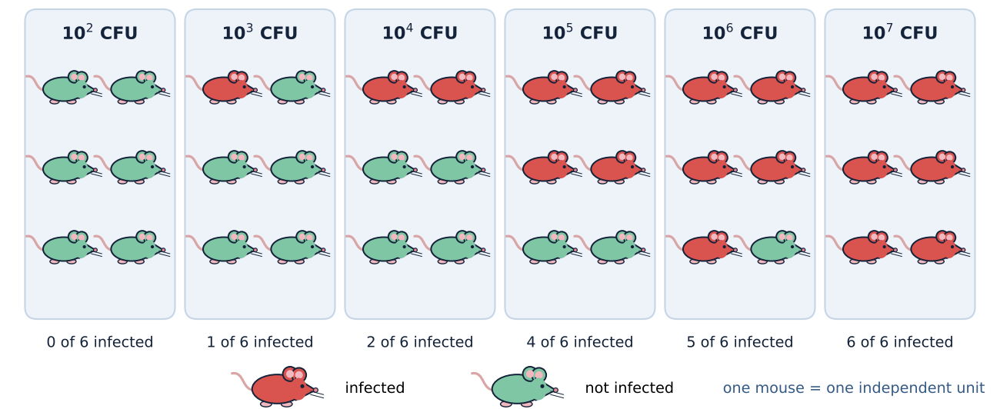
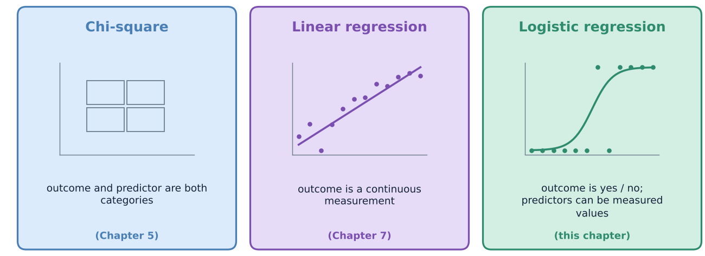
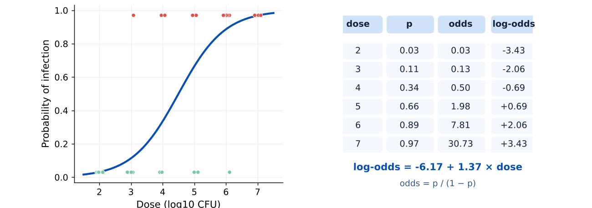
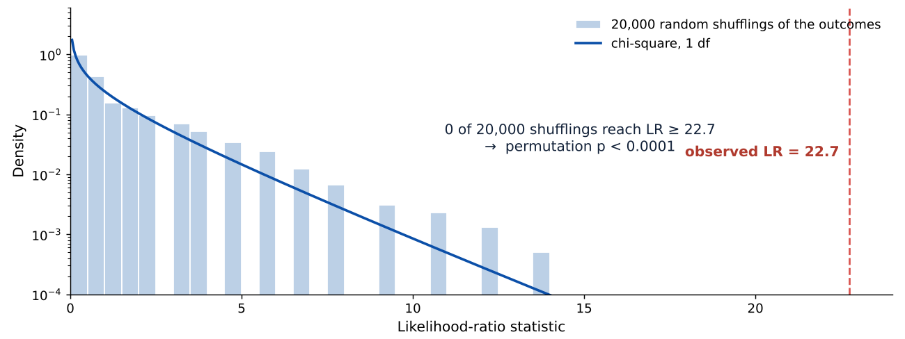
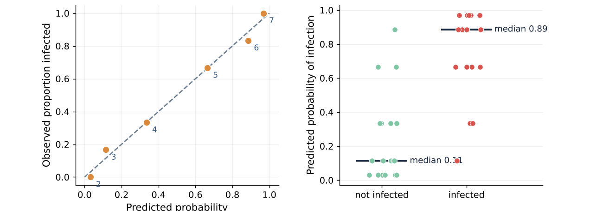
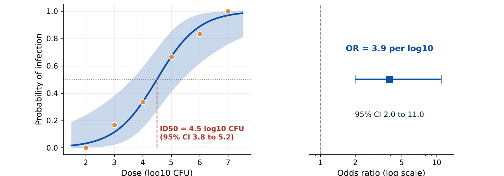
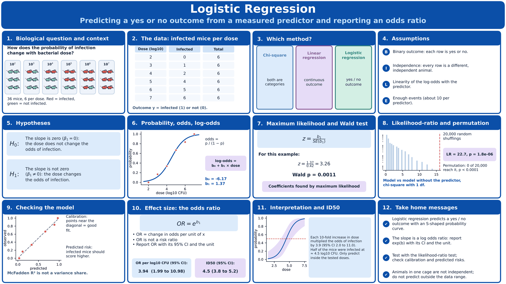

::: {.chapter-lead}
**Biostatistics · Molecular Biosciences**  
This chapter introduces **logistic regression**: predicting a yes or no outcome from a measured predictor. One experiment is followed from start to finish: mice given increasing doses of a bacterium, infected or not infected.
:::

## Learning goals

By the end of this chapter, you should be able to:

- recognise when the outcome is yes or no and logistic regression is the right tool;
- explain probability, odds and log-odds;
- interpret the slope as a log odds ratio and report the odds ratio with its interval;
- state the hypotheses and assumptions, and run the Wald and likelihood-ratio tests;
- check the model with a calibration plot and the predicted risks;
- estimate the dose that infects half of the animals (ID50);
- run the analysis in R.

## Biological question: how does infection depend on dose?

Thirty-six mice are divided into six groups of six. Each group receives a different dose of a bacterium, from 10² to 10⁷ colony-forming units (CFU). After a week each mouse is classed as **infected** or **not infected**. **This one experiment is used throughout the chapter.**

{.nostretch fig-alt="Six boxes of mice, one per dose, with infected mice in red" width=100%}

The outcome has only two values, so a straight line is the wrong model: it would predict probabilities below 0 or above 1. Logistic regression models the **probability of infection** with an S-shaped curve.

::: {.callout-warning}
**What to tell the analyst when you submit data.** Say what one row is (here, one mouse) and what the outcome is. Give the dose as a number, not as a label. Say how many animals were in each group and whether any were housed together in a cage: mice in the same cage are not independent. Report the range of doses tested: predictions are only valid inside it.
:::

## Choosing the method

{.nostretch fig-alt="Three cards comparing chi-square, linear regression and logistic regression" width=100%}

- **Chi-square (Chapter 5):** outcome and predictor are both categories.
- **Linear regression (Chapter 7):** the outcome is a continuous measurement.
- **Logistic regression:** the outcome is yes or no and the predictor can be a measured value (or several predictors).

## Assumptions and hypotheses

The assumptions of logistic regression are:

- **Binary outcome:** each observation is yes or no.
- **Independence:** every row is a different, independent animal.
- **Linearity on the log-odds scale:** the log-odds of the outcome change in a straight line with the predictor.
- **Enough events:** a rough rule is at least 10 of the rarer outcome for each predictor in the model.

There is **no** normality or equal-variance assumption for the residuals. The hypotheses for the slope are:

$$
H_0:\ \beta_1=0\quad\text{(the dose does not change the odds of infection)}
$$

$$
H_1:\ \beta_1\neq0\quad\text{(the dose changes the odds of infection)}
$$

### Model and R code

With $p$ the probability of infection, the model is

$$
\log\frac{p}{1-p}=\beta_0+\beta_1\,x
$$

In R:

```r
fit <- glm(infected ~ dose, family = binomial)
summary(fit)
```

## Worked example: probability, odds and log-odds

The **odds** are $p/(1-p)$: at $p=0.5$ the odds are 1, at $p=0.8$ they are 4. The **log-odds** (logit) can take any value, which is why a straight line can be fitted to them. The fitted model is

$$
\log\frac{p}{1-p}=-6.17+1.37\times\text{dose}
$$

{.nostretch fig-alt="Fitted S-shaped curve with the mice and a table of probability, odds and log-odds" width=100%}

The log-odds rise by the same amount (1.37) for each extra log10 unit of dose, whereas the probability does not: it changes slowly at the extremes and fastest near 50%. At dose 10³ the model gives $p=0.11$.

## Estimating the coefficients: maximum likelihood

Logistic regression has no closed formula like least squares. The coefficients are found by **maximum likelihood**: the values that make the observed pattern of infected and healthy mice most probable. Software searches for them iteratively.

The standard error of the slope is 0.42. The **Wald test** divides the estimate by its standard error:

$$
z=\frac{b_1}{SE(b_1)}=\frac{1.37}{0.42}=3.26,\qquad p=0.0011
$$

## The likelihood-ratio test and a permutation check

A better test compares the fitted model with a model without dose. Twice the difference of their log-likelihoods is the **likelihood-ratio statistic**, which follows a chi-square distribution with 1 degree of freedom when $H_0$ is true:

$$
LR=-2\,(\ell_0-\ell_1)=22.7,\qquad p=1.8e-06
$$

To check this without relying on the chi-square approximation, shuffle the 36 outcomes at random across the doses, refit, and record the statistic. This was done 20,000 times.

{.nostretch fig-alt="Histogram of permuted likelihood ratio statistics with observed value far right" width=100%}

Only 0 of the 20,000 shufflings reaches the observed statistic, so the permutation p-value is below 0.0001 (strictly, it is less than $1/20,000$, and it is never reported as exactly zero).

::: {.callout-important}
The Wald test is quick but can be unreliable with small groups or extreme probabilities. The likelihood-ratio test is preferred, and it is the one that `anova(fit, test = "Chisq")` gives.
:::

## Checking the model: calibration and predicted risk

A significant p-value does not show that the model describes the data well.

{.nostretch fig-alt="Calibration plot and predicted probabilities of infected and healthy mice" width=100%}

- **Calibration:** the points should lie close to the diagonal. They do, so the S-curve fits the six dose groups.
- **Predicted risk:** infected mice should receive higher predicted probabilities than healthy mice. Here the infected mice have a clearly higher median predicted probability, although the two groups overlap: some healthy mice at high doses and some infected mice at low doses are not predicted well.
- **McFadden pseudo-$R^2$** = 0.46. This is not the share of variance explained and is not comparable with the $R^2$ of linear regression.

## Effect size: the odds ratio

Exponentiating the slope gives the **odds ratio** for one unit of the predictor:

$$
OR=e^{b_1}=e^{1.37}=3.94
$$

Each 10-fold increase in dose multiplies the odds of infection by about 3.94. The 95% profile-likelihood interval is 1.99 to 10.98 (the Wald interval, 1.73 to 8.96, is narrower and less reliable here).

{.nostretch fig-alt="Fitted curve with confidence band and ID50, and an odds ratio forest plot" width=100%}

An odds ratio is **not** a risk ratio: they are close only when the event is rare. Report the odds ratio with its interval, and say which unit of the predictor it refers to.

The **ID50** is the dose at which $p=0.5$, i.e. where the log-odds equal zero: $x=-b_0/b_1=4.5$ log10 CFU (95% CI 3.8 to 5.2, delta method).

::: {.callout-note}
Never predict outside the range of doses tested (10² to 10⁷ CFU here). Logistic regression also does not prove that the dose causes infection: it describes how the two go together in this experiment.
:::
## R practical: run the analysis in your browser

The following editor runs R in the browser using WebR. No additional R package is required. A ready-to-use helper computes the ID50 with an interval. The code fits the logistic model, gives the odds ratios and the likelihood-ratio test, and predicts probabilities.

```{=html}
<div class="webR-runner">
<div class="runner-heading">
  <div><strong>Editable R code</strong><p>Change the data or code, then select Run R.</p></div>
  <span id="rstatus" class="status" aria-live="polite">WebR has not loaded yet.</span>
</div>
<textarea id="rcode" spellcheck="false" aria-label="Editable R code">dose     &lt;- rep(2:7, each = 6)                                  # log10 CFU per mouse
infected &lt;- c(rep(c(1, 0), c(0, 6)), rep(c(1, 0), c(1, 5)), rep(c(1, 0), c(2, 4)),
              rep(c(1, 0), c(4, 2)), rep(c(1, 0), c(5, 1)), rep(c(1, 0), c(6, 0)))
print(table(dose, infected))

fit &lt;- glm(infected ~ dose, family = binomial)
print(summary(fit))                         # coefficients and Wald z tests
print(round(exp(cbind(OR = coef(fit), confint(fit))), 2))   # odds ratios, profile 95% CI
print(anova(fit, test = "Chisq"))           # likelihood ratio test

print(round(predict(fit, data.frame(dose = 2:7), type = "response"), 3))
print(id50_ci(fit))                         # dose giving 50% infection</textarea>
<div class="runner-actions">
  <button id="runR" type="button">▶ Run R</button>
  <button id="resetR" class="secondary" type="button">Reset code</button>
  <button id="loadOverlap" class="secondary" type="button">Load second-example exercise</button>
</div>
<pre id="rout" class="r-output" aria-live="polite">R output will appear here.</pre>
</div>
```


### R interpretation exercise: too few animals

Select **Load second-example exercise** above, or copy the code into desktop R. The same experiment is repeated with only **3 mice per dose**.

The slope is still positive ($b_1=0.605$), but its standard error is large (0.384), the Wald $p=0.116$ and the odds ratio is 1.83 with a 95% interval of 0.86 to 3.89, which includes 1. The data are compatible with no effect of dose. A non-significant result from a small experiment is not evidence that the dose has no effect: it shows that the experiment had too little information.

## Practice questions

Answer the questions online and check the feedback. These questions are formative: use the explanations to review the relevant sections.

::: {.practice-question data-correct="C" data-explanation="The outcome (infected or not) has two values, so logistic regression is the method of choice." data-wrong="A=A continuous outcome calls for linear regression.||B=Comparing a continuous measurement between two groups calls for Mann–Whitney.||D=Three related conditions call for a Friedman test."}
**1. Which question calls for logistic regression?**

- A. How much does absorbance increase per µg/mL of protein?
- B. Do two groups of cell lines differ in median expression?
- C. How does the probability of infection change with bacterial dose?
- D. Do three conditions differ within the same donors?
:::

::: {.practice-question data-correct="B" data-explanation="Odds are p/(1−p): with p = 0.8 the odds are 0.8/0.2 = 4." data-wrong="A=0.8 is the probability, not the odds.||C=0.25 would be the odds of not being infected (0.2/0.8).||D=1.25 is 1/0.8, which is not the odds."}
**2. A mouse has an 80% probability of infection. What are the odds of infection?**

- A. 0.8
- B. 4
- C. 0.25
- D. 1.25
:::

::: {.practice-question data-correct="D" data-explanation="The slope is the change in log-odds per unit of x; its exponential is the odds ratio." data-wrong="A=The probability does not change by a constant amount: it follows an S-curve.||B=That depends on the intercept, and it is a probability, not an odds ratio.||C=Logistic regression has no variance-explained R² of that kind."}
**3. What does exp(b₁) represent in logistic regression?**

- A. The change in probability per unit of x
- B. The probability when x = 0
- C. The share of variance explained
- D. The odds ratio for one unit increase in the predictor
:::

## Practice questions: odds and the model

::: {.practice-question data-correct="A" data-explanation="Dose is an exposure variable on the log scale, and b₁ = 1.37 gives OR = e^1.37 ≈ 3.9 per 10-fold increase." data-wrong="B=The slope is on the log-odds scale, so it is not a change in probability.||C=A slope is not a percentage of animals.||D=A correlation cannot exceed 1."}
**4. The slope is b₁ = 1.37 per log10 CFU. How is it interpreted?**

- A. Each 10-fold increase in dose multiplies the odds of infection by about 3.9
- B. Each 10-fold increase in dose adds 1.37 percentage points to the probability
- C. 137% of mice are infected
- D. The correlation between dose and infection is 1.37
:::

::: {.practice-question data-correct="C" data-explanation="The likelihood-ratio test compares the fitted model with a model without the predictor." data-wrong="A=That describes the chi-square test of a contingency table.||B=That describes rank tests such as Mann–Whitney.||D=Logistic regression has no normal residuals to compare."}
**5. What does the likelihood-ratio test for the slope compare?**

- A. Observed and expected counts in a table
- B. The ranks of two groups
- C. The model with dose against the model without dose
- D. The residuals with a normal distribution
:::

::: {.practice-question data-correct="B" data-explanation="Points close to the diagonal mean that the observed proportions are close to the predicted probabilities." data-wrong="A=Calibration does not test the slope. A well-calibrated model can have a very significant slope.||C=A steep S-curve that follows the points shows a strong dose effect.||D=Logistic regression has no variance explained in that sense, and calibration does not measure it."}
**6. In the calibration plot the six points lie close to the diagonal. What does this mean?**

- A. The slope is not significant
- B. The predicted probabilities agree well with the observed proportions infected
- C. The dose has no effect
- D. The model explains 100% of the variance
:::

## Practice questions: testing and checking

::: {.practice-question data-correct="D" data-explanation="Mice housed in the same cage share their environment, so they are not independent observations." data-wrong="A=A binary outcome is exactly what logistic regression is for.||B=A numeric predictor is allowed.||C=Logistic regression has no normal-residual assumption."}
**7. Which problem makes the p-value of a logistic regression unreliable?**

- A. The outcome has two categories
- B. The dose is a number
- C. The residuals are not normal
- D. Several mice share a cage and are treated as independent animals
:::

::: {.practice-question data-correct="A" data-explanation="The ID50 is where the log-odds are zero: −b₀/b₁." data-wrong="B=The median of the doses tested is a design choice and says nothing about the response.||C=A p-value is not a dose.||D=The highest dose gives almost all animals infected, not half."}
**8. How is the dose that infects half of the mice (ID50) obtained?**

- A. Solve for the dose where the log-odds equal zero: −b₀/b₁
- B. Take the median dose tested
- C. Take the dose with the lowest p-value
- D. Take the highest dose
:::

::: {.practice-question data-correct="C" data-explanation="Two mice from the same cage are not independent, which breaks the independence assumption of logistic regression." data-wrong="A=Linearity concerns the shape of the relation, not how the animals were housed.||B=The outcome is still infected or not infected.||D=Logistic regression has no normal-residuals assumption."}
**9. Mice were housed six per cage, one cage per dose, and each mouse was entered as a separate row. Which assumption of logistic regression is broken?**

- A. Linearity on the log-odds scale
- B. Binary outcome
- C. Independence: mice in the same cage share their environment
- D. Normal residuals
:::

::: {.callout-note}
**Interpretation reminder.** Report the odds ratio with its confidence interval and the unit of the predictor, check calibration, and remember that an odds ratio is not a risk ratio and that a model does not prove causation.
:::

## Student notes

Use this space to record your interpretation, questions or reminders. Notes are saved locally in the current browser and device; they are not synchronised between devices.

::: {.student-notes}
<textarea id="studentNotes" aria-label="Student notes" placeholder="My notes for Chapter 8…"></textarea>
<p id="notesStatus" class="notes-status" aria-live="polite">Notes are stored locally in this browser.</p>
<button type="button" onclick="window.print()">Print / Save as PDF</button>
<button type="button" id="clearNotes" class="secondary">Clear notes</button>
:::

## Chapter recap: the complete infographic

The infographic below summarises the whole chapter. Use it to review the biological question, method choice, assumptions, hypotheses, odds and log-odds, tests, model checks, odds ratio and ID50.

{.nostretch fig-alt="Logistic regression chapter infographic recap with twelve panels" width=100%}

---

**End of Chapter 8 · Biostatistics for Molecular Biosciences**

```{=html}
<script>
(() => {
  const initialCode = document.getElementById('rcode').value;
  let webR = null;
  let initPromise = null;
  async function getWebR() {
    if (webR) return webR;
    if (!initPromise) {
      initPromise = (async () => {
        const module = await import('https://webr.r-wasm.org/latest/webr.mjs');
        const runtime = new module.WebR();
        await runtime.init();
        await runtime.evalRVoid(`
id50_ci <- function(fit, level = 0.95) {
  # Dose with 50% probability (ID50) and Wald interval by the delta method.
  b <- coef(fit); V <- vcov(fit)
  id <- unname(-b[1] / b[2])
  g <- c(-1 / b[2], b[1] / b[2]^2)
  se <- sqrt(as.numeric(t(g) %*% V %*% g))
  z <- qnorm(1 - (1 - level) / 2)
  round(c(ID50 = id, lower = id - z * se, upper = id + z * se), 2)
}
        `);
        webR = runtime;
        return runtime;
      })();
    }
    try { return await initPromise; }
    catch (error) { initPromise = null; throw error; }
  }
  document.getElementById('runR').addEventListener('click', async () => {
    const button = document.getElementById('runR');
    const status = document.getElementById('rstatus');
    const output = document.getElementById('rout');
    button.disabled = true;
    status.textContent = 'Loading WebR…';
    output.textContent = 'Starting R…';
    try {
      const runtime = await getWebR();
      status.textContent = 'Running R code…';
      const code = document.getElementById('rcode').value;
      const result = await runtime.evalRString(`paste(capture.output({\n${code}\n}), collapse = '\\n')`);
      output.textContent = String(result).trim() || 'R finished, but produced no visible output. Try print(object).';
      status.textContent = 'R finished. Output is shown below.';
    } catch (error) {
      status.textContent = 'R could not run. Check your internet connection and try again.';
      output.textContent = error?.message || String(error);
    } finally { button.disabled = false; }
  });
  document.getElementById('loadOverlap').addEventListener('click', () => {
    document.getElementById('rcode').value = `dose     <- rep(2:7, each = 3)                                  # only 3 mice per dose
infected <- c(0,0,0,  1,0,0,  0,0,0,  1,0,0,  1,0,0,  1,1,0)
print(table(dose, infected))

fit <- glm(infected ~ dose, family = binomial)
print(round(summary(fit)$coefficients, 3))       # large standard error, weak evidence
print(round(exp(cbind(OR = coef(fit), confint.default(fit))), 2))`;
    document.getElementById('rout').textContent = 'Second-example code loaded. Select Run R.';
    document.getElementById('rstatus').textContent = 'Ready to run the second-example exercise.';
  });
  document.getElementById('resetR').addEventListener('click', () => {
    document.getElementById('rcode').value = initialCode;
    document.getElementById('rout').textContent = 'R output will appear here.';
    document.getElementById('rstatus').textContent = 'Code reset. WebR has not run yet.';
  });
  document.querySelectorAll('.practice-question').forEach((box, index) => {
    const labels = Array.from(box.querySelectorAll('li'));
    if (labels.length) {
      const group = `q${index + 1}`;
      labels.forEach((li, i) => {
        const input = document.createElement('input');
        input.type = 'radio'; input.name = group; input.value = ['A','B','C','D'][i];
        input.setAttribute('aria-label', li.textContent.trim());
        li.prepend(input, document.createTextNode(' '));
      });
    }
    const feedback = document.createElement('p');
    feedback.className = 'feedback'; feedback.setAttribute('aria-live','polite');
    const check = document.createElement('button'); check.type = 'button'; check.textContent = 'Check answer';
    check.addEventListener('click', () => {
      const selected = box.querySelector('input[type="radio"]:checked');
      const short = box.querySelector('.short-answer');
      const value = selected ? selected.value : (short ? short.value.trim() : '');
      if (!value) { feedback.textContent = 'Choose or enter an answer first.'; feedback.className = 'feedback incorrect'; return; }
      const ok = value.toUpperCase() === box.dataset.correct.toUpperCase();
      let msg = ok ? 'Correct. ' + box.dataset.explanation : 'Not quite. ';
      if (!ok) {
        const wrong = {};
        (box.dataset.wrong || '').split('||').forEach(p => { const i = p.indexOf('='); if (i > 0) wrong[p.slice(0, i).trim()] = p.slice(i + 1).trim(); });
        if (wrong[value.toUpperCase()]) msg += 'Why ' + value.toUpperCase() + ' is wrong: ' + wrong[value.toUpperCase()] + ' ';
        msg += 'The correct answer is ' + box.dataset.correct.toUpperCase() + ': ' + box.dataset.explanation;
      }
      feedback.textContent = msg;
      feedback.className = 'feedback ' + (ok ? 'correct' : 'incorrect');
    });
    box.append(check, feedback);
  });
  const notes = document.getElementById('studentNotes');
  const key = `biostatistics-course-${location.pathname}-chapter-8-notes`;
  const status = document.getElementById('notesStatus');
  try {
    notes.value = localStorage.getItem(key) || '';
    notes.addEventListener('input', () => {
      try { localStorage.setItem(key, notes.value); status.textContent = 'Saved in this browser.'; }
      catch (e) { status.textContent = 'Autosave is unavailable; print or copy your notes before leaving.'; }
    });
  } catch (e) { status.textContent = 'Browser storage is unavailable; print or copy your notes before leaving.'; }
  document.getElementById('clearNotes').addEventListener('click', () => {
    notes.value = '';
    try { localStorage.removeItem(key); status.textContent = 'Notes cleared in this browser.'; }
    catch (e) { status.textContent = 'Notes cleared from the text area.'; }
  });
})();
</script>
```
