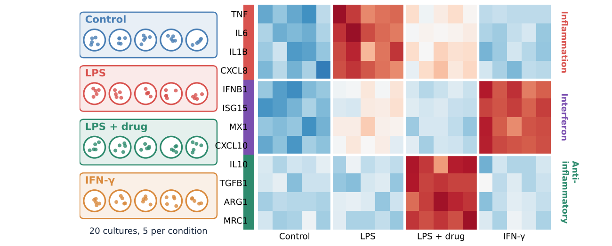
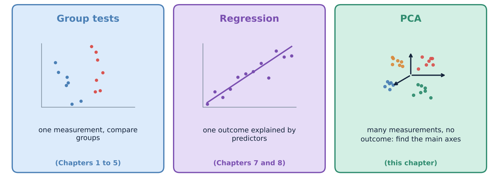
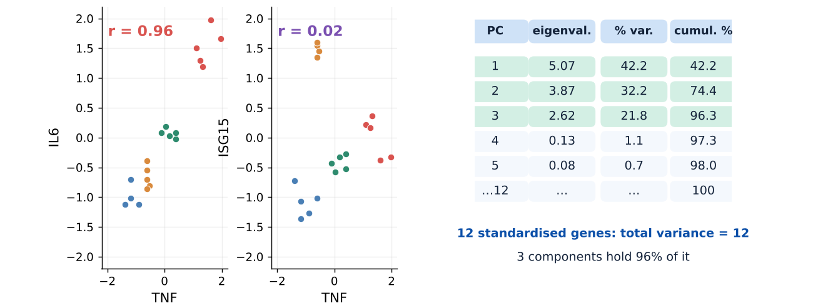
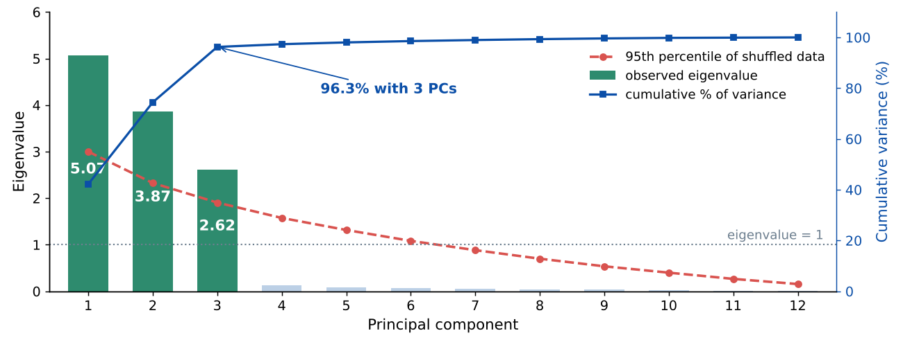
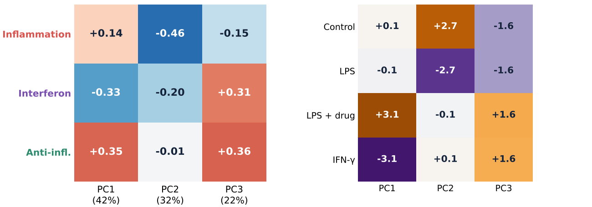
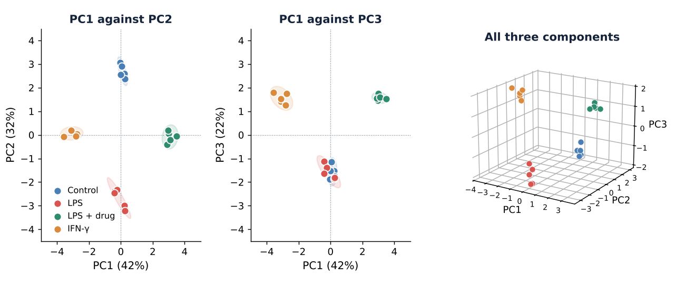
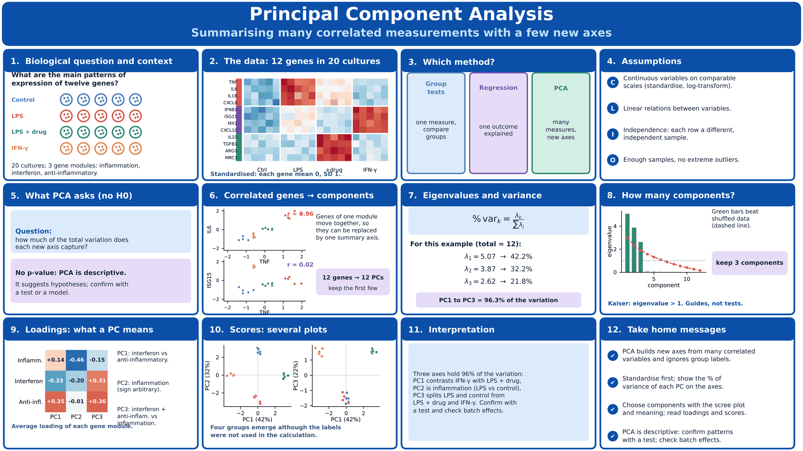

::: {.chapter-lead}
**Biostatistics · Molecular Biosciences**  
This chapter introduces **principal component analysis (PCA)**: a way to summarise many correlated measurements by a few new axes and to see the main patterns in a dataset. One experiment is followed from start to finish: the expression of twelve genes in macrophages.
:::

## Learning goals

By the end of this chapter, you should be able to:

- recognise when PCA is useful and what question it answers;
- explain why variables are usually standardised first;
- read eigenvalues, the percentage of variance explained and a scree plot;
- decide how many components to keep;
- interpret loadings and scores, and read plots of several components;
- state the assumptions and limits of PCA;
- run the analysis in R with `prcomp`.

## Biological question: what are the main patterns of gene expression?

Macrophages were grown in four conditions, **five cultures each**: untreated (**control**), stimulated with lipopolysaccharide (**LPS**, a bacterial component that triggers inflammation), stimulated with LPS plus an anti-inflammatory **drug**, and stimulated with **interferon-γ (IFN-γ)**. The expression (log2 scale) of twelve genes was measured in each culture: four inflammatory genes (TNF, IL6, IL1B, CXCL8), four interferon-response genes (IFNB1, ISG15, MX1, CXCL10) and four anti-inflammatory genes (IL10, TGFB1, ARG1, MRC1). **This one experiment is used throughout the chapter.**

{.nostretch fig-alt="Four groups of five cultures and a heatmap of twelve genes in three modules" width=100%}

Twelve genes in 20 cultures are impossible to inspect one at a time. A regression or a scatter plot shows only two variables at once; PCA looks at all twelve together and finds a small number of new variables, the **principal components**, that capture most of the variation. It does not use the condition labels: any grouping that appears comes from the data.

::: {.callout-warning}
**What to tell the analyst when you submit data.** Say what one row is (here, one culture) and what each column is. Say whether the values are on a log scale and whether each row is an independent biological replicate or a repeat of the same sample. Say which groups exist (they are used for colouring, not for the calculation), and report any batch or plate: batch effects often show up as a principal component.
:::

## Choosing the method

{.nostretch fig-alt="Three cards comparing group tests, regression and PCA" width=100%}

- **Group tests (Chapters 1 to 5):** one measurement at a time, compared between groups.
- **Regression (Chapters 7 and 8):** one outcome explained by one or more predictors; the axes are chosen by us.
- **PCA:** many measurements and no outcome: *what are the main directions of variation?* The axes are **new variables built from the data**, and there can be as many as there are original variables. It is a descriptive, exploratory method and, unlike the tests, it has no p-value of its own.

## Assumptions and what PCA asks

PCA has no null hypothesis. It asks how much of the total variation is captured by each new axis. Its assumptions are about whether the summary is meaningful:

- **Continuous variables** measured on a comparable and sensible scale (log-transformed if skewed).
- **Linear relations:** PCA summarises linear correlation between variables; curved relations are missed.
- **Independence:** each row is a different, independent sample.
- **Enough samples** compared with variables, and no extreme outliers: one wild point can create a component.
- **Variance is information:** PCA assumes the directions with large variation are the interesting ones.

### Model and R code

Each principal component is a weighted sum of the standardised variables. In R:

```r
pca <- prcomp(expr, scale. = TRUE)
summary(pca)
```

## Worked example: what a principal component is

First standardise each gene (subtract its mean and divide by its standard deviation) so that all genes have mean 0 and standard deviation 1. Otherwise a gene reported in large numbers dominates only because of its units.

The genes are not independent: the four genes of a module rise and fall together (for example TNF and IL6, $r=0.96$; IFNB1 and ISG15, $r=0.97$), while genes of different modules are almost uncorrelated. Genes that carry the same information can be replaced by one summary variable. The **first principal component (PC1)** is the direction in the 12-gene space along which the samples vary most; **PC2** is the direction at right angles to it that captures the most of what remains, and so on.

{.nostretch fig-alt="Two scatter plots of gene pairs and a table of eigenvalues" width=100%}

Mathematically, the components are the eigenvectors of the correlation matrix, and the **eigenvalues** give the variance of each component. With twelve standardised genes the total variance is 12, so

$$
\text{proportion of variance of PC}_k=\frac{\lambda_k}{\sum\lambda_j}=\frac{\lambda_k}{12}
$$

For our data $\lambda_1=5.07$ (42.2%), $\lambda_2=3.87$ (32.2%) and $\lambda_3=2.62$ (21.8%): together, the first three components hold 96.3% of the variation of twelve genes. The next component has $\lambda_4=0.13$ only.

## How many components? The scree plot

A **scree plot** shows the eigenvalue of each component. We keep the components before the "elbow", where the bars drop to a flat tail. Two rules of thumb help:

- **Kaiser rule:** keep components with an eigenvalue above 1 (more variation than one original standardised gene).
- **Comparison with shuffled data:** shuffle each gene independently across samples, which destroys the correlations, and compute the eigenvalues. Repeated 2,000 times, the 95th percentile gives a reference line. Components above it carry more structure than expected by chance.

{.nostretch fig-alt="Bar plot of eigenvalues with a dashed line for shuffled data and a cumulative curve" width=100%}

PC1 (5.07, reference about 3.0), PC2 (3.87, about 2.3) and PC3 (2.62, about 1.9) are all above chance and above 1; PC4 and the following components are far below and are treated as noise. **Three components are kept**, and with them the 12-dimensional data are summarised in three numbers per culture.

::: {.callout-important}
These are guides, not tests: there is no single right number of components. Choose with the scree plot, the biological meaning of the components, and the aim of the analysis.
:::

## Loadings: what each component means

The **loadings** are the weights of each gene in a component, between −1 and 1 (the figure shows the average of the four genes of each module; `pca$rotation` gives every gene). Genes with large loadings of the same sign move together; opposite signs mean they contrast. The **score** of a culture is its position along a component.

{.nostretch fig-alt="Tables of average module loadings and mean scores by condition" width=100%}

- **PC1 (42.2%):** interferon genes have negative loadings (about −0.33) and anti-inflammatory genes positive loadings (about +0.35). PC1 contrasts the **IFN-γ** cultures (score −3.1) with the **LPS + drug** cultures (+3.1).
- **PC2 (32.2%):** only the four inflammatory genes load strongly (about −0.45). PC2 is an **inflammation axis**: LPS cultures have a low score (−2.7) and control cultures a high one (+2.7).
- **PC3 (21.8%):** interferon and anti-inflammatory genes load positively and inflammatory genes slightly negatively. PC3 separates the cultures that were not stimulated by LPS alone (control and LPS, −1.6) from LPS + drug and IFN-γ (+1.6).

The sign of a component is arbitrary: the software may flip it between runs or programs (here a high inflammation is a low PC2 score). What matters is the relative signs of the loadings. Also note that a component does not have to match one condition: PCA finds directions of variation, and the biology is read from the loadings and the scores.

## Scores: looking at several components

With three components we need more than one plot: each plot shows two of them, and a 3D plot shows all three at once.

{.nostretch fig-alt="Two score plots and a three dimensional plot of the samples" width=100%}

How to read the plots:

- the four conditions form four tight, well separated groups, although the labels were not used to compute the components;
- PC1 against PC2 separates all four: control and LPS on the PC2 axis, IFN-γ and LPS + drug on the PC1 axis;
- PC1 against PC3 shows that control and LPS lie close together on both of these axes: they differ only in PC2;
- no single plot shows everything, which is why the percentage of variance of each component is written on the axes.

::: {.callout-note}
PCA is descriptive. A pattern in a PCA plot suggests hypotheses, but does not by itself prove that the groups differ: confirm with a test or a model. Also check that the separation is not a batch or plate effect.
:::

## Reporting a PCA

Report whether and how the data were transformed and standardised, the percentage of variance of the components shown (in the axis labels), the criterion used to choose the number of components, and the loadings. Colour points by a known variable such as condition or batch to help interpretation.
## R practical: run the analysis in your browser

The following editor runs R in the browser using WebR. No additional R package is required. A ready-to-use helper compares the eigenvalues with those of shuffled data. The code runs the PCA, prints the eigenvalues and loadings, and plots the samples.

```{=html}
<div class="webR-runner">
<div class="runner-heading">
  <div><strong>Editable R code</strong><p>Change the data or code, then select Run R.</p></div>
  <span id="rstatus" class="status" aria-live="polite">WebR has not loaded yet.</span>
</div>
<textarea id="rcode" spellcheck="false" aria-label="Editable R code">genes &lt;- c("TNF", "IL6", "IL1B", "CXCL8", "IFNB1", "ISG15", "MX1", "CXCL10", "IL10", "TGFB1", "ARG1", "MRC1")
condition &lt;- factor(rep(c("Control", "LPS", "LPS + drug", "IFN-gamma"), each = 5),
                    levels = c("Control", "LPS", "LPS + drug", "IFN-gamma"))
expr &lt;- rbind(
  c(4.8, 4.5, 5.7, 5.7, 3.3, 3.3, 3.8, 2.7, 4.8, 7.7, 2.7, 6.2),
  c(5.2, 3.7, 6.3, 6.4, 2.5, 3.5, 3.6, 3.2, 4.2, 7.9, 3.0, 5.7),
  c(4.8, 3.9, 4.9, 5.6, 2.2, 3.9, 3.8, 2.3, 4.6, 7.1, 2.9, 5.8),
  c(4.5, 3.7, 5.0, 6.2, 3.0, 4.6, 2.8, 3.6, 4.5, 7.6, 2.9, 6.6),
  c(5.6, 4.5, 5.6, 4.7, 3.3, 4.0, 3.4, 3.2, 5.0, 7.6, 2.8, 5.7),
  c(9.2, 9.0, 9.7, 10.2, 4.8, 5.4, 5.9, 5.3, 4.1, 7.2, 3.6, 6.4),
  c(8.7, 9.6, 10.1, 10.5, 4.9, 5.3, 5.9, 6.0, 5.2, 7.1, 3.7, 5.8),
  c(8.0, 8.7, 8.4, 10.1, 5.5, 6.5, 6.7, 5.4, 4.4, 7.7, 3.5, 5.8),
  c(8.2, 8.3, 9.2, 9.8, 4.9, 6.4, 5.8, 5.8, 4.6, 7.8, 2.5, 6.0),
  c(8.3, 8.1, 9.9, 9.5, 5.6, 6.8, 5.7, 4.8, 4.4, 7.2, 3.2, 5.6),
  c(7.0, 5.8, 7.8, 7.2, 4.2, 5.5, 3.9, 4.8, 8.6, 10.0, 6.2, 8.9),
  c(6.3, 6.0, 7.1, 8.3, 3.7, 5.2, 4.8, 3.6, 8.2, 9.7, 6.7, 8.7),
  c(6.7, 5.9, 8.0, 8.8, 4.0, 5.4, 4.8, 4.4, 7.1, 9.8, 7.3, 8.9),
  c(7.0, 6.0, 7.7, 8.0, 4.4, 5.0, 4.4, 4.3, 8.5, 9.7, 7.0, 8.7),
  c(6.5, 6.2, 7.8, 8.4, 4.0, 4.9, 3.8, 3.9, 8.6, 9.7, 6.8, 9.3),
  c(5.6, 4.5, 5.3, 6.8, 8.6, 9.2, 9.1, 9.5, 3.5, 8.1, 2.4, 6.3),
  c(5.7, 4.3, 5.7, 6.2, 7.8, 9.0, 8.3, 8.9, 4.6, 7.5, 3.1, 5.8),
  c(5.6, 4.8, 6.4, 5.7, 8.3, 9.3, 7.7, 8.7, 4.2, 7.8, 3.6, 6.6),
  c(5.6, 5.1, 6.0, 6.5, 7.3, 8.8, 8.4, 8.6, 4.2, 7.4, 3.4, 6.3),
  c(5.6, 4.2, 5.6, 6.4, 7.7, 9.3, 8.5, 8.8, 4.7, 7.6, 3.1, 5.8))
colnames(expr) &lt;- genes     # one row per culture, one column per gene (log2 expression)
print(round(cor(expr)[1:6, 1:6], 2))    # genes of the same module are strongly correlated

pca &lt;- prcomp(expr, scale. = TRUE)       # scale. = TRUE: standardise each gene first
print(round(summary(pca)$importance[, 1:5], 3))   # sd, proportion and cumulative proportion
print(round(pca$sdev^2, 2))              # eigenvalues
print(round(pca$rotation[, 1:3], 2))     # loadings of PC1, PC2 and PC3
sc &lt;- pca$x[, 1:3]
print(round(rowsum(sc, condition) / 5, 2))   # mean score of each condition on PC1 to PC3

print(parallel_analysis(expr, B = 500)[1:5, ])   # helper: eigenvalues vs shuffled data
op &lt;- par(mfrow = c(1, 2))
plot(sc[, 1], sc[, 2], col = as.integer(condition) + 1, pch = 19, xlab = "PC1", ylab = "PC2")
plot(sc[, 2], sc[, 3], col = as.integer(condition) + 1, pch = 19, xlab = "PC2", ylab = "PC3")
legend("topleft", levels(condition), col = 2:5, pch = 19, cex = 0.8)
par(op)</textarea>
<div class="runner-actions">
  <button id="runR" type="button">▶ Run R</button>
  <button id="resetR" class="secondary" type="button">Reset code</button>
  <button id="loadOverlap" class="secondary" type="button">Load second-example exercise</button>
</div>
<pre id="rout" class="r-output" aria-live="polite">R output will appear here.</pre>
</div>
```


### R interpretation exercise: forgetting to standardise

Select **Load second-example exercise** above, or copy the code into desktop R. Here IL6 is reported on the raw scale (2 to the power of the log2 value), so its numbers are far larger than those of the other genes.

With `scale. = FALSE` the first component holds essentially 100% of the variance and its loading is 1.00 for IL6: PC1 is just IL6, because it has the largest variance. With `scale. = TRUE` all genes weigh the same again and three components (about 42%, 31% and 23%) are recovered. Standardise whenever variables have different units or scales, and use log-scale expression for skewed data.

## Practice questions

Answer the questions online and check the feedback. These questions are formative: use the explanations to review the relevant sections.

::: {.practice-question data-correct="D" data-explanation="PCA summarises many correlated measurements by a few components without using an outcome." data-wrong="A=Comparing one measurement between two groups calls for Mann–Whitney.||B=A yes or no outcome calls for logistic regression.||C=A continuous outcome explained by a predictor calls for linear regression."}
**1. Which question calls for a principal component analysis?**

- A. Do two groups differ in median expression of one gene?
- B. How does the probability of infection change with dose?
- C. How much does absorbance increase per µg/mL of protein?
- D. What are the main patterns of variation across twelve correlated genes?
:::

::: {.practice-question data-correct="B" data-explanation="Genes with large variance would dominate otherwise; standardising gives each gene variance 1." data-wrong="A=Standardising changes the scale, not the shape of the distribution.||C=Outliers stay in the data after standardising.||D=The number of components equals the number of variables, whatever the scaling."}
**2. Why are variables usually standardised before PCA?**

- A. To make the data normal
- B. So that variables with large numbers do not dominate only because of their units
- C. To remove the outliers
- D. To increase the number of components
:::

::: {.practice-question data-correct="A" data-explanation="With twelve standardised variables the total variance is 12, so a component with eigenvalue 3.87 holds 3.87/12 ≈ 32%." data-wrong="B=68% is the share that is not explained by PC2 (100 − 32), not the share PC2 explains.||C=3.87 is an eigenvalue, not a percentage.||D=That is 12/3.87, the inverse of the ratio."}
**3. Twelve standardised genes give a total variance of 12. PC2 has an eigenvalue of 3.87. What share of the variance does PC2 explain?**

- A. About 32%
- B. About 68%
- C. 3.87%
- D. About 3.1%
:::

## Practice questions: components and variance

::: {.practice-question data-correct="C" data-explanation="The loadings are the weights of each variable in a component; opposite signs mean the variables contrast." data-wrong="A=A large loading means the module is strongly involved in PC1, not that it is unrelated.||B=The loading is a weight, not a percentage of variance.||D=A large loading means the gene is influential, not removed."}
**4. On PC1 the interferon genes have loadings of about −0.33 and the anti-inflammatory genes about +0.35. What does this mean?**

- A. The two modules are not correlated with anything
- B. PC1 explains 35% of the variance
- C. Cultures high in the interferon genes tend to be low in the anti-inflammatory genes along PC1, and the reverse
- D. The interferon genes were removed from the analysis
:::

::: {.practice-question data-correct="D" data-explanation="Components far below the shuffled-data reference are treated as noise; those above it carry structure." data-wrong="A=Keeping all twelve would give no summary.||B=PC2 and PC3 are also above the reference line.||C=PC4 to PC12 are below the reference, so they are not kept."}
**5. PC1, PC2 and PC3 exceed the 95th percentile of eigenvalues from shuffled data and PC4 to PC12 do not. How many components are kept by this rule?**

- A. Twelve
- B. One
- C. Nine
- D. Three
:::

::: {.practice-question data-correct="B" data-explanation="The condition labels were not used, so separation in the plot comes from the data." data-wrong="A=PCA does not need groups: it is unsupervised.||C=No labels are used for any group.||D=PCA does not use p-values."}
**6. The four conditions form separate groups in the score plot. Were the condition labels used to compute the components?**

- A. Yes, PCA needs the groups
- B. No, PCA ignores the labels; they are only used for colouring
- C. Yes, but only for the controls
- D. No, because PCA uses the p-values
:::

## Practice questions: interpretation and pitfalls

::: {.practice-question data-correct="A" data-explanation="The sign of a component is arbitrary: the software can flip it without changing the result." data-wrong="B=Both are correct: the sign is arbitrary.||C=Standardising changes the scale of the genes, not the sign of a component.||D=The relationships between samples and genes are the same in both plots."}
**7. A colleague obtains the same plot with PC2 upside down. What does this mean?**

- A. Nothing important: the sign of a component is arbitrary
- B. One of the analyses is wrong
- C. The data were not standardised
- D. The inflammation effect is reversed
:::

::: {.practice-question data-correct="D" data-explanation="PCA describes patterns; it does not test whether groups differ." data-wrong="A=PCA does not produce a p-value.||B=A map of samples does not show a cure.||C=A component is a summary of the data, not a cause."}
**8. The score plots show four separate clouds. What is the correct conclusion?**

- A. The groups differ significantly at p < 0.05
- B. The drug cures inflammation
- C. PC1 is the cause of the differences
- D. The pattern is a hypothesis to confirm with a test or model, after checking batch effects
:::

::: {.practice-question data-correct="C" data-explanation="Unstandardised PCA is dominated by the variable with the largest variance, which breaks the assumption of comparable scales." data-wrong="A=Independence concerns how the samples were obtained, not the scale of the variables.||B=PCA does not model residuals and requires no normality of residuals.||D=PCA does not use groups, so group sizes do not matter."}
**9. IL6 was entered on the raw scale and the other genes on the log2 scale, with no standardisation. Which assumption of PCA is broken?**

- A. Independence of the samples
- B. Normality of the residuals
- C. The variables are on comparable scales: IL6 dominates PC1 only because of its units
- D. Equal group sizes
:::

::: {.callout-note}
**Interpretation reminder.** PCA is descriptive: report the transformation and standardisation, the percentage of variance of each component shown and the loadings, check for batch effects, and confirm group differences with a test.
:::

## Student notes

Use this space to record your interpretation, questions or reminders. Notes are saved locally in the current browser and device; they are not synchronised between devices.

::: {.student-notes}
<textarea id="studentNotes" aria-label="Student notes" placeholder="My notes for Chapter 9…"></textarea>
<p id="notesStatus" class="notes-status" aria-live="polite">Notes are stored locally in this browser.</p>
<button type="button" onclick="window.print()">Print / Save as PDF</button>
<button type="button" id="clearNotes" class="secondary">Clear notes</button>
:::

## Chapter recap: the complete infographic

The infographic below summarises the whole chapter. Use it to review the biological question, method choice, assumptions, standardisation, eigenvalues, the scree plot, loadings, scores and interpretation.

{.nostretch fig-alt="PCA chapter infographic recap with twelve panels" width=100%}

---

**End of Chapter 9 · Biostatistics for Molecular Biosciences**

```{=html}
<script>
(() => {
  const initialCode = document.getElementById('rcode').value;
  let webR = null;
  let initPromise = null;
  async function getWebR() {
    if (webR) return webR;
    if (!initPromise) {
      initPromise = (async () => {
        const module = await import('https://webr.r-wasm.org/latest/webr.mjs');
        const runtime = new module.WebR();
        await runtime.init();
        await runtime.evalRVoid(`
parallel_analysis <- function(x, B = 500, seed = 1) {
  # Compare the eigenvalues of the correlation matrix with those of data in which
  # each variable is shuffled independently (no correlation between variables).
  set.seed(seed)
  obs <- eigen(cor(x))$values
  null <- replicate(B, eigen(cor(apply(x, 2, sample)))$values)
  data.frame(PC = seq_along(obs), eigenvalue = round(obs, 2),
             null_95th = round(apply(null, 1, quantile, 0.95), 2),
             keep = obs > apply(null, 1, quantile, 0.95))
}
        `);
        webR = runtime;
        return runtime;
      })();
    }
    try { return await initPromise; }
    catch (error) { initPromise = null; throw error; }
  }
  document.getElementById('runR').addEventListener('click', async () => {
    const button = document.getElementById('runR');
    const status = document.getElementById('rstatus');
    const output = document.getElementById('rout');
    button.disabled = true;
    status.textContent = 'Loading WebR…';
    output.textContent = 'Starting R…';
    try {
      const runtime = await getWebR();
      status.textContent = 'Running R code…';
      const code = document.getElementById('rcode').value;
      const result = await runtime.evalRString(`paste(capture.output({\n${code}\n}), collapse = '\\n')`);
      output.textContent = String(result).trim() || 'R finished, but produced no visible output. Try print(object).';
      status.textContent = 'R finished. Output is shown below.';
    } catch (error) {
      status.textContent = 'R could not run. Check your internet connection and try again.';
      output.textContent = error?.message || String(error);
    } finally { button.disabled = false; }
  });
  document.getElementById('loadOverlap').addEventListener('click', () => {
    document.getElementById('rcode').value = `genes <- c("TNF", "IL6", "IL1B", "CXCL8", "IFNB1", "ISG15", "MX1", "CXCL10", "IL10", "TGFB1", "ARG1", "MRC1")
condition <- factor(rep(c("Control", "LPS", "LPS + drug", "IFN-gamma"), each = 5),
                    levels = c("Control", "LPS", "LPS + drug", "IFN-gamma"))
expr <- rbind(
  c(4.8, 4.5, 5.7, 5.7, 3.3, 3.3, 3.8, 2.7, 4.8, 7.7, 2.7, 6.2),
  c(5.2, 3.7, 6.3, 6.4, 2.5, 3.5, 3.6, 3.2, 4.2, 7.9, 3.0, 5.7),
  c(4.8, 3.9, 4.9, 5.6, 2.2, 3.9, 3.8, 2.3, 4.6, 7.1, 2.9, 5.8),
  c(4.5, 3.7, 5.0, 6.2, 3.0, 4.6, 2.8, 3.6, 4.5, 7.6, 2.9, 6.6),
  c(5.6, 4.5, 5.6, 4.7, 3.3, 4.0, 3.4, 3.2, 5.0, 7.6, 2.8, 5.7),
  c(9.2, 9.0, 9.7, 10.2, 4.8, 5.4, 5.9, 5.3, 4.1, 7.2, 3.6, 6.4),
  c(8.7, 9.6, 10.1, 10.5, 4.9, 5.3, 5.9, 6.0, 5.2, 7.1, 3.7, 5.8),
  c(8.0, 8.7, 8.4, 10.1, 5.5, 6.5, 6.7, 5.4, 4.4, 7.7, 3.5, 5.8),
  c(8.2, 8.3, 9.2, 9.8, 4.9, 6.4, 5.8, 5.8, 4.6, 7.8, 2.5, 6.0),
  c(8.3, 8.1, 9.9, 9.5, 5.6, 6.8, 5.7, 4.8, 4.4, 7.2, 3.2, 5.6),
  c(7.0, 5.8, 7.8, 7.2, 4.2, 5.5, 3.9, 4.8, 8.6, 10.0, 6.2, 8.9),
  c(6.3, 6.0, 7.1, 8.3, 3.7, 5.2, 4.8, 3.6, 8.2, 9.7, 6.7, 8.7),
  c(6.7, 5.9, 8.0, 8.8, 4.0, 5.4, 4.8, 4.4, 7.1, 9.8, 7.3, 8.9),
  c(7.0, 6.0, 7.7, 8.0, 4.4, 5.0, 4.4, 4.3, 8.5, 9.7, 7.0, 8.7),
  c(6.5, 6.2, 7.8, 8.4, 4.0, 4.9, 3.8, 3.9, 8.6, 9.7, 6.8, 9.3),
  c(5.6, 4.5, 5.3, 6.8, 8.6, 9.2, 9.1, 9.5, 3.5, 8.1, 2.4, 6.3),
  c(5.7, 4.3, 5.7, 6.2, 7.8, 9.0, 8.3, 8.9, 4.6, 7.5, 3.1, 5.8),
  c(5.6, 4.8, 6.4, 5.7, 8.3, 9.3, 7.7, 8.7, 4.2, 7.8, 3.6, 6.6),
  c(5.6, 5.1, 6.0, 6.5, 7.3, 8.8, 8.4, 8.6, 4.2, 7.4, 3.4, 6.3),
  c(5.6, 4.2, 5.6, 6.4, 7.7, 9.3, 8.5, 8.8, 4.7, 7.6, 3.1, 5.8))
colnames(expr) <- genes
expr[, "IL6"] <- 2^expr[, "IL6"]          # IL6 reported on the raw scale: much larger numbers

wrong <- prcomp(expr, scale. = FALSE)     # forgot to standardise
print(round(wrong$sdev^2 / sum(wrong$sdev^2), 3)[1:4])   # share of variance of PC1 to PC4
print(round(wrong$rotation[, 1], 2))                      # PC1 is just IL6

right <- prcomp(expr, scale. = TRUE)      # standardised
print(round(right$sdev^2 / sum(right$sdev^2), 3)[1:4])
print(round(right$rotation[, 1:2], 2))`;
    document.getElementById('rout').textContent = 'Second-example code loaded. Select Run R.';
    document.getElementById('rstatus').textContent = 'Ready to run the second-example exercise.';
  });
  document.getElementById('resetR').addEventListener('click', () => {
    document.getElementById('rcode').value = initialCode;
    document.getElementById('rout').textContent = 'R output will appear here.';
    document.getElementById('rstatus').textContent = 'Code reset. WebR has not run yet.';
  });
  document.querySelectorAll('.practice-question').forEach((box, index) => {
    const labels = Array.from(box.querySelectorAll('li'));
    if (labels.length) {
      const group = `q${index + 1}`;
      labels.forEach((li, i) => {
        const input = document.createElement('input');
        input.type = 'radio'; input.name = group; input.value = ['A','B','C','D'][i];
        input.setAttribute('aria-label', li.textContent.trim());
        li.prepend(input, document.createTextNode(' '));
      });
    }
    const feedback = document.createElement('p');
    feedback.className = 'feedback'; feedback.setAttribute('aria-live','polite');
    const check = document.createElement('button'); check.type = 'button'; check.textContent = 'Check answer';
    check.addEventListener('click', () => {
      const selected = box.querySelector('input[type="radio"]:checked');
      const short = box.querySelector('.short-answer');
      const value = selected ? selected.value : (short ? short.value.trim() : '');
      if (!value) { feedback.textContent = 'Choose or enter an answer first.'; feedback.className = 'feedback incorrect'; return; }
      const ok = value.toUpperCase() === box.dataset.correct.toUpperCase();
      let msg = ok ? 'Correct. ' + box.dataset.explanation : 'Not quite. ';
      if (!ok) {
        const wrong = {};
        (box.dataset.wrong || '').split('||').forEach(p => { const i = p.indexOf('='); if (i > 0) wrong[p.slice(0, i).trim()] = p.slice(i + 1).trim(); });
        if (wrong[value.toUpperCase()]) msg += 'Why ' + value.toUpperCase() + ' is wrong: ' + wrong[value.toUpperCase()] + ' ';
        msg += 'The correct answer is ' + box.dataset.correct.toUpperCase() + ': ' + box.dataset.explanation;
      }
      feedback.textContent = msg;
      feedback.className = 'feedback ' + (ok ? 'correct' : 'incorrect');
    });
    box.append(check, feedback);
  });
  const notes = document.getElementById('studentNotes');
  const key = `biostatistics-course-${location.pathname}-chapter-9-notes`;
  const status = document.getElementById('notesStatus');
  try {
    notes.value = localStorage.getItem(key) || '';
    notes.addEventListener('input', () => {
      try { localStorage.setItem(key, notes.value); status.textContent = 'Saved in this browser.'; }
      catch (e) { status.textContent = 'Autosave is unavailable; print or copy your notes before leaving.'; }
    });
  } catch (e) { status.textContent = 'Browser storage is unavailable; print or copy your notes before leaving.'; }
  document.getElementById('clearNotes').addEventListener('click', () => {
    notes.value = '';
    try { localStorage.removeItem(key); status.textContent = 'Notes cleared in this browser.'; }
    catch (e) { status.textContent = 'Notes cleared from the text area.'; }
  });
})();
</script>
```
